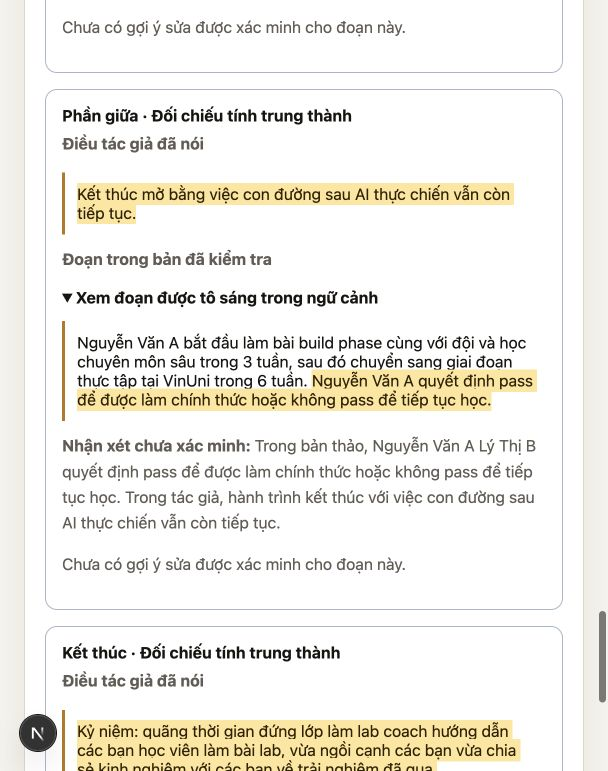
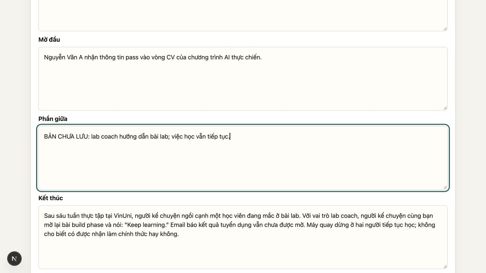

# Kiểm tra tính trung thành và highlight — PR #18

**Cập nhật mới nhất:** [hợp đồng v2 và bộ nghiệm thu tổng quát](fidelity-contract-v2.md).
Các kết quả bên dưới là lịch sử của hợp đồng v1, không phải kết quả v2.

**Đã triển khai luồng và giao diện; chưa đạt nghiệm thu ngữ nghĩa trên Qwen 2.5 3B.**
PR vẫn cần giữ Draft. Trích dẫn đúng chữ không chứng minh nhận xét đúng nghĩa.

## Ba câu hỏi trong trải nghiệm

1. **Bản thảo có làm sai điều tác giả đã nói không?** Bước `fidelity` đọc ý tưởng,
   giới hạn và toàn bộ ngữ cảnh hỏi–đáp trước critic. Câu hỏi AI chỉ là ngữ cảnh;
   không được trích câu hỏi làm quyết định tác giả. Câu trả lời để sau vẫn để mở.
2. **Sai ở đoạn nào?** Model chọn ID đoạn từ bảng nguồn do backend tạo. Backend
   lấy nguyên văn, kiểm tra đúng phần và không có nhiều vị trí trùng nhau. Giao
   diện tô sáng ý đồ tác giả và đoạn trong toàn văn phần đã kiểm tra, có nhãn
   Mở đầu/Phần giữa/Kết thúc theo giao diện. Không dựng HTML từ văn bản AI.
3. **Gợi ý sửa có giữ đúng ý đồ không?** Mỗi gợi ý đi qua một lượt đối chiếu riêng
   (`fidelity_audit`). Auditor chỉ chọn verdict, nguồn trích và lý do, không tự sửa
   gợi ý rồi duyệt bản khác. Backend yêu cầu đúng nguồn trích đã dùng cho lỗi.

Nếu phát hiện mâu thuẫn có trích dẫn, ưu tiên xử lý nó trước, chưa chấm nghệ thuật.
Nếu scan không thấy mâu thuẫn, critic vẫn chạy; các cặp điểm yếu/gợi ý của critic
cũng phải qua audit. Số cặp lệch nhau hoặc vượt ba bị giữ ở trạng thái chưa xác minh.
Tối đa một scan, một critic và ba audit: **năm lượt model tuần tự**. Có thể chậm hơn
trước; không thay timeout mỗi request hoặc thêm phụ thuộc.

Nguồn trích sai/không rõ, audit từ chối hoặc không đủ căn cứ → `unverified`.
Gợi ý chưa qua kiểm tra không được hiển thị, điểm và kết luận passed cũng không
được trình bày như đã duyệt. Quan sát bị audit bác bỏ không còn hiển thị. Quan sát có trích dẫn đúng chữ nhưng chưa
đủ căn cứ vẫn hiện với nhãn **Nhận xét chưa xác minh** để tác giả tự đối chiếu.
`clear` chỉ có nghĩa model chưa tìm thấy mâu thuẫn, không phải chứng nhận chất lượng.

## Phiên bản, lưu trữ và tương thích

- `evaluation.fidelity` là trường tùy chọn; bản cũ mặc định `null`, không cần
  migration. Báo cáo nằm cùng feedback trong project, lịch sử và JSON backup.
- Trích dẫn lưu `section_index`, tên phần và toàn văn phần tại lúc kiểm tra.
  Không tìm lại đoạn trong editor đang sửa; không tự đổi bản nháp hay áp dụng gợi ý.
- Sửa nội dung/đổi ngôn ngữ vẫn dùng cơ chế đánh dấu feedback cũ. Khi audit timeout,
  nội dung đã lưu và feedback trước đó còn nguyên, không tạo phiên bản review giả.
- Bản ghi dataset có thêm `fidelity`/`fidelity_audit`. Giữ raw request/output và
  model thực; không tự duyệt demo/train. Chúng hiện chỉ đọc, chưa có editor sửa
  các output nội bộ mới. Chỉnh tay output critic bỏ báo cáo fidelity cũ khi replay
  demo, để không gán chứng cứ của feedback cũ cho feedback đã biên tập.

## Kiểm thử Ollama thật

Model `qwen2.5:3b`, temperature 0.3, context 16.384, không cố định seed.
Ba ca dùng ý tưởng/giới hạn nguyên văn “AI chông gai”; hai ca đầu dùng bản cũ chỉ
sửa Ending, ca cuối sửa đầy đủ vai trò, trình tự và kết mở. Gọi service review
thật, dataset ở thư mục tạm; không ghi đè dự án trên dev.

Raw bằng chứng cuối: [fidelity-workflows](../../demo/evaluations/fidelity-workflows-2026-10-21.jsonl).

| Ca cuối | Kết quả |
| --- | --- |
| Bản chỉ sửa Ending, VI | Scan chọn sai ưu tiên (Logline/Core idea/Theme), bỏ sót lỗi pass ở Middle. Audit trả uncertain cho cả ba gợi ý → không có gợi ý/điểm đã duyệt. Còn ba quan sát có trích dẫn nhưng ghi rõ chưa xác minh. |
| Cùng bản, EN | Scan trả clear rồi critic trả số điểm yếu/gợi ý lệch nhau. Backend dừng trước audit, trả unverified, không hiển thị các góp ý đó. |
| Bản đã sửa đầy đủ, VI | Scan vẫn báo sai rằng các câu tương đương khác ý nhau. Audit bác cả ba gợi ý; không đưa ra gợi ý sửa hay điểm số đã duyệt. Các quan sát được đánh dấu chưa xác minh. |

**Cả ba ca chưa đạt chất lượng nội dung**, dù cơ chế bảo vệ đã hoạt động. Không
coi việc chặn hết gợi ý là bằng chứng đã hiểu câu chuyện. Chưa thử model khác.

Các pilot [v1/v2](../../demo/evaluations/fidelity-pilots-2026-10-21.json) được giữ:
v1 để model chép trích dẫn, nhiều trích dẫn bịa hoặc sai chữ bị chặn; v2 dùng ID
đoạn nhưng audit nhiều góp ý cùng lúc vẫn chấp nhận một gợi ý ép làm rõ kết quả.
Vì vậy bản cuối kiểm tra từng gợi ý, không dùng v2 làm bằng chứng đã đạt.

Chạy lại từ root repo, dùng môi trường backend đã cài và Ollama đang chạy:

```bash
PYTHONPATH=backend backend/.venv/bin/python backend/scripts/replay_fidelity.py \
  --dataset demo/evaluations/fidelity-workflows-2026-10-21.jsonl \
  --output /tmp/fidelity-new-run.jsonl
```

Script gọi Ollama cục bộ, giữ dữ liệu tạm riêng, lưu cả bước thất bại, từ chối
đè file kết quả đã có. Không mở database dự án hoặc tự phê duyệt dữ liệu.

## Kiểm thử giao diện

Chạy frontend/backend riêng tại 3018/8018 với database tạm. Dùng bản ghi Qwen v2
có câu “quyết định pass” để kiểm tra render; đây là kiểm tra UI, **không phải kết
quả nghiệm thu của model cuối**.

- Highlight đúng câu trong phần giữa và nguyên văn giới hạn tác giả.
- Sửa Phần giữa thành “BẢN CHƯA LƯU: Người kể làm lab coach, vẫn học tiếp dù kết
  quả tuyển dụng ra sao.” rồi đổi ngôn ngữ VI → EN: nháp vẫn nguyên văn, trạng thái
  chưa lưu còn, feedback báo thuộc bản trước, highlight vẫn trên bản chụp cũ.
- Hai thao tác trên không gọi AI hay lưu dự án. Backend chỉ nhận hai GET mở project.
- Không tác động tab/dự án đang dùng ở 3001. Dừng các server kiểm thử sau khi xong.



## Kiểm tra kỹ thuật

**229 tests backend đạt** (một cảnh báo phụ thuộc Starlette/httpx có sẵn).
**14 assertions render/validation frontend đạt**, production build Next.js đạt,
Ruff trên các file Python thay đổi và `git diff --check` đạt. Bao phủ nguồn trích bịa, sai phần,
trùng vị trí, emoji, đoạn dài; thứ tự scan/audit; chặn góp ý bị bác; không dùng
câu hỏi làm bằng chứng tác giả; giữ nội dung/feedback khi timeout; lưu/mở lại và
đổi ngôn ngữ; bỏ chứng cứ cũ khi feedback được biên tập; replay không ghi đè file.

Kiểm thử render không cần cài thư viện mới:

```bash
cd frontend
node node_modules/typescript/bin/tsc app/FidelityPanel.tsx app/apiClient.ts \
  --jsx react-jsx --module commonjs --target ES2020 --esModuleInterop --skipLibCheck \
  --outDir /tmp/fidelity-render-build
NODE_PATH="$PWD/node_modules" node tests/fidelity-render.cjs /tmp/fidelity-render-build/FidelityPanel.js
```

Giới hạn: bộ tách đoạn dùng dấu câu/xuống dòng, chưa phải phân tích ngôn ngữ.
Một trích dẫn lặp trong cùng phần bị coi là không xác định, không đoán vị trí.
Cơ chế hiện chưa phát hiện mọi trường hợp bỏ mất vai trò/kỷ niệm, chưa chứng minh
chống mọi prompt injection, và dùng cùng model cho scan/audit không phải đánh giá
độc lập về năng lực. Cần giữ kiểm thử đối chứng và chưa cho PR chuyển sang ready.


## Review tiếp theo trên PR #18

Đã đọc scan → audit → API lưu project → feedback/lịch sử → giao diện và ba bản
raw Qwen. Phạm vi tải: MVP local một người dùng; không benchmark tải đồng thời.

### Phát hiện và sửa

1. **P2 — Nhận xét bị bác vẫn hiện như chưa xác minh.** `audit_suggestions` bỏ
   verdict/reason rồi thêm lại mọi quan sát scan không được duyệt. Trên ca đã sửa
   đầy đủ, cả ba audit trả contradicted nhưng giao diện vẫn dẫn tác giả về ba
   “lỗi” đó. Nay loại nhận xét bị bác khỏi cards (raw vẫn nằm trong dataset), giữ
   trạng thái toàn báo cáo unverified, không suy ra bản thảo đã đúng. Với uncertain,
   giữ lý do audit để người dùng biết điều chưa đủ căn cứ. Ghép bằng cả phần,
   trích đoạn bản thảo và trích ý đồ, tránh gộp hai nhận xét cùng đoạn khác ý đồ.
2. **P2 — Prompt tiếng Anh chứa lời góp ý mẫu có thể bị chép nguyên.** Ca partial_en
   cũ chép đúng ba câu “A specific, anchored strength…”, “An anchored issue…” và
   “A matching, anchored next revision…”. Đã đổi các mảng minh họa thành rỗng và
   yêu cầu nội dung có căn cứ. Kiểm tra số cặp vẫn giữ nguyên; không đoán cách ghép
   khi model trả sai. Ca cũ có hai weaknesses/một suggestion nên bị chặn là đúng.
3. **P1 còn mở — Có chữ trích đúng nhưng suy luận sai.** partial_vi cũ nhầm việc
   tóm tắt/chia đoạn là mâu thuẫn, bỏ qua Middle; corrected_vi coi hai cách nói
   “học tiếp dù kết quả ra sao” là khác ý. Model còn trộn điều tác giả nói với điều
   nằm trong bản thảo. Đã làm rõ trong prompt: phải có hai mệnh đề trái nhau, không
   bắt lỗi cách diễn đạt hay nhấn mạnh; đọc toàn bản trước khi chọn ba lỗi. Đây là
   giảm nhập nhằng chỉ dẫn, chưa phải cách khắc phục chắc chắn năng lực model.

### Replay sau sửa

[Raw ba ca mới](../../demo/evaluations/fidelity-review-2026-10-21.jsonl), cùng input,
qwen2.5:3b, temperature 0.3, không seed. Đây là một lượt quan sát, không chứng minh
độ ổn định hoặc quan hệ nhân quả giữa đổi prompt và kết quả.

| Ca | Kết quả mới |
| --- | --- |
| partial_vi | unverified, 2 gợi ý bị bác không còn cards. Còn 1 gợi ý được audit supported: trích đúng câu pass ở Middle nhưng giải thích lệch sang lab coach, không xử lý lỗi quyền quyết định tuyển dụng; reason còn bằng tiếng Anh. Chưa đạt. |
| partial_en | unverified, 3 audit contradicted, không còn cards/gợi ý. Không tới critic trong lượt này nên không dùng ca này để chứng minh prompt critic đã tốt. Chưa đạt. |
| corrected_vi | unverified, 2 audit contradicted bị loại; 1 supported chọn nguồn khác candidate nên backend giữ như quan sát chưa xác minh, không hiện gợi ý. Scan vẫn báo sai. Chưa đạt. |

Cả ba không có điểm/passed đã duyệt. **Không được diễn giải rằng mọi góp ý sai
đã bị chặn**: partial_vi cho thấy cùng model vẫn có thể tự duyệt sai. Bộ kiểm tra
chuỗi chỉ chứng minh nguồn và vị trí highlight, không chứng minh quan hệ ý nghĩa.
Cần tiếp tục giữ Draft; chưa merge hoặc dùng kết quả làm dữ liệu huấn luyện đã duyệt.

### Kiểm tra dữ liệu và giao diện

- 232 tests backend đạt, Ruff và diff-check đạt; thêm hồi quy cho audit bị bác,
  lý do uncertain, review lại đúng bản sửa và giữ feedback lịch sử khi mở lại.
- 15 assertions frontend đạt; production build đạt. Literal highlight giữ escape
  HTML, từ Anh–Việt và không đoán vị trí khi một trích dẫn trùng nhiều lần.
- UI thử riêng 3018/8018, database tạm, feedback từ bản ghi pilot để kiểm tra UI
  (không dùng pilot làm kết quả nghiệm thu ngữ nghĩa). Sửa Middle rồi đổi VI → EN:
  chữ chưa lưu còn nguyên, feedback báo cũ, highlight vẫn thuộc snapshot cũ.
  Server chỉ có hai GET, không PUT/review. Hoàn nguyên màn hình và dừng server.
- Chưa thấy lỗi mất nháp trong luồng này. Nút review lưu nháp trước rồi mới gọi AI;
  khi timeout, test xác nhận draft đã lưu và feedback cũ vẫn còn.
- Không sửa checkout dev có thay đổi khác hoặc dự án thật trên cổng 3001.



Chưa kiểm tra model khác, tải đồng thời hoặc mọi dạng lỗi ngữ nghĩa. Các giới hạn
về độ chính xác và ngôn ngữ reason là blocker nghiệm thu, không che bằng fixture giả.

Kiểm tra riêng critic tiếng Anh sau sửa prompt (vì replay mới chưa tới critic):
[raw probe](../../demo/evaluations/fidelity-review-critic-2026-10-21.json).
Không còn chép ba câu placeholder, số cặp là 3/3. Tuy nhiên model chép các đoạn
bản thảo vào cả weaknesses/suggestions, không giải thích bằng tiếng Anh và lặp
lại câu sai pass. **Probe này cũng chưa đạt**, không đi qua audit và không phải
phản hồi đã duyệt. Bỏ câu mẫu sửa được nguồn gây sao chép đó, chưa sửa được toàn
bộ chất lượng critic trên model 3B.
