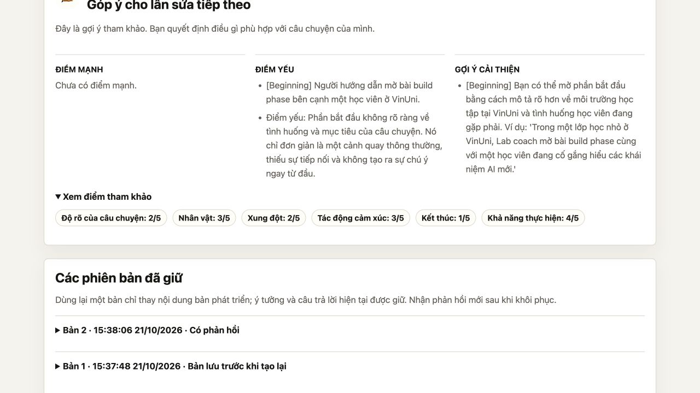

# Kiểm thử nhận diện ngôn ngữ và nhãn giao diện — issue #15

## Phạm vi

Bộ nhận diện dùng chung ở backend cho làm rõ, phát triển, góp ý và `/api/generate`.
Hỗ trợ đầu ra tiếng Việt và tiếng Anh; người viết có thể chọn rõ ngôn ngữ đầu ra.
Không áp dụng quy tắc tiếng Việt thuần: thuật ngữ `lab coach`, `build phase`, tên
riêng và trích dẫn của tác giả có thể giữ nguyên.

Tách từ sau chuẩn hóa Unicode NFC, so khớp cả từ, cần ít nhất hai tín hiệu khác nhau
và số tín hiệu lớn hơn hai lần ngôn ngữ còn lại. Khi không đủ bằng chứng, chế độ tự
động trả HTTP 422 trước khi gọi AI và hướng dẫn chọn ngôn ngữ. Đây là heuristic có
chủ đích thận trọng, không phải bộ nhận diện mọi ngôn ngữ. Tiếng Việt không dấu,
đầu vào quá ngắn và nội dung song ngữ cân bằng có thể cần chọn thủ công.

## Hồi quy tự động

| Nhóm đầu vào | Kỳ vọng |
| --- | --- |
| Câu tiếng Anh có `concert`, `character` | Tiếng Anh; không khớp chuỗi con `con` |
| Tiếng Việt có dấu; Unicode phân rã và chữ hoa | Tiếng Việt |
| Tiếng Việt xen `lab coach`, `build phase`, `VinUni` | Tiếng Việt, giữ nguyên thuật ngữ |
| Câu tiếng Anh có tên Việt | Tiếng Anh |
| Tiếng Pháp có dấu | Chưa xác định, yêu cầu chọn |
| Tiếng Việt không dấu, song ngữ cân bằng | Chưa xác định, yêu cầu chọn |
| `AI`, `lab coach`, một từ Việt, lặp một từ, rỗng, số/emoji | Chưa xác định |
| Chọn rõ `vi` hoặc `en` | Cùng lựa chọn qua cả bốn thao tác AI |
| Giá trị ngoài `auto`, `vi`, `en` | Từ chối request |

Kiểm thử trạng thái dự án xác nhận:

- Đổi lựa chọn và lưu cùng bản đang sửa giữ câu trả lời, ý đồ, bản thảo và lịch sử;
  phản hồi cũ không được coi là phản hồi hiện hành của lựa chọn mới.
- Góp ý nhận đúng bản vừa sửa và ghi ngôn ngữ vào ngữ cảnh phiên bản.
- Client cũ bỏ qua trường ngôn ngữ không đặt lại lựa chọn đã lưu.
- Dữ liệu cũ thiếu trường mới được đọc là `auto`, không ghi lại cơ sở dữ liệu khi
  chỉ đọc; khóa nội dung chế độ tự động tương thích với phản hồi và demo cũ.
- API trả tóm tắt thực tế từ bước làm rõ thay vì thay bằng câu mẫu tiếng Anh.

Kết quả: **210 kiểm thử backend đạt** (các tệp được Git quản lý và tệp kiểm thử
ngôn ngữ mới), Ruff đạt, TypeScript `--noEmit` đạt, production build Next.js đạt.
Không thêm thư viện. Các tệp sao chép không thuộc thay đổi này không tham gia bộ kiểm thử.

## Kiểm thử giao diện với Ollama thật

Dùng frontend production ở cổng 3105 và backend ở 8105 với SQLite/dataset tạm;
không ghi vào dự án người dùng hay dừng dịch vụ ở 3001/8000. Model:
`ollama / qwen2.5:3b`. Ý tưởng kiểm thử nói về hành trình học AI, `lab coach`,
`build phase`, VinUni và kết thúc mở.

1. Ý tưởng không dấu ở chế độ tự động bị chặn và hiện hướng dẫn chọn ngôn ngữ;
   không có model step nào được gọi.
2. Chọn tiếng Việt, yêu cầu góp ý: bản đang sửa được lưu, model nhận đích tiếng
   Việt. Mở bảng điểm thấy đủ sáu nhãn Việt: độ rõ của câu chuyện, nhân vật,
   xung đột, tác động cảm xúc, kết thúc, khả năng thực hiện.
3. Sửa tên dự án và kết thúc, sau đó chọn English. Nội dung chưa lưu vẫn ở trình
   soạn thảo; đọc API xác nhận dữ liệu lưu vẫn là bản cũ và không có model call mới.
4. Lưu rồi tải lại: tên, kết thúc mới và English giữ nguyên. Phản hồi Việt được
   đánh dấu cũ, lịch sử vẫn còn.
5. Yêu cầu góp ý: model nhận đích tiếng Anh và đúng bản mới. Bản thảo Việt cùng
   thuật ngữ gốc không bị dịch. Phản hồi/lịch sử Việt trước đó vẫn được giữ.

Tổng cộng hai model step thật: góp ý tiếng Việt rồi tiếng Anh. Ngôn ngữ hướng dẫn
trong bản ghi khớp lựa chọn; giao diện luôn dùng nhãn Việt. Bằng chứng trạng thái
và bản ghi: [JSON kiểm thử](../../demo/evaluations/language-ui-2026-10-21.json).

## Giới hạn

Kết quả xác nhận đường truyền ngôn ngữ, nhãn hiển thị và việc giữ dữ liệu. Không
chứng nhận chất lượng nghệ thuật của góp ý. Qwen vẫn có thể góp ý chưa sát ý đồ
kết thúc mở; xem [đánh giá góp ý trước đó](feedback-language-2026-10-21.md).
Đổi lựa chọn không dịch lại phản hồi, câu hỏi hay bản thảo đã có; cần thao tác AI
mới để tạo đầu ra theo lựa chọn mới. Không triển khai chuyển ngôn ngữ toàn giao diện.
