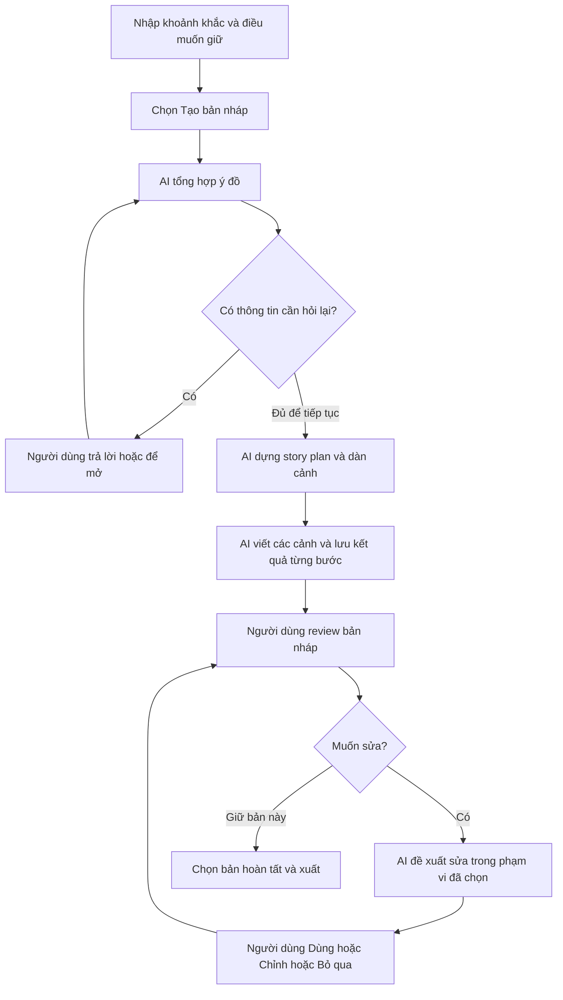

# Kế hoạch triển khai workflow AI chủ động cho FirstFrame

- Ngày lập: 29/10/2026.
- Cập nhật: kết hợp sáu giai đoạn hệ thống với 12 task UI thành backlog triển khai chung.
- Trạng thái: các task hệ thống và UI của giai đoạn 1–6 đã triển khai, kiểm chứng kỹ thuật local. QA-01 có báo cáo tích hợp nhưng chưa chốt phát hành; xem [bằng chứng và các phần còn thiếu](../testing/phase6-workflow-acceptance-2026-10-29.md).
- QA-01 tiếp nối: [context review trên Qwen mục tiêu](../evaluations/qa01-review-context-qwen7b-final-2026-10-29/README.md) đã bỏ chặn cho bộ ca cố định mà không cắt nguồn; độ tin cậy góp ý model và nghiệm thu người đọc/thiết bị vẫn chưa đạt.
- QA-01 review cuối PR #77: [kiểm tra nguồn trực tiếp và giới hạn diễn giải Qwen](../evaluations/qa01-qwen-review-v8-2026-10-29/README.md) đạt 10/10 ca ở cả hai lượt; đã sửa ca đèn pin và diễn giải ngoài nguồn. Chỉ nghiệm thu kỹ thuật trên bộ ca đã lưu; kiểm tra ngữ nghĩa tổng quát, người đọc và thiết bị vẫn chưa hoàn tất.
- Cập nhật UI đã chọn: [kế hoạch áp dụng prototype Bản nháp và Review](draft-review-workflow-ui.md), gồm DR-01–DR-10 qua năm giai đoạn. Đây là backlog tiếp nối, chưa triển khai; trạng thái hoàn tất của các task SYS/UI cũ được giữ.
- Mục tiêu: người dùng kể khoảnh khắc, AI chuẩn bị bản nháp phim ngắn, người dùng review và yêu cầu thay đổi, rồi chọn bản để xuất.
- Phạm vi ban đầu: ứng dụng local một người dùng, Next.js, FastAPI và SQLite hiện có. Đường tự viết tiếp tục dùng được.

## Trải nghiệm cần đạt

Story plan và dàn cảnh vẫn mở được trong workspace để xem hoặc chỉnh sâu. Người dùng không phải xác nhận việc chuyển tiếp giữa từng công đoạn của lần tạo nháp đã khởi động. Các chi tiết AI bổ sung giữ nhãn đề xuất; việc lưu hoặc đọc bản nháp không biến chúng thành điều người dùng yêu cầu.

Hành vi hội thoại 5–6 câu, khung kịch bản rỗng và lưu thủ công trong các kế hoạch trước là những phần được đề xuất thay trong luồng mới. Các yêu cầu về nguồn, quyền tác giả, lịch sử, dữ liệu cũ và nghiệm thu chất lượng tiếp tục áp dụng. Tài liệu này không đổi trạng thái nghiệm thu #7/#22/#26 hoặc coi model hiện tại đã đạt chất lượng.

## Điểm thay đổi trong hệ thống hiện tại

| Phần hiện có | Vấn đề khi chuyển workflow | Hướng thay đổi |
| --- | --- | --- |
| `frontend/app/Workspace.tsx`, `projectsApi.ts` | `accept()` thay cả project/saved; phản hồi lưu muộn có thể đè chữ mới khi thêm autosave; một `busy` khóa toàn bộ form | Điều phối lưu tuần tự, đối chiếu phiên chỉnh sửa, cập nhật metadata tác vụ riêng và chỉ khóa hành động xung đột |
| `backend/app/api/routes/projects.py`, `application/clarification.py` | Tự thêm bộ câu hỏi cố định; `/plan` bắt trả lời/hoãn mọi câu | Làm rõ theo thông tin thực sự thiếu; giữ quyết định để mở mà vẫn tạo được nháp |
| `application/workflow.py`, route plan và scene | Logic tạo/lưu/nhận nguồn hiện gắn với từng thao tác HTTP riêng | Tách đúng các thao tác dùng lại sang application service, thêm bộ điều phối tuyến tính cho một lượt tạo nháp |
| `application/project_store.py`, schema project | SQLite đã có CAS và cách giữ kết quả AI muộn; chưa có bản ghi điều phối xuyên nhiều bước | Tái sử dụng giao dịch và snapshot; thêm lưu trạng thái lượt chạy bền vững |
| `routes/projects.py:update_project` | Mỗi lần thay scene outline hoặc screenplay đều lưu bản cũ vào lịch sử | Tách lưu nháp thường xuyên khỏi mốc lịch sử có ý nghĩa trước khi bật autosave |
| `routes/screenplays.py`, `application/screenplay_writing.py` | Bắt đầu bằng cảnh rỗng; viết thử theo một cảnh; ngữ cảnh gửi kèm toàn bộ kịch bản | Tái sử dụng viết một cảnh để tạo bản đầu tuần tự; kiểm tra giới hạn ngữ cảnh và lưu từng kết quả |
| `application/screenplay_review.py:review_sources` | Các trường dàn cảnh được gắn `author_choice`, kể cả khi luồng mới sẽ tự sinh chúng | Phân biệt ý đồ tác giả và đề xuất AI trong nguồn và prompt góp ý |
| `ScreenplayFeedback.tsx`, `ScreenplayProposals.tsx` | Góp ý và viết lại tách biệt; nhận phương án thay toàn bộ cảnh | Ghép vòng góp ý với đề xuất sửa; bắt đầu bằng phạm vi cảnh, sau đó hỗ trợ khối có ID ổn định |
| `StoryPlanEditor.tsx`, `ScreenplayEditor.tsx`, các CSS | Card theo câu/độ dài; modal góp ý; nhiều bản đọc; mobile cộng dồn các công đoạn | Một bản thảo chính, panel review, chế độ so sánh/đọc riêng và cùng một công đoạn trên mobile |
| `ScreenplayReading.tsx`, `screenplay-selections` | Có snapshot bản chọn nhưng chưa xuất tệp | Xuất PDF đúng snapshot kịch bản đã chọn |
| `OnboardingTour.tsx`, `onboardingState.ts`, README và roadmap | Hướng dẫn hiện bám luồng cũ | Cập nhật theo hành vi đã thực sự giao, bảo toàn tiến độ và lựa chọn bỏ hướng dẫn |

## Thứ tự ưu tiên và mốc bàn giao

| Giai đoạn | Ưu tiên | Task hệ thống | Task UI | Kết quả bàn giao |
| --- | --- | --- | --- | --- |
| 1. Lưu và nguồn dữ liệu | P0 | SYS-01, SYS-02 | UI-01 | Tự lưu an toàn, nguồn tác giả và AI được phân biệt |
| 2. Làm rõ theo nhu cầu | P1 | SYS-03 | UI-02, UI-03 | Nhập ý tưởng và xem cách hiểu; chỉ trả lời phần thiếu |
| 3. Tạo bản nháp xuyên các bước | P1 | SYS-04, SYS-05 | UI-04, UI-05, UI-09 | Một lần khởi động có nội dung các cảnh; desktop/mobile theo đúng tiến độ |
| 4. Review và sửa có kiểm soát | P1 | SYS-06, SYS-07 | UI-06, UI-07, UI-08 | Một bản thảo chính, góp ý theo ngữ cảnh và sửa có xem trước |
| 5. Xuất kịch bản | P1 | SYS-08 | UI-10 | Tải PDF của đúng bản đã chọn |
| 6. Hoàn thiện và nghiệm thu | P2 cho vật liệu/hướng dẫn; P0 cho nghiệm thu phát hành | QA-01 xuyên toàn luồng | UI-11, UI-12 | Không gian rõ tầng, hướng dẫn đúng và toàn luồng đủ điều kiện phát hành |

Các chỉnh sửa UI cần để dùng từng tính năng được giao cùng tính năng đó. Giai đoạn 6 dành cho hoàn thiện vật liệu và hợp nhất trải nghiệm; lỗi làm mất dữ liệu, khó đọc hoặc không dùng được bàn phím phải sửa ngay ở giai đoạn phát sinh. Phần xuất tệp có thể được phát triển sau khi hợp đồng bản lưu ổn định, không cần chờ hoàn thiện vật liệu kính.

## Backlog task tích hợp

Backlog gồm **21 task: 8 hệ thống, 12 UI và 1 nghiệm thu toàn luồng**. **SYS-01–SYS-08 và UI-01–UI-12 đã triển khai, kiểm chứng kỹ thuật local**. QA-01 đã chạy hồi quy và luồng tích hợp; chưa chốt nghiệm thu phát hành do còn bằng chứng thiết bị/người đọc thật và giới hạn model. Mã task là định danh trong kế hoạch, chưa phải issue hoặc chat đã tạo. Mỗi task có phần kiểm tra đi cùng; QA-01 tổng hợp nghiệm thu và không thay test ở từng task.

Các vai trò Backend, Frontend và QA dưới đây mô tả phần việc cần đảm nhiệm, chưa gán người thực hiện hoặc thời lượng. Các đường dẫn trong bảng tính từ thư mục gốc repo; danh sách file và kiểm chứng chi tiết tiếp tục nằm trong từng giai đoạn.

### Task hệ thống

| Task | Giai đoạn và vai trò | Phạm vi hệ thống | Phụ thuộc | Hoàn tất khi |
| --- | --- | --- | --- | --- |
| **SYS-01 — Nguồn tác giả và đề xuất AI** | 1 · Backend · P0 | Schema nguồn trong `backend/app/api/schemas/projects.py`, `screenplays.py`, `scenes.py`; `application/screenplay_review.py` và prompt liên quan | Không | Input/điều muốn giữ của người dùng khác chi tiết AI bổ sung; dữ liệu cũ thiếu nguồn được giữ rõ; nhận draft không biến mọi chi tiết thành ràng buộc tác giả |
| **SYS-02 — Lưu nháp và checkpoint lịch sử** | 1 · Backend + Frontend · P0 | `api/routes/projects.py`, `application/project_store.py`, hợp đồng lưu, hàng đợi trong `Workspace.tsx`/`projectsApi.ts` | SYS-01 | Autosave không ghi đè chữ mới hoặc tạo một snapshot đầy đủ mỗi nhịp gõ; 409, lỗi mạng, hai tab, IME và response muộn giữ dữ liệu |
| **SYS-03 — Làm rõ theo thông tin thiếu** | 2 · Backend · P1 | `application/clarification.py`, `_analyze_project`/`plan_project`, schema analysis, `application/workflow.py`, mentor/plan prompt | SYS-01, SYS-02 | Brief đủ trả được danh sách câu hỏi rỗng; tiếp tục với điểm để mở không bị cổng bắt trả lời mọi câu; ngôn ngữ và lịch sử đúng nguồn |
| **SYS-04 — Lưu và phục hồi lượt tạo nháp** | 3 · Backend · P1 | Thêm schema/store/route `draft_runs`, đăng ký `main.py`; trạng thái, request ID, checkpoint và vòng đời tác vụ | SYS-01, SYS-02 | Refresh đọc lại được run; cùng yêu cầu không gọi model trùng; restart/hủy/mất kết nối giữ kết quả và xác định đúng bước chưa chạy |
| **SYS-05 — Chuỗi tạo nội dung các cảnh** | 3 · Backend · P1 | Thêm `application/draft_workflow.py`; dùng lại plan, `scene_suggestions.py`, `screenplay_writing.py`, `screenplay_review.py` và giới hạn ngữ cảnh | SYS-03, SYS-04 | Một lượt tạo nháp sinh plan, outline và nội dung các cảnh trong phạm vi hỗ trợ; lỗi giữa cảnh giữ phần hoàn tất; critic lỗi vẫn đọc được draft; tạo lại không đè bản đang viết |
| **SYS-06 — Đề xuất và nhận sửa cấp cảnh** | 4 · Backend · P1 | Service/route viết sửa, schema proposal, kiểm tra nguồn, nhận phương án và checkpoint/hoàn tác | SYS-01, SYS-02, SYS-05 | Phương án chỉ thay cảnh được chỉ định; nguồn đổi thì không nhận như còn hiệu lực; nhận lặp không áp hai lần; bản trước còn khôi phục được |
| **SYS-07 — Sửa đúng khối và xử lý phạm vi** | 4 · Backend · P1 | Mở rộng schema replacement và validator theo scene/block ID; ánh xạ yêu cầu và phạm vi tác động | SYS-06 | Chỉ các khối đã báo trước bị thay, ID/text phần khác giữ nguyên; yêu cầu mơ hồ hoặc đổi cấu trúc phải được làm rõ trước khi nhận |
| **SYS-08 — Xuất PDF từ bản đã chọn** | 5 · Backend · P1 | `api/routes/screenplays.py`, snapshot selection và service PDF/font mới | SYS-01, SYS-02 và hợp đồng selection hiện có | PDF dùng đúng selection bất biến, giữ tiếng Việt/thứ tự/người nói; không gọi AI hoặc đổi phiên bản khi xuất lại |

### Mười hai task UI

| Task | Giai đoạn và ưu tiên | Phạm vi giao diện | Phụ thuộc | Hoàn tất khi |
| --- | --- | --- | --- | --- |
| **UI-01 — Thống nhất trạng thái lưu** | 1 · P0 | `Workspace.tsx`, `projectsApi.ts`, thanh lưu; trạng thái đang lưu/đã lưu/lỗi và recovery đúng ngữ cảnh | SYS-02 | Một trạng thái lưu rõ, không mất chữ khi response về muộn; các nút lưu/kiểm tra thường trực được thu gọn sau khi recovery tự động hoạt động |
| **UI-02 — Tối giản màn bắt đầu** | 2 · P1 | `Workspace.tsx`, vùng nhập ý tưởng, tên/ngôn ngữ/thiết lập tùy chọn | UI-01, SYS-03; bật CTA xuyên luồng sau SYS-05 | Nhập khoảnh khắc và điều muốn giữ là đủ; nút Tạo bản nháp thực sự khởi động luồng đã nối, không đưa người dùng vào đường cụt |
| **UI-03 — Thiết kế lại bước làm rõ** | 2 · P1 | `ClarificationConversation.tsx`, `AuthorIntentCard.tsx`, kiểu analysis/context | SYS-03, UI-02 | Xem/sửa điều AI đã hiểu, chỉ trả lời phần thiếu, để mở được; không lặp xác nhận cùng thông tin |
| **UI-04 — Thu gọn điều hướng workflow** | 3 · P1 | `Workspace.tsx`, `WorkspaceStage.tsx`, navigation/CSS; ba công đoạn chính và phần mở sâu | UI-03, SYS-04 | Desktop/mobile cùng chỉ tập trung một công đoạn; vẫn mở được plan/outline, giữ buffer và quay lại đúng công việc gần nhất |
| **UI-05 — Hiển thị tiến độ tạo nháp** | 3 · P1 | `OperationProgress.tsx`, `progressState.ts`, run API client và vùng bản thảo đang có | SYS-04; nghiệm thu cùng SYS-05 | Hiển thị bước/số cảnh thật, phần đọc được và trạng thái gián đoạn; kiểm tra/tiếp tục/hủy không khởi động lại model ngoài ý muốn |
| **UI-06 — Một vùng bản thảo chính** | 4 · P1 | `ScreenplayEditor.tsx`, `ScreenplayReading.tsx`, `ContinuousSceneEditor.tsx` nếu đổi phần tích hợp; chế độ viết/đọc/so sánh | UI-01, UI-04, SYS-05 | Một editor chính; bản cũ và bản đã lưu chỉ mở khi cần so sánh; đổi chế độ không mất chữ hoặc trộn buffer với snapshot |
| **UI-07 — Góp ý cạnh nội dung** | 4 · P1 | `ScreenplayFeedback.tsx`, `CardFeedback.tsx`, `StoryPlanEditor.tsx`, panel desktop/sheet mobile và anchor | SYS-01, UI-06; dùng nguồn review từ SYS-05 | Chọn góp ý làm nổi đúng đoạn, sửa được trong ngữ cảnh; đóng panel trả focus; góp ý cũ mở đúng snapshot cũ |
| **UI-08 — Review phương án sửa** | 4 · P1 | `ScreenplayProposals.tsx`, editor/feedback, so sánh trước/sau và Dùng/Chỉnh/Bỏ qua/Hoàn tác | SYS-06, UI-07; hoàn tất cấp khối cùng SYS-07 | Người dùng thấy phạm vi đổi trước khi nhận; ngoài phạm vi giữ nguyên; không nhận phương án cũ sau khi đã sửa nguồn |
| **UI-09 — Tối giản card câu chuyện và cảnh** | 3 · P1 | `StoryPlanEditor.tsx`, `SceneOutlineEditor.tsx`, `ScreenplayEditor.tsx`, `sceneOutline.css`/CSS liên quan | SYS-01, UI-04; tích hợp dữ liệu từ SYS-05 | Card đọc theo nhịp truyện, thông tin phụ/thao tác ít dùng thu gọn, không có vùng ảnh trống lớn; nhóm lại không đổi text hoặc gắn nhầm góp ý cũ |
| **UI-10 — Hoàn tất và xuất PDF** | 5 · P1 | `ScreenplayReading.tsx`, selection/export client và trạng thái xuất | SYS-08, UI-01, UI-06 | Đọc/chọn/tải đúng bản; phân biệt đã lưu nhưng chưa xuất được; tải lại không tự chuyển sang bản mới nhất |
| **UI-11 — Spatial UI và Glassmorphism** | 6 · P2 | `storyWorkspace.css`, `sceneOutline.css`, `screenplay.css`, `globals.css`; lớp nền/bản thảo/công cụ/panel | UI-04, UI-06, UI-07, UI-09, UI-10 | Nội dung chính rõ, glass ở công cụ, panel có thứ bậc; chữ thường tương phản ít nhất 4.5:1, có nền dự phòng và giảm chuyển động |
| **UI-12 — Cập nhật hướng dẫn sử dụng** | 6 · P2 cho hợp nhất | `OnboardingTour.tsx`, `onboardingState.ts`, copy tại chỗ, README/roadmap | Các task thay đổi hành vi ở giai đoạn 1–5; chốt cùng UI-11 | Tour đi đúng luồng đã giao, giữ bỏ qua/phát lại/tiến độ cũ; người mới không phải hiểu revision hoặc request ID |

UI-08 được giao theo hai mốc: nhận phương án cấp cảnh sau SYS-06; nhận sửa khối sau SYS-07. UI-12 có trách nhiệm cập nhật phần hướng dẫn bị ảnh hưởng ngay khi từng tính năng được bật; giai đoạn 6 hợp nhất toàn bộ hướng dẫn. Lỗi khả năng đọc, bàn phím/focus và giữ dữ liệu thuộc mức chặn phát hành của task đang làm, kể cả khi task hoàn thiện vật liệu được xếp P2.

### Task nghiệm thu

**QA-01 — Nghiệm thu workflow và UI tích hợp · giai đoạn 6 · P0 trước phát hành.** Backend, Frontend và QA cùng cung cấp bằng chứng; người đọc đánh giá riêng về giữ đúng ý đồ và chất lượng tác phẩm. Phụ thuộc: SYS-01–SYS-08 và UI-01–UI-12 đã tích hợp cho phiên bản chuẩn bị phát hành. Phạm vi: bộ test từng giai đoạn, đi hết brief → draft → review/giữ hoặc sửa → PDF, dữ liệu cũ, mất mạng, hai tab, restart, bàn phím/IME, 320/390px và desktop. Hoàn tất khi có báo cáo pass/fail, không còn lỗi chặn về dữ liệu/nguồn/gọi trùng/khả dụng, và giới hạn model được đo đúng; model trả JSON hợp lệ chưa chứng minh chất lượng sáng tác.

### Thứ tự triển khai task và khả năng làm song song

1. SYS-01 → SYS-02 + UI-01: chốt nguồn, lưu và recovery trước.
2. SYS-03 + UI-02 + UI-03: giao làm rõ có nhu cầu; chỉ bật CTA tạo nháp hoàn chỉnh sau khi SYS-05/UI-05 tích hợp. Có thể chuẩn bị và kiểm chứng form bằng provider giả trong lúc backend được nối.
3. SYS-04 → SYS-05, đồng thời nối UI-04/UI-05/UI-09 theo hợp đồng và fixture. Cuối giai đoạn phải đi được một lần khởi động → nội dung mọi cảnh, không chỉ xem demo giao diện.
4. UI-06 → UI-07; SYS-06 + UI-08 cấp cảnh → SYS-07 + UI-08 cấp khối. Các mốc UI kiểm chứng cùng endpoint thật với provider giả trước thử model thật.
5. SYS-08 + UI-10: hoàn thiện đường xuất. SYS-08 có thể phát triển sau giai đoạn 1, song song với phần làm rõ/tạo nháp vì nguồn xuất đã có selection; nghiệm thu UI cuối cùng theo bản được review ở giai đoạn 4.
6. UI-11 + phần hợp nhất UI-12 → QA-01 tổng hợp và chốt phát hành. Bằng chứng QA được tích lũy từ từng task, không đợi đến đây mới kiểm tra dữ liệu và mobile.

Mỗi task là đơn vị theo dõi backlog; một PR có thể ghép backend và UI của cùng một lát cắt dùng được. Tách gói đủ nhỏ để review, không làm một PR chứa toàn bộ workflow. Các task có thể dùng hợp đồng/fixture để phát triển song song nhưng chỉ đánh dấu hoàn tất sau kiểm chứng tích hợp phần phụ thuộc.

## Giai đoạn 1 P0 Lưu và nguồn dữ liệu

Task bàn giao: **SYS-01, SYS-02, UI-01**.

Đã triển khai: metadata nguồn do backend quản lý, phân loại nguồn review, lưu có session/checkpoint và mã đối chiếu kết quả, hàng đợi autosave giữ chữ/focus, trạng thái lưu và recovery. Kiểm chứng bằng provider giả, SQLite QA riêng và trình duyệt desktop/mobile; giới hạn và lỗi nền được ghi trong [báo cáo](../testing/phase1-autosave-2026-10-29.md). Việc này chưa xác nhận chất lượng model hoặc nghiệm thu toàn luồng QA-01.

### Công việc

1. Chốt fixture và hợp đồng cho `author_input`, `ai_proposal`, lựa chọn tác giả xác nhận và nguồn cũ chưa biết. Chỉ backend cấp thông tin nguồn và ID. Với dữ liệu cũ thiếu căn cứ, giữ trạng thái nguồn chưa biết; không tự chuyển nội dung thành quyết định tác giả.
2. Phân biệt nguồn phát sinh văn bản và các điều tác giả muốn giữ. Nhận một bản nháp để viết tiếp không đồng nghĩa xác nhận mọi chi tiết trong đó thành ràng buộc sáng tác. Giai đoạn đầu ghi nguồn ở cấp lựa chọn/cảnh/khối được tạo hoặc thay; chưa xây truy vết tác giả cho từng ký tự.
3. Tách lưu nháp khỏi checkpoint lịch sử. Lưu thường xuyên vẫn đổi revision và khóa nội dung dùng cho feedback; giữ mốc trước nhận phương án, thay cấu trúc, khôi phục và chọn bản cuối. Có thể gộp nhiều lần gõ thành một phiên chỉnh sửa, với snapshot trước phiên để khôi phục; không lưu một bản đầy đủ cho mỗi lần ngừng gõ.
4. Thêm hàng đợi lưu trong frontend: debounce sau khoảng 1 giây không gõ, hoãn khi đang ghép chữ IME, chỉ một mutation của người dùng đang gửi tại một thời điểm. Có chữ mới trong khi chờ thì giữ buffer mới, đối chiếu kết quả của đúng request rồi gửi lượt tiếp theo. Response không được truyền thẳng qua `accept()` để thay chữ mới.
5. Flush hàng đợi trước tác vụ AI, nhận phương án, đổi dự án và chọn bản xuất. Lưu lỗi hoặc 409 giữ buffer và cho tải bản sao; không tự lấy revision mới rồi ghi đè. Khi đóng trang đột ngột chỉ bảo đảm những lần server đã xác nhận; giữ cảnh báo lúc còn thay đổi chờ lưu.
6. Tách trạng thái lưu, tạo nháp và xuất tệp. Poll trạng thái tác vụ không thay bản đang sửa. Chỉ tự tiếp tục khi khớp nội dung dựa trên snapshot; metadata thay đổi không làm mất hiệu lực nội dung một cách máy móc.

### Phần cần sửa

`frontend/app/Workspace.tsx`, `projectsApi.ts`; tách phần quản lý autosave thành hook riêng nếu cần. `backend/app/api/schemas/projects.py`, `screenplays.py`; `api/routes/projects.py`, `application/project_store.py`; nguồn review trong `application/screenplay_review.py` và các kiểu tương ứng ở frontend.

### Nghiệm thu

- Gõ tiếp trong lúc request lưu đang chờ, chuyển cảnh, đổi dự án, lỗi mạng và 409 đều giữ đúng buffer.
- Lưu thành công, reload và mở lại giữ tiếng Việt, khoảng trắng, thứ tự, speaker, scene/block ID. Giới hạn bảo đảm cho thay đổi chưa được xác nhận phải được hiển thị đúng.
- Hai tab không ghi đè nhau; request đọc trạng thái và thao tác điều hướng không gọi model.
- Autosave không tạo lịch sử đầy bản trùng hoặc làm mất mốc trước nhận phương án.
- Góp ý không lấy chi tiết AI tự thêm làm bằng chứng về ý đồ người dùng. Client cũ bỏ trường mới không xóa dữ liệu mới.

## Giai đoạn 2 P1 Làm rõ theo nhu cầu

Task bàn giao: **SYS-03, UI-02, UI-03**. Đã triển khai; xem [kiểm chứng giai đoạn 2](../testing/phase2-clarification-2026-10-29.md). Đường khởi động tạo nháp hoàn chỉnh được bật cùng giai đoạn 3.

### Công việc

1. Đổi hành động đầu thành **Tạo bản nháp**; nút này khởi động phạm vi đọc ý tưởng, làm rõ nếu cần và tạo các tài liệu trung gian. Ngôn ngữ mặc định theo lựa chọn hiện có; nếu chưa xác định được ngôn ngữ thì hỏi trước model như hợp đồng hiện hành.
2. Thay bộ câu hỏi cố định bằng kết quả có cấu trúc: điều đã hiểu, điều người dùng nêu rõ, phần AI dự kiến đề xuất, câu hỏi quan trọng chưa giải quyết. Dùng prompt/schema hiện có mở rộng vừa đủ; không tự điền đề xuất AI vào `answers` hoặc `constraints`.
3. Ý tưởng đủ dữ liệu trả danh sách câu hỏi rỗng. Mỗi đợt chỉ đưa những câu có tác động cụ thể đến hướng kể, ưu tiên 1–2 câu; giới hạn là mục tiêu UX, không phải lý do bỏ sót xung đột đã biết. Giữ hành động tiếp tục với điều chưa quyết định.
4. Thay điều kiện bắt trả lời/hoãn mọi câu ở backend `/plan` và frontend. Bảo toàn vị trí câu hỏi, câu trả lời cũ và clarification history; sửa ý tưởng tạo nguồn mới. Không chỉ bỏ nút ở UI rồi vẫn gặp 422 ở API.
5. Khi người dùng chọn để mở, AI có thể tạo phương án có nhãn; prompt review phải giữ hợp lệ các kết mở, cảnh im lặng và lựa chọn chưa xác định.

### Phần cần sửa

`application/clarification.py`, `api/routes/projects.py:_analyze_project/plan_project`, schema analysis/story/project và lớp ánh xạ `application/workflow.py`; `domains/short-film/prompts/story_mentor_prompt.md` cùng prompt tạo plan. Frontend: `ClarificationConversation.tsx`, `AuthorIntentCard.tsx`, `Workspace.tsx`, `projectsApi.ts`, tour và kiểu dữ liệu liên quan.

### Nghiệm thu

- Brief đầy đủ đi qua bước làm rõ mà không bắt nhập thêm hoặc xác nhận lại cùng thông tin.
- Brief thiếu một quyết định quan trọng hỏi đúng phần đó; trả lời hoặc để mở đều tạo được bản nháp khi không có điều kiện thực sự ngăn xử lý.
- Đổi brief không tái dùng nhầm câu trả lời cũ. Dự án cũ và `/analyze` tương thích theo hợp đồng đã công bố.
- Luồng không biến “chưa quyết định” thành kết thúc hay thông điệp mà AI tự khẳng định là ý đồ tác giả.

## Giai đoạn 3 P1 Tạo bản nháp xuyên các bước

Task bàn giao: **SYS-04, SYS-05, UI-04, UI-05, UI-09**. Đã triển khai local; xem [kiểm chứng giai đoạn 3](../testing/phase3-draft-runs-2026-10-29.md).

### Thiết kế tối thiểu

Thêm bộ điều phối tuyến tính trong `backend/app/application/draft_workflow.py` và route riêng `api/routes/draft_runs.py`. Tách đúng phần tạo plan, scene và screenplay cần dùng lại khỏi HTTP handler; dùng chung với route hiện hành. Không điều phối bằng chuỗi click hoặc chuỗi request phụ thuộc vào tab trình duyệt.

Giữ bản ghi `draft_runs` trong SQLite qua lớp store nhỏ: `run_id`, project ID, khóa nguồn đầu vào, cấu hình prompt/provider, trạng thái, bước hiện tại, các request con, kết quả/checkpoint và lỗi. Mỗi artifact giữ snapshot nguồn cần thiết; bản ghi tiến độ tham chiếu ID thay vì lặp toàn bộ project trong mỗi sự kiện. Chỉ một lượt tạo nháp đang hoạt động trên một dự án; tạo run và kiểm tra điều kiện này trong giao dịch.

API dự kiến, tên được chốt ở PR hợp đồng:

| API | Vai trò |
| --- | --- |
| `POST /api/projects/{id}/draft-runs` | Tạo hoặc lấy lại cùng run theo request ID và đầu vào; trả ID sớm |
| `GET /api/projects/{id}/draft-runs/{run_id}` | Trạng thái và tham chiếu kết quả gọn; dùng poll có giãn nhịp |
| `GET /api/projects/{id}/draft-runs/{run_id}/candidate` | Đọc bản nháp/kết quả trung gian đúng nguồn |
| `PUT /api/projects/{id}/draft-runs/{run_id}/candidate` | Lưu phần người dùng chỉnh trong candidate với revision riêng; giữ output AI ban đầu |
| `POST .../{run_id}/continue` | Gửi lựa chọn làm rõ hoặc tiếp tục những bước chưa chạy đã xác định được |
| `POST .../{run_id}/cancel` | Dừng bắt đầu các bước sau; tác vụ model đã gửi có thể vẫn hoàn thành |
| `POST .../{run_id}/adopt` | Nhận một bản nháp riêng vào workspace bằng revision/kiểm tra nguồn; giữ bản trước |

Trạng thái tối thiểu: `running`, `needs_input`, `ready`, `partial`, `failed`, `interrupted`, `cancelled`. UI dịch thành trạng thái người dùng hiểu. Poll/đọc lại không tạo lần gọi model. Sau restart, run chưa rõ kết quả chuyển sang trạng thái gián đoạn để đối chiếu checkpoint; chỉ bước chắc chắn chưa chạy mới được tiếp tục. Không tự gửi lại một yêu cầu có kết quả chưa xác định.

Tái sử dụng cách chạy tác vụ ngoài luồng request hiện có cho bản local. Run phải tồn tại và được đánh dấu hoạt động trước khi trả về; reload tab không khởi động thêm runner. Tiến trình chết có thể làm gián đoạn tính toán, nhưng checkpoint trong DB vẫn đọc được. Chưa cam kết phục hồi tự động qua nhiều worker/host.

### Chuỗi tạo nháp

1. Cố định ý tưởng, ngôn ngữ, lựa chọn tác giả và cấu hình model/prompt sau khi lưu thành công; chưa gọi model nếu preflight không hợp lệ.
2. Tạo và lưu story plan trước phần critic. Góp ý lỗi vẫn giữ plan hợp lệ; trạng thái review tách khỏi trạng thái có bản nháp.
3. Tạo và kiểm tra dàn cảnh bằng `suggest_scenes(mode=list)`. Trong candidate có thể dùng kết quả AI làm đầu vào của bước tiếp theo mà không ghi đó là lựa chọn tác giả.
4. Cấp ID và khung screenplay trong candidate; dùng `write_scene()` để viết tuần tự từng cảnh. Cảnh sau đọc đúng các cảnh trước đã có trong cùng lượt. Lưu kết quả mỗi cảnh và khóa nguồn đã dùng; không coi cảnh thiếu là hoàn tất.
5. Hiển thị bản thảo ngay khi có phần đọc được. Chuẩn bị góp ý sau khi đã lưu văn bản; góp ý lỗi được báo riêng và không xóa hoặc giữ kín bản nháp. Không có vòng AI tự sửa để đạt điểm.
6. Trên dự án chưa có bản viết, có thể đưa bản đầu hợp lệ vào workspace với nhãn AI khi nguồn và vùng đích còn khớp; kiểm tra lại trong giao dịch. Nếu người dùng đã viết thêm, dự án đã có bản thảo hoặc đang tạo lại, giữ candidate riêng chờ **Dùng bản nháp này**. Autosave candidate và bản đang viết có đích lưu riêng, không trộn hai buffer. Nhận candidate phải cập nhật project và trạng thái đã nhận của run trong cùng giao dịch SQLite; gửi lại không nhận hai lần.
7. Nếu người dùng sửa nguồn trong lúc chạy, giữ kết quả theo nguồn cũ và báo tác động; không tự áp vào nội dung mới. Hủy chỉ dừng bước chưa gửi; kết quả về muộn được giữ đúng trạng thái, không tự nhận.

### Giới hạn cần giải quyết trước khi phát hành

`screenplay_writing.py` hiện gửi toàn bộ kịch bản và `screenplay_context.py` đặt ngân sách ngữ cảnh. Khi nội dung dài lên, các cảnh sau có thể bị chặn dù chưa chạm giới hạn 60 cảnh của schema. Đặt giới hạn tạo tự động theo khả năng đo được của provider; kiểm tra trước từng bước. Nếu phải giảm ngữ cảnh, giữ đầy đủ ý đồ tác giả và cảnh đích, mô tả rõ phần bối cảnh khác bị rút gọn; không tự cắt văn bản hay thiếu cảnh để báo thành công. Khởi đầu bằng fixture ngắn 2–6 cảnh để xác định phạm vi hỗ trợ thực tế.

### Phần cần sửa

Thêm service/store/schema/route cho lượt tạo nháp; đăng ký trong `main.py`. Tái sử dụng `application/workflow.py`, `scene_suggestions.py`, `screenplay_writing.py`, `screenplay_review.py`, `screenplay_context.py`, `progress.py`; điều chỉnh route hiện có để dùng chung service. Frontend thêm client và progress cho run, cập nhật `Workspace.tsx`, `OperationProgress.tsx`, `progressState.ts`, `SceneOutlineEditor.tsx`, `ScreenplayEditor.tsx`.

### Nghiệm thu

- Một lần khởi động và các câu trả lời thật sự cần thiết tạo được nội dung mọi cảnh trong phạm vi đã công bố; không cần kích hoạt riêng từng cảnh hoặc điền form kỹ thuật.
- Reload hoặc mất stream đọc lại được tiến độ và kết quả; cùng request ID không tạo run/lần gọi model trùng. Cùng ID khác nội dung bị từ chối.
- Hỏng ở cảnh giữa giữ phần đã tạo; tiếp tục không viết lại cảnh đã hoàn tất. Cảnh chưa rõ kết quả không tự retry.
- Critic lỗi vẫn đọc và sửa được bản nháp. Hai tab, autosave, hủy, đổi brief, response muộn không ghi đè bản người dùng.
- Candidate tự tạo không được review như toàn bộ là quyết định tác giả; ID và nguồn giữ đúng qua việc nhận bản.

## Giai đoạn 4 P1 Review và sửa có kiểm soát

Task bàn giao: **SYS-06, SYS-07, UI-06, UI-07, UI-08**. Đã triển khai local; xem [kiểm chứng giai đoạn 4](../testing/phase4-controlled-review-2026-10-29.md).

### Công việc

1. Một editor chính và panel góp ý theo cảnh. Mobile mở panel/sheet riêng, giữ vị trí và focus khi trở lại. Chọn góp ý làm nổi đúng đoạn theo scene/block ID và snapshot; góp ý cũ mở nguồn cũ.
2. Nối **Đề xuất cách sửa** với nguồn góp ý, yêu cầu người dùng và phạm vi cảnh. Có thể không nhập prompt bổ sung. Tái sử dụng viết thử một cảnh, hiển thị trước/sau, cho chỉnh phương án và Dùng/Bỏ qua.
3. Giao lát cắt sửa một cảnh trước. Hỗ trợ sửa một hoặc vài khối bằng ID trong gói kế tiếp: schema replacement có đích rõ, văn bản/khóa nguồn dự kiến và nội dung thay thế; backend xác minh toàn bộ phạm vi trước khi áp dụng. Các khối và cảnh ngoài phạm vi giữ nguyên ID và text. Không nhận dạng đích theo tên hoặc vị trí hiển thị.
4. Yêu cầu nói tự do như “giảm thoại cảnh 2” được ánh xạ thành phạm vi có thể xem trước; nếu có nhiều cách hiểu hoặc ảnh hưởng cấu trúc thì hỏi lại. Đổi cấu trúc ở story plan/dàn cảnh tạo nhánh candidate có danh sách phần ảnh hưởng; chưa xây đồng bộ hai chiều tự động.
5. Nhận phương án tạo checkpoint, cập nhật đúng đích và nguồn; nhận lại cùng phương án không áp hai lần. Hoàn tác kiểm tra nội dung hiện tại trước khi phục hồi. Góp ý Hữu ích/Bỏ qua không tự nhận bản sửa.

### Phần cần sửa

`ScreenplayEditor.tsx`, `ScreenplayFeedback.tsx`, `ScreenplayProposals.tsx`, `screenplayTypes.ts`, `screenplayReviewTypes.ts`; `StoryPlanEditor.tsx` và `CardFeedback.tsx` cho panel thay modal. Backend: schema screenplay/proposal, route nhận phương án, service viết/sửa và prompt `screenplay_scene_prompt.md`/`screenplay_review_prompt.md`. Kiểm tra lại mọi anchor trong editor liền mạch và editor khối.

### Nghiệm thu

- Review không bắt nhập yêu cầu mới; có thể duyệt hoặc bỏ qua phương án ngay cạnh nội dung.
- “Giảm thoại cảnh 2” không đổi cảnh 1, kết thúc đã giữ hoặc khối ngoài phạm vi đã hiển thị.
- Nếu người dùng đã sửa đoạn nguồn, nhận phương án cũ bị chặn và buffer vẫn giữ; nguồn cũ vẫn đọc được.
- Cảnh im lặng, kết mở và chủ ý khác thường không bị tự sửa để đạt kết luận AI. Góp ý không hợp lệ không tạo liên kết sửa có vẻ đã xác thực.

## Giai đoạn 5 P1 Xuất kịch bản đã chọn

Task bàn giao: **SYS-08, UI-10**. Đã triển khai local; xem [kiểm chứng giai đoạn 5](../testing/phase5-screenplay-pdf-2026-10-29.md).

### Công việc

1. Dùng `ScreenplaySelection`/`screenplay_handoff` hiện có làm nguồn bất biến. Nút hoàn tất flush thay đổi, chọn đúng bản người dùng vừa đọc rồi tải PDF từ selection ID. Nếu người dùng chọn bản lịch sử, không tự thay lựa chọn bằng bản mới nhất.
2. Dựng PDF gồm tên phim đã gắn với bản chọn, tiêu đề cảnh, hành động, tên người nói, lời thoại, thứ tự và số trang. Lấy tên phim từ story plan nguồn nằm sẵn trong snapshot của chính screenplay được chọn; không lấy tên dự án đang đổi hoặc tên từ story plan hiện tại để trộn vào bản cũ. Không đưa góp ý, điểm AI, ý tưởng riêng và thông tin model vào tác phẩm.
3. Chọn thư viện PDF sau khi kiểm tra môi trường hiện có; ưu tiên phương án nhỏ xử lý tốt font tiếng Việt. Chốt cách đóng gói font và tạo ngắt trang. Hợp đồng HTTP trả tệp từ nguồn đã chọn, dùng được khi AI tắt.
4. Lỗi xuất giữ nguyên bản đã lưu và selection. Xuất lại cùng selection cho cùng nội dung; không phát sinh review/model call hoặc một phiên bản tác phẩm mới.

### Phần cần sửa

`ScreenplayReading.tsx`, `screenplayTypes.ts`, API client; `api/routes/screenplays.py` và service dựng PDF mới. Tái sử dụng metadata bất biến trong selection; dữ liệu cũ thiếu tên được hiển thị rõ và dùng tên tệp trung tính, không suy ra từ bản mới. Đăng ký route và thêm dependency/font chỉ khi thực sự cần.

Kế hoạch `story-plan-pdf-export.md` dùng cho bản phát triển, không phải hợp đồng xuất screenplay này. Tái sử dụng nguyên tắc lấy đúng snapshot; không thay mục tiêu thành xuất story plan.

### Nghiệm thu

- PDF giữ nguyên văn tiếng Việt, dấu tổ hợp, thứ tự cảnh/khối và người nói; lời thoại không bị gán sai hoặc ngắt trang làm mất ngữ cảnh.
- Xuất current/history/selection cũ lấy đúng nguồn; sửa dự án sau khi chọn không đổi tệp của selection đó.
- Đường từ kể ý tưởng đến tải PDF hoàn tất được; người tự viết cũng xuất được khi không có AI/góp ý/ảnh.

## Giai đoạn 6 P2 Hoàn thiện không gian viết và nghiệm thu toàn luồng

Task bàn giao: **UI-11, UI-12, QA-01**. UI-11/UI-12 đã triển khai local. QA-01 có [báo cáo pass/fail và bằng chứng](../testing/phase6-workflow-acceptance-2026-10-29.md); quyết định phát hành còn **cần thêm bằng chứng**, không được suy ra từ số test.

### Công việc

1. Hoàn thiện sự nhất quán của điều hướng **Ý tưởng → Bản nháp và review → Hoàn tất** đã giao ở UI-04; kiểm tra phần mở sâu, vị trí quay lại và một công đoạn trên cả desktop/mobile.
2. Hoàn thiện các chế độ bản thảo/đọc/so sánh của UI-06, panel của UI-07 và card của UI-09. Kiểm tra lại ánh xạ nguồn khi chuyển chế độ; góp ý cũ không được tự gắn sang card mới bằng số thứ tự.
3. Rà soát copy và mức độ nổi của form kỹ thuật, lịch sử, recovery, ảnh tùy chọn đã thu gọn trong các task trước. Giữ ảnh tham khảo là tùy chọn, không tự tạo ảnh trong pipeline.
4. Nền dịu, bản thảo trên bề mặt đặc dễ đọc, thanh điều hướng/công cụ dùng kính mờ vừa đủ, panel review có độ nổi rõ. Giữ tương phản chữ thường tối thiểu 4.5:1; có nền đặc dự phòng và tôn trọng giảm chuyển động. Không phủ glass lên mọi card.
5. Cập nhật tour theo luồng mới, giữ lựa chọn bỏ qua/phát lại và chuyển tiến độ cũ theo trạng thái thật. README/roadmap mô tả khả năng đã giao; kế hoạch cũ giữ lịch sử và có ghi chú phần được thay khi phát hành.
6. Phát hành trước cho dữ liệu QA; bật luồng mới cho dự án mới sau khi qua nghiệm thu. Dự án cũ được chủ động chọn tạo nháp mới, không tự chạy AI khi mở. Nếu cần tắt luồng mới, giữ artifact và cho đọc/sửa/xuất qua khả năng hiện có; tránh để fallback xóa trường mới.

### Phần cần sửa

`Workspace.tsx`, `WorkspaceStage.tsx`, `StoryPlanEditor.tsx`, `ScreenplayEditor.tsx`, `ScreenplayReading.tsx`, các CSS workspace/outline/screenplay; `OnboardingTour.tsx`, `onboardingState.ts`, `AuthorIntentCard.tsx`, README và roadmap.

### Nghiệm thu

- 320/390px và desktop: không tràn ngang, không cộng dồn các bản đọc trùng; chạm/Tab tới được mọi cảnh và hành động.
- Bàn phím, focus, screen reader, IME tiếng Việt, giảm chuyển động và nền dự phòng dùng được; chưa có ảnh vẫn hoàn thành workflow.
- Người mới đi từ brief đến review và PDF mà không cần hiểu request ID, revision, nguồn kỹ thuật hoặc tự tìm nút khôi phục.

## Kiểm chứng và cách chia gói triển khai

Mỗi giai đoạn giao thành PR nhỏ theo lát cắt dùng được, kèm test đúng phần rủi ro. Giai đoạn 3 tách ít nhất ba gói: hợp đồng run/lưu checkpoint; chuỗi plan–outline–screenplay; nối UI và xử lý gián đoạn. Giai đoạn 4 giao sửa cấp cảnh trước sửa cấp khối. Đây là thứ tự dự kiến khi lập kế hoạch; kết quả triển khai thực tế được liên kết theo từng giai đoạn ở trên.

| Nhóm kiểm tra | Dùng lại và bổ sung |
| --- | --- |
| Lưu, lịch sử và nguồn | `backend/tests/test_projects.py`, `test_plan_recovery.py`, `test_screenplays.py`; thêm ca autosave, nguồn AI và race với tác vụ nền |
| Làm rõ | `test_clarification_conversation.py`, `test_language_detection.py`; brief đủ/thiếu/để mở và khả năng plan không cần bộ câu trả lời đầy đủ |
| Chuỗi tự tạo | Test service/run mới với provider giả: đếm call, checkpoint, restart, duplicate, hủy, nguồn đổi và lỗi giữa cảnh |
| Viết và góp ý | `test_scene_suggestions.py`, `test_screenplay_writing.py`, `test_screenplay_review.py`; nguồn AI không thành ý đồ, sửa đúng scene/block và quote |
| Frontend | Browser test về clarification, progress, scene handoff, screenplay context/writing/feedback/selection, revision targets và onboarding bị ảnh hưởng; thêm ca giữ chữ khi response muộn |
| Xuất | `test_screenplay_selection.py`, test export mới; render PDF kiểm tra trực quan tiếng Việt, ngắt trang, đúng snapshot và gọi lại |

Fixture tổng hợp ban đầu: câu chuyện đủ ý; khoảnh khắc thiếu hướng kể; kết mở không thoại; yêu cầu giữ nguyên một chi tiết; sửa brief giữa lúc chạy; lỗi ở cảnh giữa; văn bản chạm ngân sách ngữ cảnh; dữ liệu cũ thiếu provenance. Test UI/storage dùng provider giả và DB QA riêng. Sau khi tích hợp ổn định mới chạy một bộ model thật có mục tiêu, cấu hình và ngân sách được chốt; giữ toàn bộ lỗi, độ trễ và kết luận người đọc, không chỉ lượt thành công.

Các ngân sách hiện hành cho clarification ≤45 giây, plan kèm critic ≤120 giây, review ≤60 giây và demo hiện tại ≤5 phút được giữ nguyên cho phạm vi đã định nghĩa. Chuỗi mới thêm tạo dàn cảnh, viết và review nhiều cảnh nên phải đo và chốt ngân sách riêng trước thử nghiệm; không khẳng định cả pipeline đạt 5 phút hoặc tự nới tiêu chí cũ. Theo dõi thời gian tới phần bản thảo đầu tiên đọc được và thời gian hoàn tất toàn bộ riêng biệt.

Chỉ số UX cần ghi: số trường/câu bắt buộc trước bản nháp; số lần người dùng phải kích hoạt AI; thời gian tới bản đầu; số thao tác nhận/bỏ sửa; hoàn thành tải PDF; lỗi/mất dữ liệu và lịch sử phình; phản hồi của người dùng về giữ đúng ý đồ. Mục tiêu đường brief đầy đủ là một lần khởi động, không phải nhập lại thông tin đã có và không phải kích hoạt từng cảnh; chỉ số này không thay nghiệm thu chất lượng văn bản.

## Điều kiện phát hành và phạm vi để sau

Luồng mới được phát hành khi đi hết kể ý tưởng → nháp → một vòng review/chọn giữ hoặc sửa → PDF; dữ liệu cũ mở/lưu an toàn; không còn lỗi mất chữ, nhận sai nguồn hoặc gọi AI trùng ngoài ý muốn; giới hạn thời gian/ngữ cảnh được đo và hiển thị đúng. Lỗi critic được thể hiện riêng và không tước quyền tự sửa, giữ bản hoặc xuất.

Tái sử dụng provider, SQLite, snapshot, ID, history và kiểm tra nguồn hiện có. Chưa thêm Redis/Celery, workflow engine tổng quát, nhiều agent tự tranh luận, vector database, đổi model hàng loạt, cộng tác thời gian thực hoặc AI tự sửa lặp vô hạn. Những phần này chỉ được mở khi có lỗi hoặc tải thực tế mà thiết kế local tuyến tính không xử lý được. Hosting, triển khai công khai và thử nghiệm người dùng đi theo thứ tự kỹ thuật/cho phép hiện có, không phát sinh từ việc lưu bản kế hoạch này.
