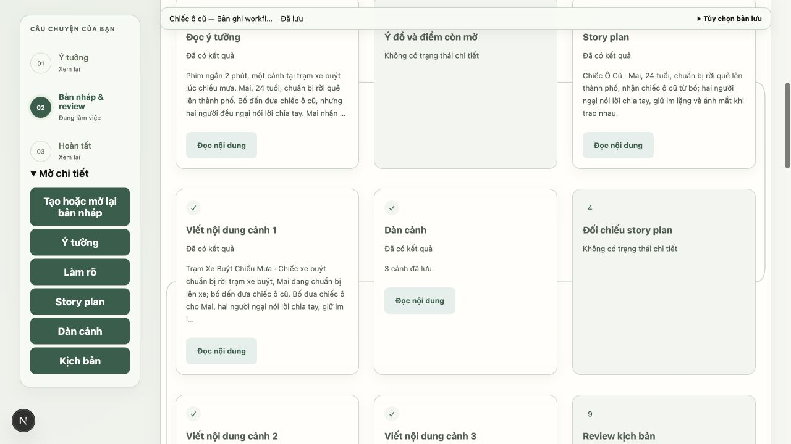
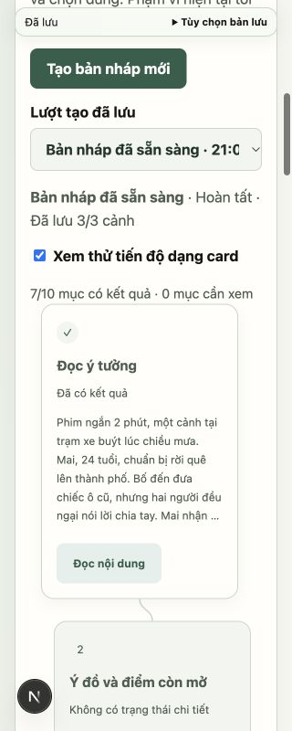

# Card workflow DR 03 và DR 04

Nhánh `fix/draft-workflow-cards` từ dev sau PR #79 (`354c2e7`). Backend tiến độ được tái sử dụng; không đổi prompt hoặc gọi AI để trình bày card.

Trong vùng tạo nháp, bật **Xem thử tiến độ dạng card**. Đây là đường xem thử chủ động, chưa thay giao diện mặc định trước mốc DR-09/DR-10. Các nút tạo, làm rõ, hủy, nhận bản và editor/recovery cũ tiếp tục dùng được.

- Kiểu và validator frontend nhận progress version 0/1, trạng thái item, children, ID duy nhất và tham chiếu candidate revision; response cũ không có progress hiện fallback.
- Nội dung card chỉ lấy từ candidate đã lưu; chưa tải tới checkpoint thì báo đang tải, không ghép nội dung tương lai vào card. Góp ý từng phần vẫn mở được. Card không tạo editor/buffer thứ hai.
- Ba cột theo thứ tự hàng trái → phải, rồi phải → trái. DOM giữ thứ tự nghiệp vụ. Card một cảnh dùng ID thật; tổng card theo backend, không cố định chín mục.
- Dưới breakpoint nội dung 640px, một cột lệch nhẹ. Đường nối đo từ card thật và cập nhật qua ResizeObserver, không chạy loop từng frame.
- Đọc nội dung flush buffer trước, kiểm tra lại bản lưu rồi mở đúng vùng plan/outline/cảnh/review. Unknown lịch sử giữ nguyên, không suy ra thành công. Card tham chiếu góp ý trước khi sửa luôn kèm cảnh báo nguồn cũ tại phần đọc.
- Chặn run response/candidate cũ ghi đè revision mới. Poll vẫn kiểm tra tiến độ độc lập với việc tải lại candidate.

## Kiểm chứng

TypeScript và production build đạt. **16 suite frontend không dùng browser đạt**, gồm suite mới `draft-workflow.cjs`: version/status sai, ID trùng, tham chiếu lỗi, response đến muộn, chờ đúng checkpoint, góp ý từng phần và candidate revision giảm bị từ chối. Hồi quy autosave/candidate-autosave hiện có tiếp tục đạt.

Browser kiểm tra trên Next.js/FastAPI thực, DB demo riêng từ lần ghi workflow; không mở DB ứng dụng chính và không gọi model. Run cũ có 3 cảnh được hiển thị 10 card với mục unknown đúng dữ liệu. Đo vị trí xác nhận hàng đầu đi trái sang phải, hàng hai đảo chiều. Nút đọc card mở đúng story plan và đưa focus tới vùng đọc. 320px: document scrollWidth=320, card x lệch 14px, không tràn ngang. Khôi phục viewport sau kiểm tra.

DR-05/DR-06 tiếp tục skeleton, thinking, reveal và nghiệm thu phục hồi sâu hơn; DR-07/DR-08 tiếp tục hợp nhất quyết định và reader. Mốc này không nghiệm thu model thật, thiết bị/IME/screen reader hoặc toàn luồng phát hành QA-01. Browser lần này kiểm chứng bố cục và đọc run cũ, không thay nghiệm thu pipeline live mới.
