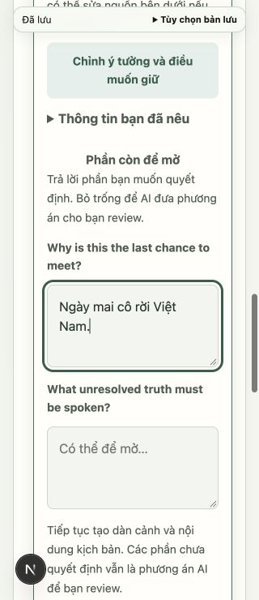
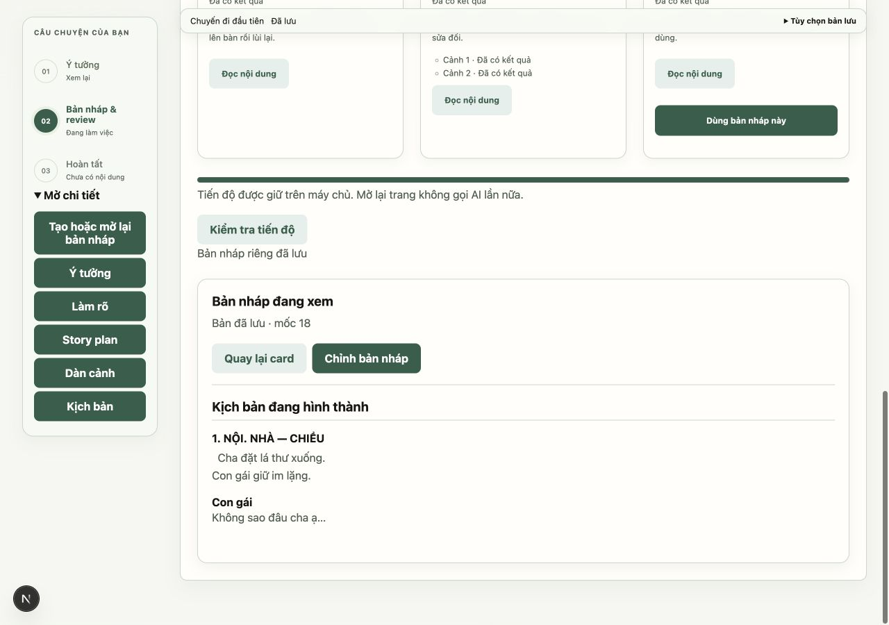
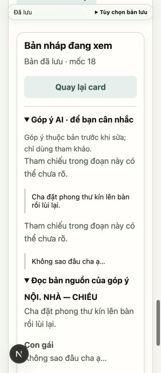
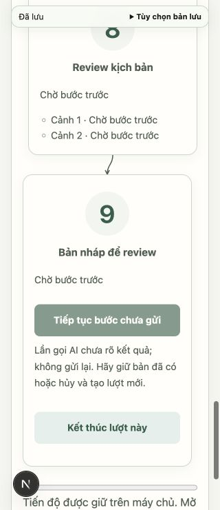

# DR-07 và DR-08 — quyết định tại card, đọc/sửa/nhận candidate

Nhánh `fix/draft-workflow-decisions` từ `dev` sau PR #81 (`2f385f8`). Tiếp tục chế độ xem thử chủ động; chưa bật giao diện thay thế mặc định. Không đổi prompt/runner hoặc shape API. Siết kiểm tra candidate revision trong nhánh nhận lặp của backend để không coi bản khác là cùng một lần nhận.

## Phần bàn giao

- Card Ý đồ dùng đúng `ClarificationConversation` và queue candidate hiện có: một form, câu hỏi/câu trả lời theo run; bỏ trống vẫn là phần để mở. Khi đang gửi, khóa form; nếu backend không cho tiếp tục thì không tạo CTA gọi lại.
- Card đang chạy có hủy các bước tiếp theo và thông báo rõ call đã gửi vẫn có thể trả kết quả. Card cuối tập hợp tiếp tục, kết thúc, nhận bản hoặc trạng thái đã nhận. Không suy ra quyền tiếp tục từ tên `interrupted`: phải có `can_continue === true` và candidate đã tải tới checkpoint. Run cũ thiếu quyền không được tự cấp quyền.
- Trước POST continue, flush rồi đọc lại run/candidate và kiểm tra quyền/revision. Unknown result, đổi cấu hình, candidate đã sửa hoặc provider không sẵn sàng giữ nguyên lý do backend. Chặn thao tác đồng thời bằng ref đồng bộ; không tự retry POST khi mất phản hồi.
- Khi xem card, một reader dùng đúng candidate/queue hiện có. Chỉ phần được chọn hiển thị; mặc định đọc, chuyển sang sửa khi người dùng chọn. Sửa title/logline/nội dung plan hoặc text các block cảnh; không nhân bản editor của cùng một trường. Tắt chế độ card vẫn dùng đường cũ với cùng buffer.
- Mở/đóng reader và kết thúc sửa đều flush trước. Khóa các input trong lúc gửi thao tác để không phát sinh chữ mới giữa flush và nhận bản. Lỗi lưu giữ nguyên vùng sửa và recovery hiện có. Quay lại trả focus tới đúng nút mở; reload mở lại reader ở chế độ đọc và giữ đích đã chọn. Dữ liệu run cũ không có workflow items dùng giao diện cũ thay vì ẩn toàn bộ nội dung.
- Nhận bản: flush, đọc lại trạng thái và đối chiếu đúng candidate revision đang có; không âm thầm tải một candidate mới rồi nhận thay bản vừa đọc. API nhận giữ kiểm tra nguồn/revision; nhánh idempotent cũng bắt buộc đúng candidate revision đã nhận, chặn cuộc đua một cửa sổ sửa/nhận bản mới trước POST từ cửa sổ còn lại. Xác minh lại `adopted_revision` sau thao tác. Nếu POST đã thành công nhưng mất phản hồi, Workspace dùng GET run xác nhận đúng candidate revision rồi GET project để mở đúng bản đã nhận; không gửi lại POST. Không nhận thay revision khác và không đoán thành công khi GET cũng lỗi. Candidate đã nhận không tiếp tục chỉnh trong reader; chỉnh tiếp ở workspace chính.
- Review cũ giữ cảnh báo nguồn, có evidence quote và bản cảnh nguồn chỉ đọc. Sửa plan/cảnh không viết lại snapshot review hoặc tự áp góp ý. Các phần plan/outline/script/review cùng nằm trong một vùng đọc theo ngữ cảnh.

## Kiểm chứng

TypeScript, **18 suite frontend không dùng browser**, production build và toàn bộ backend **656 passed, 1 skipped** đạt (đã chạy riêng 42 test draft runs/progress trước đó). Backend có warning Starlette TestClient cũ; không có lỗi test. Suite frontend mới kiểm tra capability thật/thiếu capability, câu trả lời để mở, unknown result, cấu hình đổi, candidate đã sửa, checkpoint chậm, revision lệch, hủy, nhận và candidate đã nhận chỉ đọc. Các suite autosave/recovery/IME và transport/source hiện có tiếp tục đạt.

Browser dùng Next.js/FastAPI, SQLite mới trong thư mục tạm và provider giả của `backend/tests/ui_draft_progress_fixture.py`. Fixture bổ sung `ask`, `fail_stage` và `lose_adopt` vào `/__test/control`; không đụng DB chính hoặc gọi model thật.

| Ca | Kết quả |
| --- | --- |
| Run cần hỏi | Một form thật nằm trong card Ý đồ; trả lời câu đầu và để câu sau trống. Candidate lưu chính xác cả hai giá trị; tiếp tục đi tới hai cảnh |
| Mobile 320px | Form/câu hỏi và reader không tràn ngang; textarea trong card rộng 212px; điều khiển đọc/sửa nằm trong viewport |
| Sửa plan rồi quay lại ngay | Queue flush giữ nguyên khoảng trắng, đóng reader, focus trả về nút plan |
| Mở một cảnh, sửa rồi Lưu và đọc lại | Chỉ một cảnh hiển thị; không còn textarea nhìn thấy ở chế độ đọc; giữ nguyên xuống dòng/khoảng trắng |
| Review sau sửa plan/cảnh | Báo góp ý thuộc bản trước; quote và bản nguồn vẫn chứa chữ cũ, không gán sang nội dung mới |
| Candidate bị sửa ở cửa sổ khác | Bấm nhận bị chặn trước POST adopt. Kiểm tra và đọc lại mới thấy bản mới; không tự nhận phần chưa được tải/đọc |
| Sửa rồi nhận ngay | Flush trước nhận; workspace nhận đúng câu thoại mới nhất, logline và block có provenance `author_input`; candidate revision 20 đã nhận vào project revision 2 |
| Phản hồi nhận bản bị mất | Fixture trả 503 sau khi server đã xử lý adopt; Workspace xác minh bằng GET và chuyển sang editor chính, không báo nhận lỗi giả. Unit test xác nhận một POST, không nhận thay revision khác và giữ lỗi nếu chưa xác minh được |
| Call screenplay chưa rõ kết quả | Nút Tiếp tục bước chưa gửi disabled, hiện đúng lý do backend. Kiểm tra tiến độ không thêm call; phần plan/outline vẫn đọc được |
| Hủy lúc planning đang chờ | Hiện đang dừng; sau khi call trả về, plan vẫn đọc được. Không có evaluation/scene call tiếp theo cho run bị hủy |
| Reload reader và đóng | Reader mở ở chế độ đọc; y≈64px ở 320px, không dưới thanh lưu; đóng trả focus đúng nút plan ngay cả khi không còn ref DOM từ trước reload |
| Nhận candidate | Workspace chuyển về editor chính; không còn editor candidate hoạt động song song |

Ảnh kiểm chứng:

## Phần còn lại

DR-09/DR-10 tiếp tục ma trận hồi quy toàn luồng, nhiều tab/mạng/restart mở rộng, thiết bị/IME/screen reader/Safari thật, model thật tới PDF và hướng dẫn. Browser mốc này dùng provider giả; không suy ra chất lượng sáng tác hoặc độ chính xác Qwen, không đóng QA-01. Các hợp đồng dữ liệu/lịch sử và xuất PDF không đổi; chưa chạy lại phép thử PDF trong browser ở mốc UI này.
