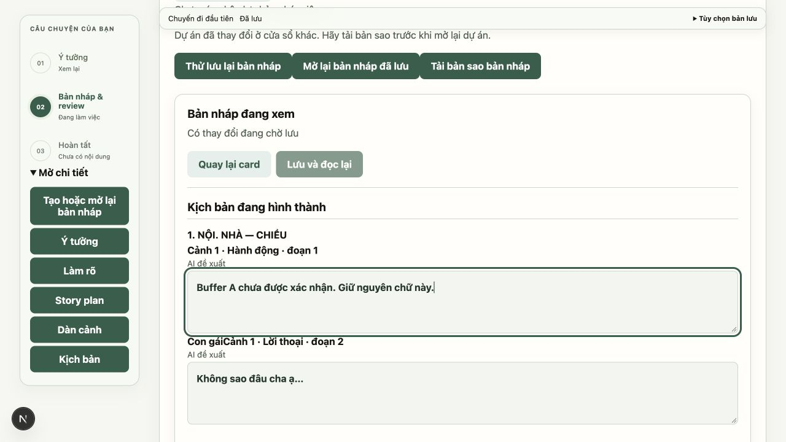
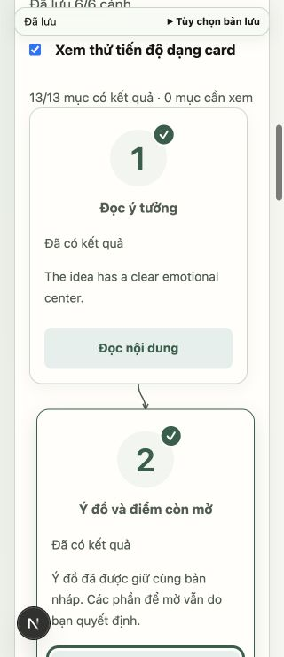
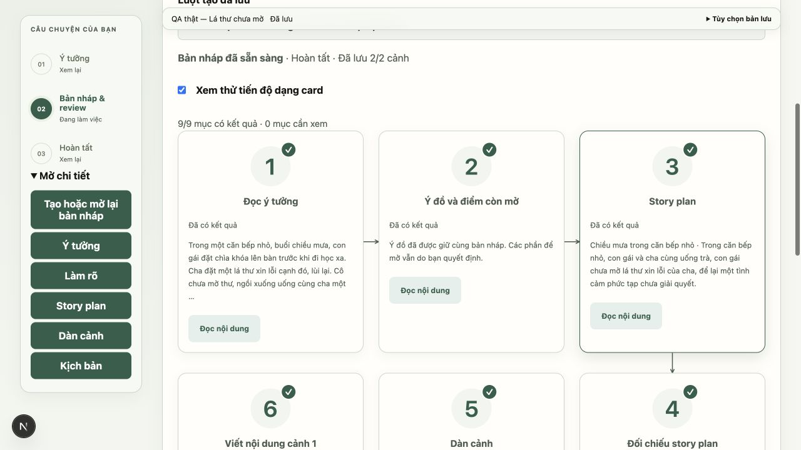
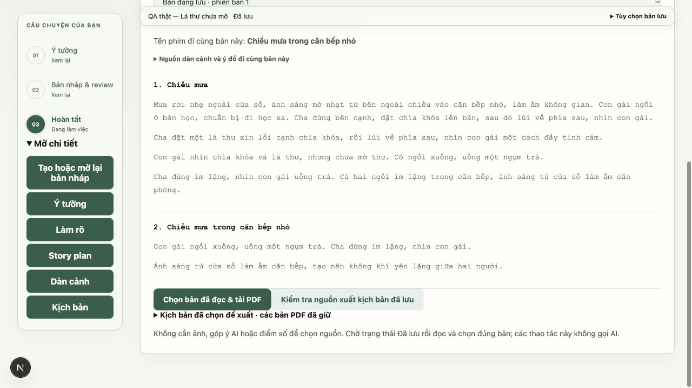
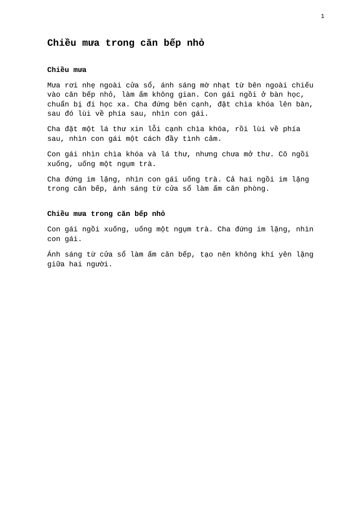
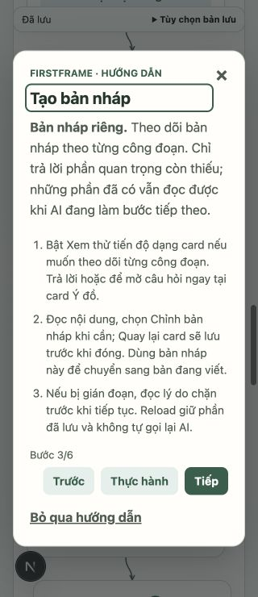

# DR-09 / DR-10 — hồi quy và bằng chứng phát hành

Nhánh `fix/draft-workflow-release-qa` từ `dev` sau PR #82 (`d1f4a64`). Review PR #82 không phát hiện lỗi mới; head đã qua TypeScript, 18 suite frontend, production build và 656 backend passed/1 skipped trước merge. GitHub khi đó không có check/Actions; không coi trạng thái pending rỗng là CI đang chạy.

**Kết luận:** đã bàn giao hồi quy, CI, hai ca Qwen thật, kiểm tra PDF/UI và hướng dẫn mới. **Chưa phê duyệt bật giao diện thay thế mặc định hoặc đóng QA-01.** Một ca model dừng ở JSON scene không hợp lệ; ca xuất được PDF vẫn có lỗi nội dung. Thiết bị/assistive technology/người đọc độc lập chưa được nghiệm thu.

Tiếp nối kiểm thử giao diện: [QA-01 mobile/Safari, bàn phím và accessibility](qa01-mobile-safari-ime-2026-10-30.md) đã sửa mất buffer qua breakpoint, sheet tự mở và nút đóng che nội dung; có bằng chứng Safari macOS/RDM và hồi quy IME logic. Các gate thiết bị iOS/Android, bộ gõ thật và screen reader vẫn mở. Kết quả lịch sử của báo cáo này giữ nguyên.

Tiếp nối QA-01: [đợt kiểm chứng cấu trúc viết cảnh và giới hạn số cảnh](../evaluations/qa01-scene-structure-qwen7b-2026-10-30/README.md) bổ sung schema/prompt chặt hơn, bounds từ tác giả và evidence 5 snapshot + hai lượt toàn luồng. Các báo cáo lịch sử dưới đây giữ nguyên; gate nội dung/người đọc/thiết bị vẫn chưa đạt.

## Kiểm chứng tự động

- Backend: **662 passed, 1 skipped**, gồm sáu ca mới clear/needs-input × 1/2/6 cảnh. Mỗi ca đi từ start → để mở/trả lời → checkpoint → sửa → từ chối revision cũ → nhận/idempotency → selection/PDF khi AI bị tắt. Kiểm tra ID động, review nguồn cũ và số call không tăng khi GET/replay request.
- Frontend: **18 suite**, TypeScript, production build đạt. `npm test` gom lệnh compile/run vào thư mục tạm, xóa sau khi xong; không chạy các browser suite cũ hoặc gọi model.
- `.github/workflows/checks.yml`: backend pytest và frontend typecheck/test/build cho PR vào dev và push dev. Dùng Python 3.13, Node 24, quyền contents read; không cần model/secret. Trạng thái CI thật nằm trên head PR; các số local ở đây không được trình bày thay cho trạng thái GitHub.
- Các suite có sẵn tiếp tục kiểm tra mất acknowledgement, IME logic, response sai thứ tự, unmount, restart/unknown call, lịch sử/provenance và nguồn PDF.

Lệnh chạy lại: xem README và `backend/tests/test_draft_release_matrix.py`. Fixture browser `ui_draft_progress_fixture.py` bổ sung `scene_count` (1–6), `hold_save` và `release_save` để tạo race thật giữa hai tab, bên cạnh các điều khiển mạng/provider hiện có.

## Browser trên Next.js/FastAPI/SQLite thực, provider giả

| Ca | Bằng chứng quan sát |
| --- | --- |
| Sáu cảnh | 13 card có số 1–13, ID/cảnh theo dữ liệu thật, ba cột S đúng tọa độ; không cố định chín card |
| Tab | Tab từ nút đọc card 1 sang card 2 theo DOM, không theo hàng bị đảo; không có auto focus do poll |
| 390px / 320px | 13 card vẫn đọc được; scrollWidth=viewport. Đây là browser viewport, không phải điện thoại thật |
| Hai tab | Giữ PUT A tại fixture; B lưu revision mới trước; giải phóng A nhận 409. Text A vẫn nguyên trong textarea, B vẫn là bản server |
| Backup | Tải JSON của A và đọc lại: chứa đúng buffer A chưa xác nhận; GET server chứa đúng B. Không giải quyết xung đột bằng cách đè chữ của bên nào |
| Nhận và xuất | B nhận đúng candidate, mở Hoàn tất, chọn/tải PDF sáu cảnh qua UI; bản đọc/PDF có chữ B, không phát sinh call AI |
| Tương phản view Hoàn tất | 109 mẫu text hiển thị, min 6.33:1, không có mẫu dưới ngưỡng theo cỡ chữ đã đo. Đo computed foreground/background tổng hợp; không chứng nhận mọi view/theme |
| Onboarding | Bước 3/6 hướng dẫn bật xem thử, làm rõ tại card, đọc/sửa/quay lại và xử lý gián đoạn. 320px: dialog x=16/right=304/top≈62.5/bottom≈677.5, cuộn được và đóng bằng Escape |

Các ca trước về network GET/candidate terminal, mở run cũ, partial review, giữ focus/reload, hủy với kết quả muộn và nhận bị mất phản hồi nằm trong [DR-05/06](draft-workflow-transitions-2026-10-30.md) và [DR-07/08](draft-workflow-decisions-2026-10-30.md), cùng được giữ bằng các suite hồi quy. Không tuyên bố đã lặp mọi ca browser trong lần này.

Môi trường browser có reduced-motion=false, reduced-transparency=false, forced-colors=false; capability hiện có không bật các chế độ này. Đã kiểm tra CSS fallback và unit logic; **chưa nghiệm thu thực thi bằng cài đặt OS**, screen reader hoặc IME thật. Không dùng Playwright emulator ngoài CUA để thay cho bằng chứng thiết bị thật.

## Qwen thật — hai ca được giữ riêng

| Ca | Kết quả | Call / thời gian model / toàn lượt |
| --- | --- | --- |
| [Brief synthetic mới](../evaluations/draft-workflow-qwen7b-2026-10-30/README.md) | Không đạt: scene đầu structured response sai; interrupted, giữ plan/outline, không review/PDF, không tự retry | 5 / 109.662s / 109.934s |
| [Brief phase 6 đã lưu](../evaluations/draft-workflow-qwen7b-saved-brief-2026-10-30/README.md) | Đạt đường API tới PDF: hai cảnh, hai review, snapshot chính xác, xuất khi provider tắt; chưa đạt chất lượng nội dung | 12 / 126.016s / 128.963s |

Cùng qwen2.5:7b, temperature 0.3, num_ctx 16384; screenplay review dùng nhiệt độ 0 theo code hiện có. Model digest và timeout thực từng call nằm trong evidence. Không điều chỉnh prompt giữa hai ca, không sửa output, không dùng ca thành công để thay ca lỗi. `review_error=null` ở ca chưa review không có nghĩa thành công.

PDF ca thứ hai được render/đọc trực quan một trang, text tiếng Việt không lỗi glyph/cắt dòng. Mở DB của ca thật bằng viewer riêng chặn AI writes, đọc chín card và tải PDF qua UI; text PDF qua UI khớp bản API. Các ghi nhận đổi chủ thể/chuyển động mâu thuẫn/lặp nhịp ở `content-observations.json` là đánh giá agent, không phải người đọc độc lập hoặc chứng nhận độ chính xác review.

## Cổng phát hành còn mở

1. Sửa/đánh giá độ bền schema viết cảnh và lỗi nội dung trên model mục tiêu bằng task riêng; không tự retry call chưa rõ kết quả.
2. Giới hạn tác giả: chỉ dẫn runner vẫn có “Create 2 to 6 concise scenes” dù brief có thể yêu cầu tối đa một. Đã ghi từ plan gốc; đợt này không thay logic sinh nội dung. Fake provider một cảnh không chứng minh model tuân thủ giới hạn này.
3. VoiceOver/NVDA, Safari/iPhone/Android, IME/bàn phím thật và OS motion/transparency/forced colors.
4. Người đọc độc lập/pilot xác nhận ý đồ, độ hữu ích của review và tác phẩm. Không suy ra chất lượng từ JSON hợp lệ hoặc điểm model.

DR-09 có hồi quy/CI và bằng chứng browser kỹ thuật; phần thiết bị/khả năng tiếp cận thật còn mở. DR-10 đã chạy và lưu báo cáo, nhưng nghiệm thu phát hành **chưa đạt**. Card vẫn opt-in; không đổi cờ bật mặc định, không nâng trạng thái QA-01 thành hoàn tất.

