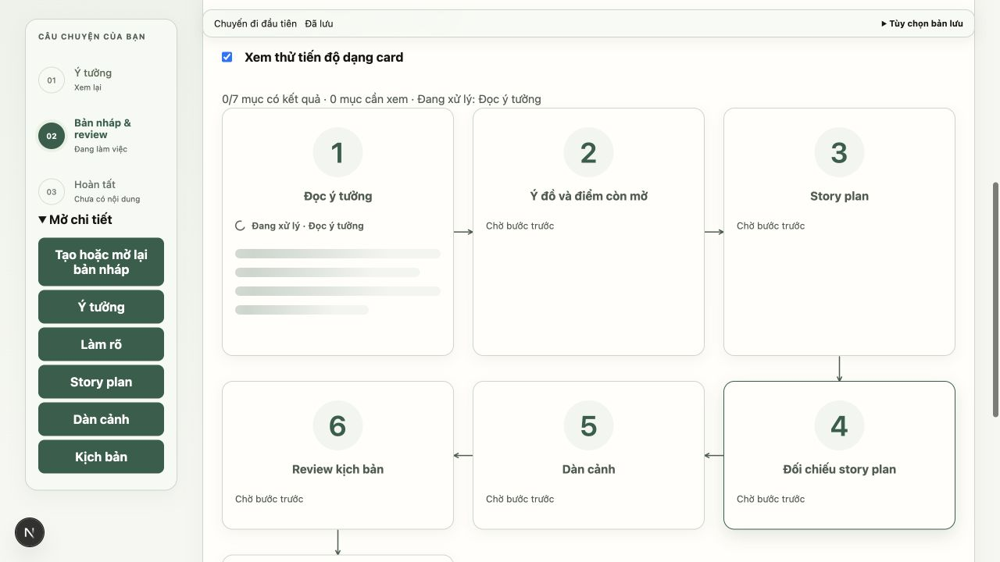
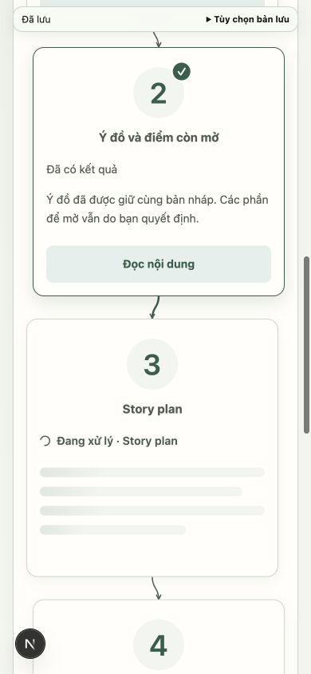
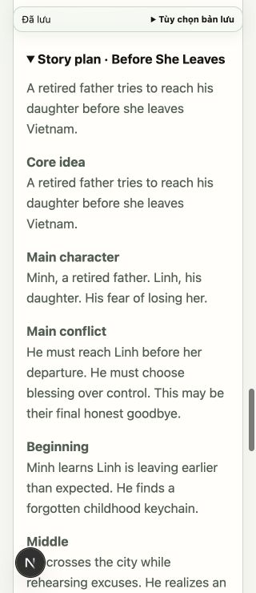

# DR-05 và DR-06 — chuyển trạng thái và phục hồi

Nhánh `fix/draft-workflow-transitions` từ `dev` sau PR #80, merge commit `6b05168`. Card vẫn là chế độ xem thử chủ động; chưa bật thay thế mặc định. Không đổi prompt, runner, API hoặc chính sách tiếp tục/hủy/nhận.

## Thay đổi

- Chỉ item `running` chưa có nội dung đọc được có skeleton xử lý và nhãn thao tác/spinner. Item pending không shimmer. Nếu đang tải candidate đã checkpoint thì skeleton mạng riêng, không giả là model còn chạy. Mục lỗi/gián đoạn kết thúc skeleton; nội dung cũ vẫn đọc được.
- Preview mới dùng fade/dịch 4px/blur 1px trong 450ms; tối đa ba item có độ trễ 0/100/200ms. Kết quả và nút đọc xuất hiện ngay theo checkpoint; không xếp hàng các bước giả. Reduced motion tắt shimmer/reveal; reduced transparency tắt reveal có blur; forced colors có nền dự phòng.
- Lịch reveal thuộc run panel, không thuộc card; dựa trên checkpoint kết quả đã có candidate tương ứng. Mở run cũ hoặc hydrate lần đầu không replay. Đổi chế độ card, poll không đổi kết quả và reload không diễn lại lịch sử.
- Poller chỉ dùng GET để phục hồi lỗi mạng, backoff tối đa 8 giây. Giữ run/candidate đã tải; lỗi candidate vẫn tự thử lại dù run đã terminal. So sánh với revision đã nhận, chặn response cũ và bỏ response từ poller đã unmount.
- Nút đọc dùng nội dung đang có sau khi flush buffer, không buộc GET thành công trước khi đọc bản đã tải. Giữ editor và autosave hiện tại. Cleanup poll không hủy debounce autosave khi chỉ thay trạng thái run.
- Session chỉ ghi ID run, tùy chọn xem card và đích đọc, không ghi văn bản. Reload giữ run đã chọn, chế độ xem và phần đọc; mở lại đích đọc sau hydrate mà không tự lấy focus bàn phím. Tương tác trong panel trước khi hydrate sẽ bỏ khôi phục vị trí chờ.

## Kiểm chứng

TypeScript, **17 suite frontend không dùng browser** và production build đạt. Suite mới kiểm tra baseline lịch sử, candidate về sau progress, batch reveal, revision mới, partial review cũ, reconnect sau lỗi GET, run terminal còn thiếu candidate, response tiến độ cũ và response sau unmount. Các suite autosave/candidate-autosave tiếp tục đạt.

Browser qua Next.js/FastAPI thực, SQLite trong thư mục tạm và provider giả có gate tại từng call. Fixture có thể chạy lại bằng:

```sh
backend/.venv/bin/python backend/tests/ui_draft_progress_fixture.py
```

Fixture dùng cổng 8034; frontend cổng 3034 phải trỏ `NEXT_PUBLIC_API_BASE_URL=http://127.0.0.1:8034`. Chỉ chạy khi hai cổng trống. Fixture in đường dẫn DB/seed riêng; `/__test/start` khởi động run đã seed, `/__test/control` nhận `release`, `auto`, `fail_run`, `fail_candidate`. Không có model thật hoặc DB người dùng trong phép thử.

| Ca | Kết quả |
| --- | --- |
| Pending rồi reasoning đang chạy | 1 skeleton xử lý ở đúng card; 0 skeleton trong card pending |
| Hoàn tất reasoning, chờ planning | Hai card đã có kết quả đọc được, planning có skeleton |
| GET run trả 503 | Nội dung của hai card giữ nguyên; đọc ý tưởng được bằng dữ liệu đã tải |
| Cho backend hoàn tất nhiều bước trong lúc GET candidate trả 503 | Run ready, nội dung cũ giữ nguyên, chỉ phần candidate chưa tải có skeleton mạng; focus vẫn ở understanding |
| Khôi phục GET candidate | Tự nhận đủ chín card/kết quả; hết lỗi mạng và skeleton; không yêu cầu khởi động AI lại |
| Bật/tắt card rồi reload | Không replay reveal hoặc skeleton của các mục đã xong |
| Chọn run cũ sau khi tạo run thứ hai rồi reload | Giữ đúng ID run cũ và chế độ card; story plan mở lại tại y≈64px, dưới thanh lưu kết thúc tại y=40px ở 320px; không ép focus bàn phím |
| Mobile 390px và 320px | scrollWidth bằng viewport, skeleton nằm trong card, số/icon trên title, đường nối cập nhật đúng |
| Desktop | Giữ ba cột chữ S và thứ tự DOM, thông báo tổng hợp chỉ mô tả trạng thái công việc |

Run đầu có 10 call fake của pipeline (gồm các lượt review theo logic có sẵn); số này giữ nguyên qua đọc, reconnect và reload, trước khi chủ động tạo run thứ hai. Không suy diễn chất lượng nội dung từ provider giả.







## Phần chưa nghiệm thu

DR-07/08 tiếp tục đưa quyết định tác giả và recovery vào card. DR-09/10 tiếp tục ma trận tích hợp đầy đủ, thiết bị/IME/screen reader/Safari thật, reduced motion/transparency ở môi trường thật và model thật tới PDF. Browser lần này kiểm chứng trạng thái theo checkpoint của provider giả, không xác nhận toàn luồng QA-01 hoặc chất lượng Qwen. Trạng thái gián đoạn/restart backend vẫn dùng hợp đồng đã giao ở DR-01/02; chưa chạy lại ma trận restart toàn hệ thống trong mốc UI này.
