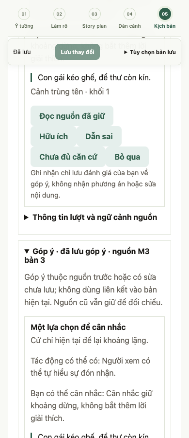

# M3 Gói 3 — Góp ý có bằng chứng và tác giả tự sửa

Ngày 27/10/2026. Nhánh `feat/screenplay-evidence-feedback`, từ `dev` tại `28de3ac` sau PR #54. Chỉ triển khai Gói 3 của plan M3; chưa commit, tạo PR hay triển khai Gói 4. Plan, roadmap, prototype, cấu hình model và bằng chứng trước giữ nguyên, gồm cả các thay đổi tài liệu local có sẵn.

## Kết luận trước khi đóng gói

Luồng kỹ thuật đã có kiểm chứng bằng provider giả và trình duyệt: đọc góp ý riêng → đối chiếu nguồn → ghi nhận hữu ích/dẫn sai/chưa đủ căn cứ/bỏ qua → tự sửa hoặc giữ nguyên → lưu/mở lại → chủ động review đúng bản mới. Không có tự sửa, tự nhận, điểm số hoặc cổng chặn lưu nháp.

**Chưa đạt chất lượng góp ý với Qwen 2.5 7B.** Sáu lượt thật đều parse được schema nhưng thiếu/sai tham chiếu bắt buộc và bị từ chối; không có góp ý hợp lệ đến người dùng. Output thô còn đọc sai chi tiết, bỏ sót và đề xuất đi ngược ràng buộc. Không tính việc guard chặn lỗi là hoàn tất nghiệm thu chất lượng Gói 3. Không mở vòng chỉnh prompt/model hoặc chạy bù trong đợt này.

## Phạm vi và bảo vệ dữ liệu

- Một cảnh đã lưu, cảnh liền trước/sau làm ngữ cảnh, lựa chọn M2 và ý đồ/story plan đi cùng snapshot M3. Không lấy ý đồ M1 mới để âm thầm thay nguồn M3 cũ; câu hỏi chưa trả lời không thành quyết định tác giả.
- Mỗi nhận xét có quan sát, tác động có thể có, gợi ý tùy chọn và quote/ID nguồn. Phải dẫn khối văn bản của cảnh đích; nếu nghi lệch ý đồ thì dẫn thêm lựa chọn tác giả. ID phải khớp chính xác, quote phải có trong snapshot. Cả lượt sai hợp đồng thành `failed`, không sửa ID hoặc đoán nguồn để cứu output.
- Giao diện phân biệt nghi lệch ý đồ, lựa chọn sáng tạo và chưa chắc cách hiểu. Nêu rõ quote đúng không chứng minh nhận xét đúng; không có nhận xét không chứng minh tác phẩm tốt hoặc tuân thủ. Tác giả quyết định và tự sửa.
- Nguồn đọc được riêng; liên kết vào phần đang viết chỉ hiện khi nguồn còn khớp và không có sửa liên quan chưa lưu. Kiểm tra ID/field/text một lần nữa trước focus. Sửa cảnh lân cận cũng làm góp ý cũ hết hiệu lực; nguồn cũ không bị cấp lại hoặc trỏ nhầm sang chữ mới.
- Ghi nhận về nhận xét chỉ lưu metadata, giữ buffer chưa lưu. Đọc nguồn/chuyển cảnh/lưu không gọi AI. Sửa và lưu rồi chủ động yêu cầu góp ý mới tạo record riêng, giữ nguyên snapshot cũ.
- Checkpoint trước gọi, ID tác vụ idempotent, không tự retry. Lượt pending phải kiểm tra/bỏ trước lượt review hoặc viết thử mới. Transaction lưu kết quả muộn chỉ cập nhật record của lượt đó, giữ sửa mới và quyết định bỏ. Thiếu provider, timeout, mất phản hồi, lỗi schema/tham chiếu vẫn cho tự viết/lưu.
- Dùng guard ngữ cảnh hiện có của Gói 2 qua helper chung; không cắt nguồn âm thầm. Tối đa 100 lượt review/dự án. Snapshot review không lọt vào dataset M1; đường ghi dataset riêng dùng cơ chế local hiện có. Không mở API trả phí, provider ảnh hay tải model.

## Kiểm thử kỹ thuật

| Phần | Kết quả |
| --- | --- |
| Toàn bộ backend | **477 passed, 1 skipped**, 209,21 giây; gồm 15 ca mới về review và các hồi quy Gói 1–2 |
| Contract frontend | Review mới, M3, M2 transport, progress và onboarding đều qua |
| Build/typecheck | Production build qua; build QA trỏ API riêng, sau kiểm tra khôi phục build theo cấu hình mặc định |
| Browser Gói 3 | Qua lưu trước review, nguồn/focus đúng khối, đọc không ghi/call model, đánh giá/inspect khi có buffer, tự sửa/lưu/review mới, nguồn cảnh lân cận cũ, mất phản hồi không retry, quote sai, timeout, notes rỗng, reload |
| Browser hồi quy | Luồng M3 viết tay và AI viết thử Gói 2 đều qua trên fixture riêng |
| Màn hình | Chrome headless 1280/390/320 px, không tràn ngang; không page error; kiểm tra ảnh chụp mobile |

API kiểm cả revision/409, phạm vi dự án/note, client cũ bỏ trường mới, không chấp nhận client ghi snapshot review, giữ M1/M2/ảnh/lịch sử, kết quả muộn sau sửa/bỏ, quota/ngữ cảnh quá lớn và đường tự lưu sau lỗi. Browser dùng SQLite/API/provider giả riêng; không mở database tác giả. Các lượt thử test browser ban đầu gặp race chờ animation frame/record lỗi cũ; sửa điều kiện chờ trong test rồi chạy lại toàn kịch bản trên fixture sạch, không sửa runtime để ép test đạt. Warning Starlette/httpx và CSS `start` có sẵn vẫn còn.

## Sáu lượt Qwen đã đóng băng

Ngân sách đã được người dùng duyệt: ba cặp tuân thủ/vi phạm, đúng sáu lượt, ≤60 giây/lượt, không retry chọn lọc. Mỗi cặp chỉ đổi một khối ở cảnh đích. Prompt/schema/input/code và digest model được đóng băng trước gọi; không đổi sau khi thấy kết quả.

Model `qwen2.5:7b`, digest `845dbda0ea48ed749caafd9e6037047aa19acfcfd82e704d7ca97d631a0b697e`, temperature 0,3, context 16384. Runner đặt timeout 60 giây; timeout runtime hiện có 180 giây và `.env` giữ nguyên. Provider không gửi seed, không tự thêm seed. Thời gian dưới đây là quan sát API, không phải SLA/benchmark tải cô lập.

| Ca | Giây | Lỗi hợp đồng | Đọc output thô của Codex — chưa phải PO nghiệm thu |
| --- | ---: | --- | --- |
| Kết mở / tuân thủ | 15,427 | ID khối bỏ hậu tố `:text` | Nói con gái không hành động dù bản có nhìn cha/kéo ghế; thêm run tay/vuốt thư thiếu lý do cần thiết |
| Kết mở / vi phạm | 11,830 | Chỉ dẫn M2/ý tưởng, thiếu quote câu kịch bản | Nhận ra câu tha thứ chốt kết; bỏ câu hoặc giữ im lặng có ích. Gật đầu vẫn cần tác giả cân nhắc cách thể hiện |
| Tự quyết / tuân thủ | 12,989 | ID khối bỏ hậu tố `:text` | Quan sát nhìn cửa đúng, phần tác động là gu; ví dụ sửa lẫn tiếng Trung và giải thích nội tâm, hữu ích thấp |
| Tự quyết / vi phạm | 12,484 | Tự đổi cả ID khối và ID M2 | Nhận ra giấu hộ chiếu trái lựa chọn tự quyết; chưa đưa hành động sửa cụ thể |
| Đèn pin / tuân thủ | 12,511 | Dùng UUID khối thay ID nguồn đầy đủ | Góp ý thoại cứng dù cảnh chỉ có action, tự thêm thoại giải thích dư |
| Đèn pin / vi phạm | 11,526 | Dùng UUID khối thay ID nguồn đầy đủ | Bỏ sót đèn hỏng sáng và khuyên điều chỉnh ánh sáng đèn pin, tiếp tục vi phạm |

Tổng: **6 model calls, 0 retry, 6 parse schema, 0/6 qua hợp đồng bằng chứng**, mọi lượt giữ nguyên screenplay/M2. Output thô nhận ra 2/3 vi phạm nhưng không thể trình bày như góp ý có nguồn hợp lệ; ca thứ ba bỏ sót và dẫn sai. Hai bản tuân thủ có nhận xét sai thực tế, bản còn lại có ích thấp. Không chuyển lỗi thành `notes: []`, không sửa nguồn để làm đạt và không coi 0 góp ý hiển thị là 0 bỏ sót. Chưa có baseline M3 cùng hợp đồng để kết luận cải thiện A/B so với các thử nghiệm harness cũ.

[Manifest](../evaluations/m3-scene-review-qwen7b-2026-10-27/manifest.json), [đầu vào](../evaluations/m3-scene-review-qwen7b-2026-10-27/inputs.json), [kết quả đủ sáu lượt](../evaluations/m3-scene-review-qwen7b-2026-10-27/results.json), [đối chiếu từng lỗi](../evaluations/m3-scene-review-qwen7b-2026-10-27/comparison.json). Mỗi ca lưu request/schema, output nguyên văn, project sau gọi và trạng thái lỗi. Audit đối chiếu hash sau kiểm thử xác nhận code/prompt/schema/input của đợt chạy không thay đổi.

## Phần còn mở

Gói 3 có luồng dùng và bằng chứng an toàn kỹ thuật; chất lượng review với model hiện tại còn chặn việc gọi phần AI đạt. Cần người dùng chốt hướng xử lý lỗi cụ thể trước một lượt kiểm chứng khác; không tự mở chuỗi tối ưu prompt hoặc chuyển model. Chưa có phiên tác giả/người dùng thật nghiệm thu. Chưa làm đọc toàn bản/chọn nguồn M4 của Gói 4, chưa xuất bản/deploy; giữ nguyên tiêu chí nghiệm thu.

