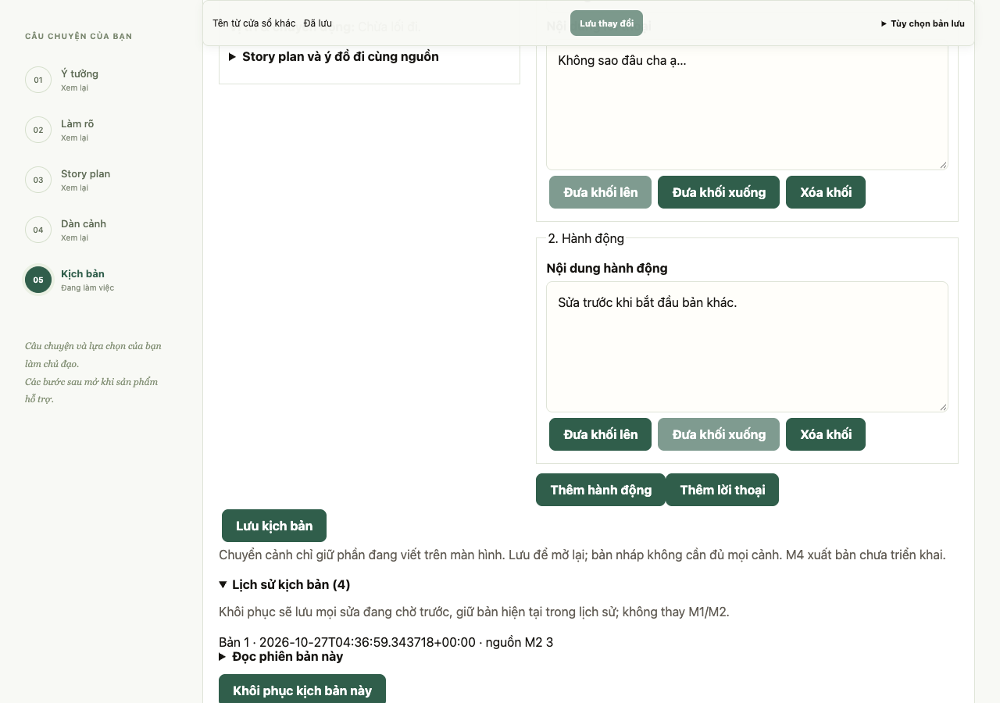
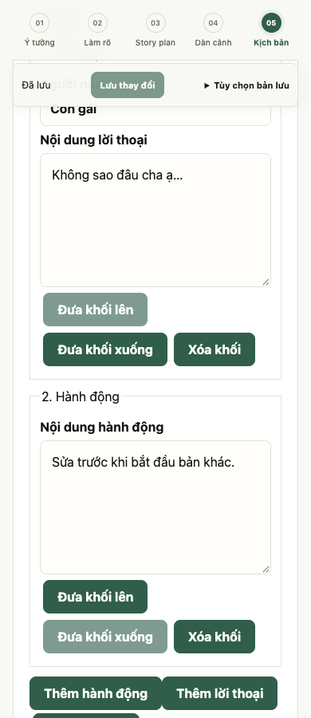

# M3 Gói 1 viết và lưu kịch bản thủ công

Ngày 27/10/2026. Nhánh `feat/screenplay-manual-editing`, từ `dev` tại `16c4e86` sau PR #52. Báo cáo kiểm chứng trước khi đóng gói PR. Không triển khai Gói 2, không gọi model thật, không đổi provider/model/cấu hình/plan/prototype.

## Phần đã triển khai

- Bắt đầu M3 từ dàn cảnh M2 đã lưu, đủ tên và diễn tiến từng cảnh. Chụp `source_outline` gồm story plan/ý đồ/ngôn ngữ đi cùng, revision tại lúc bắt đầu và ID cảnh nguồn. Không lấy ý đồ M1 mới hơn, buffer client hoặc ghi chú AI chưa nhận.
- Khung M3 có ID riêng cho bản/cảnh/khối, tiêu đề cảnh và khối hành động/lời thoại. Không tự chép diễn tiến M2 thành screenplay. Tác giả thêm, sửa, xóa, sắp xếp khối; thoại có người nói, cảnh im lặng/khối trống vẫn lưu nháp được. Text giữ nguyên dấu tiếng Việt, khoảng trắng và xuống dòng.
- Mở nguồn cảnh song song trên desktop; màn hẹp xếp một cột và nguồn có thể thu gọn. Đọc cả story plan/ý đồ, quyết định đã xác nhận và câu hỏi chưa quyết định. Điều hướng Kịch bản đưa focus tới M3, không gọi AI. Nút chuẩn bị nguồn M2 chuyển tới vùng M3 sau lưu, chưa tự bắt đầu bản.
- Lưu trong cùng mutation/revision dự án để không tách buffer M1/M2/M3. Mọi sửa screenplay thực lưu giữ phiên bản trước; client cũ không gửi M3 không xóa dữ liệu. So nội dung nguồn để báo cũ; đổi tên dự án/metadata hoặc version không tự làm nội dung nguồn khác.
- Bắt đầu bản khác có lựa chọn xác nhận, lưu mọi sửa đang chờ trước, giữ bản trước trong lịch sử. ID yêu cầu nhận diện lần bắt đầu đã có, kể cả đã vào lịch sử; mất response không tạo thêm bản trống. UI yêu cầu kiểm tra kết quả trước lượt mới.
- Lịch sử đọc được, khôi phục có revision, giữ cả nguồn cũ và bản hiện tại trước khi thay. Không khôi phục M1/M2 theo kịch bản. Xóa khối có hoàn tác khi trạng thái vẫn khớp; sửa mới hơn không bị hoàn tác cũ ghi đè.
- Backup JSON hiện có chứa cả M3 đang sửa và snapshot; dữ liệu M3/lịch sử không tự lọt vào snapshot ghi dataset tác vụ M1. Không đổi khóa nội dung/góp ý M1.

## Hợp đồng và bảo vệ

Thêm `screenplay`, `screenplay_versions` và trạng thái tính `screenplay_source_is_current`; mặc định rỗng cho dự án cũ. Editable payload chỉ gồm ID/version/scenes, không cho client sửa snapshot hoặc lịch sử. Thứ tự/liên kết cảnh giữ theo bản nguồn; thay cấu trúc tại M2 rồi chủ động bắt đầu bản khác, không tự ghép hai chiều.

Giới hạn: 1–60 cảnh, tối đa 200 khối/cảnh và 1.000 khối/bản; text tối đa 10.000 ký tự/khối, người nói 200, tiêu đề cảnh 500, tổng text/tiêu đề/người nói 200.000 ký tự. API từ chối ID trùng, khối chuyển sang cảnh khác, trường ngoài hợp đồng, loại khối sai hoặc payload vượt giới hạn. Frontend kiểm tra dữ liệu trả về và độ dài Unicode tương thích backend. Không thêm dependency.

Nguồn thay đổi chỉ cảnh báo; vẫn tự sửa/lưu bản gắn nguồn trước được. Không cần ảnh, critic, điểm số hoặc nhận gợi ý để lưu. Mất mạng/409 không thay buffer; đổi dự án chỉ thực hiện sau khi lưu được. Lỗi lưu vẫn tải bản sao được. Render text bằng React, không thực thi HTML từ nội dung.

## Kết quả kiểm chứng

| Kiểm tra | Kết quả |
| --- | --- |
| Backend toàn bộ `python -m pytest -q` | **447 passed, 1 skipped**, 126,88 giây |
| `tests/test_screenplays.py` | **18 passed**: snapshot/context cũ, ID/order/text, client cũ và storage cũ, reload, phạm vi M1/M2/ảnh, lịch sử/khôi phục, revision/409, start replay, nguồn giả và giới hạn |
| Production build/TypeScript/lint | Đạt; build lại với cấu hình API mặc định sau QA |
| Node `screenplay-contract.cjs` | Đạt: whitelist, legacy, Unicode/khoảng trắng, ID/nguồn/kind/size/history sai và thay đổi cửa sổ khác |
| Node contract M2/progress/tour | Đạt |
| Chrome `screenplay.browser.cjs` | Đạt toàn luồng thủ công trên API/SQLite tạm; không thêm lượt model ảnh/văn bản |
| Chrome `scene-handoff.browser.cjs` | Đạt hồi quy bàn giao M2 và tour |
| Chrome `onboarding.browser.cjs` | Đạt tour/recovery/HITL/đọc plan/ý đồ |
| Chrome `workspace-focus.browser.cjs` | 4/4 đạt, desktop và mobile giả lập |
| Phạm vi và định dạng | Plan/roadmap/tài liệu cũ/prototype so hash giữ nguyên; `git diff --check` đạt |

Ca Chrome M3 dùng hai cảnh tổng hợp trùng tên: xác nhận liên kết ID, viết tiếng Việt, thứ tự/xóa/hoàn tác khối, Tab, chuyển cảnh giữ buffer, lưu/mở lại, tải JSON chứa sửa chưa lưu, lỗi mạng và 409, đổi dự án khi lưu thất bại/thành công, thay M2 giữ nguồn trước, tạo bản khác với response bị mất rồi kiểm tra không retry, đọc/khôi phục lịch sử, 1280/390/320px không tràn ngang. Kiểm tra API/provider state trước/sau xác nhận không phát sinh model call trong luồng M3.

Các lượt Chrome đầu dừng ở label textarea sau hoàn tác: label bọc textarea chứa sẵn nội dung làm tên truy cập lẫn text khi dựng lại. Đã xác định bằng DOM, sửa sang label `htmlFor`/textarea `id` rồi chạy lại toàn bộ trên fixture sạch; chỉ các lượt sau sửa được tính đạt. Lệnh test/compile ban đầu có lần dùng sai thư mục, không được tính là kết quả test. Backend có cảnh báo Starlette/httpx deprecated; build QA có cảnh báo CSS `start` hiện có. Không sửa ngoài phạm vi để dọn cảnh báo.

## Phần còn mở

Chỉ xác nhận Gói 1 kỹ thuật: chưa có AI viết thử/góp ý M3, chọn bản cho M4 hoặc xuất bản. Không coi đây là nghiệm thu M3 đầy đủ hay người dùng. Chưa kiểm tra IME/screen reader/thiết bị thật, Safari/Firefox hoặc tải production; Chrome mobile chỉ đổi viewport. Cấu trúc cảnh cố định theo snapshot M2 là phạm vi MVP, không phải đồng bộ hai chiều.

## Chạy lại mà không dùng model

1. Từ `backend`, chạy `.venv/bin/python -m pytest -q tests/test_screenplays.py`.
2. Chạy `.venv/bin/python tests/ui_workspace_fixture.py`, ghi thư mục `firstframe-workspace-*`; fixture tạo SQLite tạm và provider giả, không mở DB tác giả.
3. Build frontend với `NEXT_PUBLIC_API_BASE_URL=http://127.0.0.1:8034`, chạy production tại 3034. Từ repo root, đặt `FIRSTFRAME_QA_DIRECTORY` và `NODE_PATH` tới Playwright, chạy `node frontend/tests/screenplay.browser.cjs`.
4. Mỗi ca browser dùng fixture sạch. Sau QA dừng server và build lại frontend với cấu hình API thường dùng. Không chạy model hoặc runner ảnh để kiểm tra Gói 1.

## Review trước khi đóng gói

Review ngày 27/10/2026 không phát hiện lỗi chặn trong phạm vi ứng dụng local và nhiều cửa sổ trên cùng máy. Đã đọc cả đường gọi frontend, validator/transport, route/schema và SQLite CAS; xác nhận nguồn bất biến, quyền soạn thảo, start replay, lịch sử/khôi phục và phạm vi dữ liệu M1/M2/ảnh.

Chạy lại test M3 + outline/handoff M2: **25 passed** trong 2,09 giây. TypeScript CJS và Node M3/M2 contract, progress, tour đạt. Không đổi code sau lượt backend toàn bộ/build/Chrome đã ghi ở trên, không chạy thêm model. PR chỉ gồm code, test, báo cáo và hai ảnh tổng hợp liên quan Gói 1; plan/roadmap/prototype và các thay đổi cũ đang local được giữ ngoài commit. Gói 2, nghiệm thu M3 đầy đủ và thiết bị/người dùng thật còn mở.
