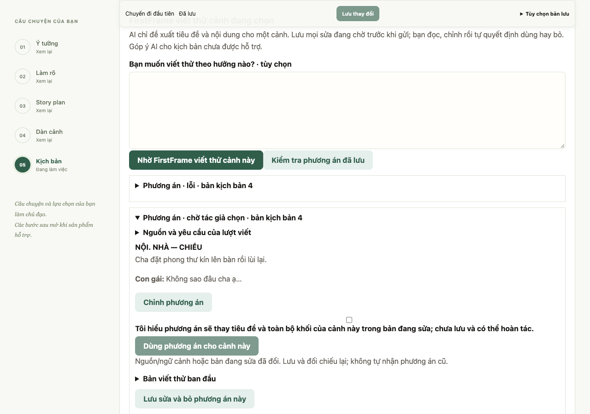
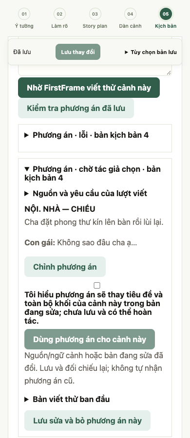

# M3 Gói 2 AI viết thử đúng một cảnh

Ngày 27/10/2026. Nhánh `feat/screenplay-scene-drafts`, từ `dev` tại `0319f86` sau PR #53. Báo cáo triển khai và review trước khi đóng gói PR, chỉ gồm Gói 2; chưa làm góp ý Gói 3. Giữ nguyên plan/roadmap/prototype, model/provider và cấu hình local.

## Phần đã triển khai

Một yêu cầu đọc nguồn M2 bất biến trong M3, story plan/ý đồ đi cùng và kịch bản đã lưu để giữ liên tục; chỉ đề xuất thay cảnh đích. Schema trả một object `scene` gồm heading và khối action/dialogue, không trả danh sách cảnh hoặc ID do model tự cấp. Dialogue cần người nói; action có speaker rỗng; output trống/sai trường bị từ chối. Ứng dụng gắn ID cảnh nguồn và cấp ID khối.

Phương án lưu riêng theo ID tác vụ, nguồn, prompt/schema/model/tham số và trạng thái. Không tự nhận, gọi critic hoặc sửa M1/M2/ảnh. Tác giả đọc bản chính và phương án riêng, chỉnh phương án bằng cùng form cảnh, xác nhận thay thế nếu cảnh đã có khối, rồi **Dùng phương án cho cảnh này**. Dùng chỉ vào buffer; lưu mới ghi bản tác giả/lịch sử. Bản AI ban đầu không bị phương án tự chỉnh ghi đè. Có hoàn tác khi trạng thái còn khớp; tự sửa tiếp giữ quyền tác giả. Khi đang chọn dùng, không cho bấm bỏ cùng phương án trước khi hoàn tác hoặc lưu để tránh vô tình lưu như đã nhận rồi mới bỏ.

Tiến trình theo sự kiện thật: nguồn/checkpoint → viết → kiểm tra cấu trúc → lưu phương án riêng. Gửi lại cùng ID không tạo thêm lượt; ID khác yêu cầu bị từ chối. Pending phải kiểm tra/bỏ trước lượt mới. Kết quả về muộn cập nhật riêng record bằng transaction, giữ sửa mới và quyết định bỏ. Provider thiếu cấu hình/timeout/sai schema lưu trạng thái lỗi và vẫn cho viết tay. Không retry tự động.

Preview được lưu riêng; client cũ bỏ trường mới không xóa nó. Dùng chỉ thay đúng cảnh, không cho âm thầm thay cảnh lân cận hoặc cấu trúc. Ngữ cảnh đã dùng, nguồn M2 hiện tại hoặc ý đồ M1 thay đổi làm phương án cũ không còn được nhận; chỉ đọc để tham khảo. Version/revision metadata không tự đổi ý nghĩa nội dung. Bản M3 vốn gắn nguồn cũ vẫn viết thử theo nguồn cũ đã hiển thị, không ghép ý đồ M1 mới hơn vào prompt.

Tối đa 100 lượt phương án/dự án, giới hạn heading/khối/text và payload hiện có giữ nguyên. Thêm guard tổng UTF-8 bytes của input + system/schema: tối đa 12.000 bytes và thấp hơn khi `num_ctx` nhỏ (chừa 4.096 cùng 512 đơn vị dự phòng). Đây là giới hạn ứng dụng thận trọng, không phải tokenizer chính xác hay hỗ trợ toàn bộ kịch bản dài. Vượt giới hạn báo 422 trước provider, giữ bản viết và đường thủ công; không tự cắt/bỏ nguồn. Không thêm dependency hoặc router đa model.

## Kiểm chứng kỹ thuật

| Kiểm tra | Kết quả |
| --- | --- |
| Backend toàn bộ sau sửa preview cuối | **462 passed, 1 skipped**, 119,88 giây |
| Bộ viết thử sau bổ sung ca quota/phạm vi và preview | **15 passed** trong bộ tập trung 33 ca M3 |
| Gói 1 + viết thử sau sửa preview | **33 passed** |
| Build production/TypeScript/lint | Đạt; build QA trỏ API tạm, sau đó trả build về cấu hình mặc định |
| Node contract M3/M2, progress, tour | Đạt; gồm whitelist, ID/source, preview, quyết định cửa sổ khác và Unicode |
| Chrome viết thử với provider giả | Đạt: lưu trước gọi, preview riêng/chỉnh/xác nhận/use/undo/save, output gốc, ngữ cảnh lân cận cũ, bỏ, mất phản hồi không retry, timeout/lưu tay, reload và 1280/390/320px |
| Chrome hồi quy Gói 1 thủ công | Đạt nguồn/buffer/lưu/backup/409/khôi phục/đổi dự án và 3 độ rộng; không gọi model |
| Phạm vi | Plan/roadmap/prototype, `.env` và bằng chứng trước giữ nguyên theo hash; nằm ngoài phạm vi commit |

Test API kiểm tra late result không ghi đè cảnh lân cận, pending bị bỏ không tái kích hoạt, replay không gọi thêm, source giả/field ngoài hợp đồng, scope project/revision, output không phải một cảnh, thoại thiếu người nói, giới hạn ngữ cảnh không gọi provider, quota đầy vẫn viết tay. Test dùng provider giả xác nhận request sau guard khớp nội dung prompt/input/schema của cả ba lượt thật đã lưu.

Các lượt kiểm tra đầu có lỗi đường dẫn prompt/test do đặt sai thư mục; đã sửa trước khi đóng băng model. Browser đầu chờ lỗi ở chi tiết đang đóng và có lần click record cũ trước khi GET hoàn tất; sửa script chờ record lỗi được gắn vào DOM rồi mới mở. Chỉ lượt chạy toàn bộ sau đó trên fixture sạch được tính đạt. Cảnh báo Starlette/httpx và CSS `start` hiện có còn nguyên.

## Ba lượt Qwen thật đã được duyệt

Ngân sách được tác giả duyệt: đúng ba ca tổng hợp, tối đa 120 giây/lượt, đóng băng trước chạy, không retry chọn lọc. Dùng Qwen `qwen2.5:7b`, digest `845dbda0ea48ed749caafd9e6037047aa19acfcfd82e704d7ca97d631a0b697e`, temperature 0,3, `num_ctx` 16384, timeout 120 giây trong runner. Không đổi `.env`: timeout runtime đang cấu hình 180 giây vẫn giữ; ngân sách thử 120 giây không được trình bày như cấu hình runtime mới. Provider hiện không gửi seed; không chọn seed hoặc chạy lại output.

| Ca | Thời gian API | Kết quả kỹ thuật | Đối chiếu nội dung của Codex, chưa phải tác giả nghiệm thu |
| --- | --- | --- | --- |
| Khoảnh khắc lặng/kết mở | 25,830 giây | 200 ready, một cảnh | Giữ thư kín, không thoại/tha thứ/chốt hòa giải; **đổi tay đặt cạnh thư thành trên mặt thư**, cần tác giả duyệt |
| Chuyện vui nhẹ | 34,102 giây | 200 ready, một cảnh | Giữ hai nhân vật và tình huống; thêm Hà mở khóa, vượt điểm dừng Nam đưa vạt áo; câu cuối “Không sao, em cũng gặp phải chuyện này.” chưa tự nhiên/có thể lẫn ngôi xưng |
| Giới hạn nguồn lực | 19,776 giây | 200 ready, một cảnh | Giữ đèn pin hỏng, rèm/đèn đường/tờ giấy và hai người; có câu tả ánh sáng trang trí cần cân nhắc rút gọn |

Đúng **3 model calls, 0 retry, 0 lỗi provider/schema**, cả ba dưới 120 giây. Không tự nhận bất kỳ output nào; snapshot kịch bản và M2 trước/sau giữ nguyên. Kiểm tra đồng thời với các tác vụ kỹ thuật khác nên đây chỉ là thời gian quan sát, không phải benchmark tải cô lập/SLA. **Không gọi đây là 3/3 đạt chất lượng sáng tác**: ca kết mở còn sai chi tiết, ca vui cần đọc lại thoại/diễn tiến. Chưa có lượt người dùng/PO duyệt.

[Manifest đã đóng băng](../evaluations/m3-scene-writing-qwen7b-2026-10-27/manifest.json), [inputs](../evaluations/m3-scene-writing-qwen7b-2026-10-27/inputs.json), [mọi kết quả](../evaluations/m3-scene-writing-qwen7b-2026-10-27/results.json), [đối chiếu chi tiết](../evaluations/m3-scene-writing-qwen7b-2026-10-27/comparison.json), [audit tích hợp](../evaluations/m3-scene-writing-qwen7b-2026-10-27/integration-audit.json). Mỗi ca có request/schema, raw output, project sau chạy và kết quả riêng; lỗi nếu có sẽ lưu cùng ca, không xóa.

Guard giới hạn input và kiểm tra ID/độ dài preview được thêm **sau** ba lượt thật qua review kỹ thuật. Độ dài/ID preview không làm đổi schema gửi model. Đã chụp code đúng lúc chạy vào `source/`, hash khớp manifest gốc; không viết lại manifest/output để gán kết quả cho code mới. Prompt/schema/input của ba ca không thay và đã kiểm tra parity bằng provider giả; không chạy thêm model cho các guard. Runner giữ lock và từ chối chạy lại; trên code mới cũng từ chối hash cũ theo thiết kế.

## Điểm dừng

Đường kỹ thuật viết thử có quyền chọn đã được triển khai; chất lượng nội dung vẫn cần đối chiếu và sửa bởi tác giả. Không mở thêm vòng prompt/model sau khi dùng hết ngân sách. Chưa triển khai Gói 3, không coi test giả hoặc JSON đúng là minh chứng kịch bản hay, không đóng nghiệm thu #7/#22/#26 hoặc M3 đầy đủ.

Kịch bản dài vượt guard hiện dùng đường viết tay; chưa có chiến lược chọn ngữ cảnh dài. Chưa kiểm chứng IME/screen reader/thiết bị thật, Safari/Firefox, tải nhiều người dùng hoặc OpenAI trả phí. Chỉ fixture tổng hợp và SQLite/dataset tạm, không đưa nội dung riêng vào bộ thử.

Chạy lại test giả: từ `backend`, `.venv/bin/python -m pytest -q tests/test_screenplay_writing.py`. UI dùng `tests/ui_workspace_fixture.py`, frontend QA API 8034/server 3034 và `FIRSTFRAME_QA_DIRECTORY` đúng fixture sạch; chạy `node frontend/tests/screenplay-writing.browser.cjs` hoặc `screenplay.browser.cjs` từ repo root với `NODE_PATH` có Playwright. Không chạy lại runner model trong bộ đã dùng ngân sách.

## Review trước PR

Review ngày 27/10/2026 không phát hiện lỗi chặn trong phạm vi sử dụng local, gồm nhiều cửa sổ cùng dự án. Đã đọc cả luồng gọi/transport/validator, snapshot/applicability, preview/use/discard, lưu revision và transaction kết quả muộn. Giữ output AI gốc, chỉ nhận đúng cảnh với revision hợp lệ và giữ đường tự viết khi lỗi hoặc vượt giới hạn.

Review chạy lại Gói 1 + viết thử: **33 passed**, 2,85 giây. TypeScript và Node contract M3/M2/progress/tour đều đạt. Không thay runtime sau lượt full suite **462 passed, 1 skipped**, build và Chrome đã ghi; hash code khớp audit tích hợp. Không chạy thêm model thật. Code, test, prompt và bằng chứng tổng hợp Gói 2 là phạm vi PR; plan/prototype và các tài liệu cũ đang local giữ ngoài commit. Chất lượng AI, ngữ cảnh dài và nghiệm thu M3 đầy đủ vẫn còn mở.
