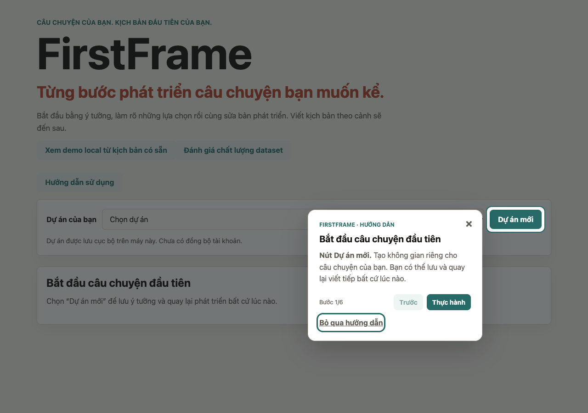
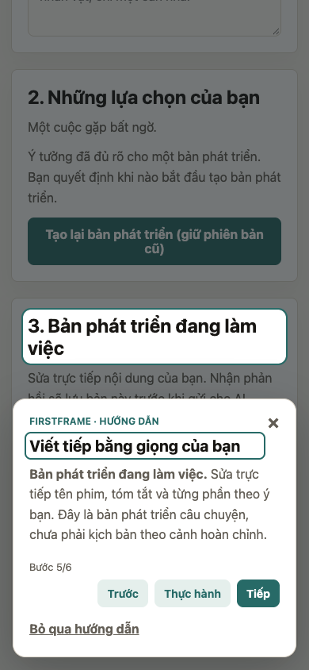

# Tour người dùng mới: kiểm chứng và review

Triển khai theo [issue #22](https://github.com/thomasMinh1995/firstframe-ai/issues/22)
và [plan đã review](../plans/new-user-tour.md), từ `dev` sau merge PR #23.

## Hành vi

- Workspace mới mời xem tour sau khi tải thành công. Người đã có dự án mở
  bằng **Hướng dẫn sử dụng**; điểm vào ưu tiên brief cần làm rõ trước draft cũ.
- Sáu bước có một spotlight mỗi bước. **Thực hành** đóng thẻ và focus control
  thật; **Tiếp tục hướng dẫn** là thao tác chủ động, không tự bật overlay sau AI.
- Nhập ý tưởng/sửa draft có thể tiếp tục mà không lưu hoặc gọi AI. Chờ
  create/analyze/plan chỉ được mở khóa bởi kết quả đúng phiên tour/lượt request.
- Các nút thật của workspace giữ luồng lưu trước AI. Tour không ghi dự án,
  thay buffer, tự chạy AI hoặc chứng nhận chất lượng câu chuyện.
- Đóng/Escape/Bỏ qua và tín hiệu dismissed/completed từ tab khác dừng tour.
  Reload chỉ cho chọn tiếp tục, không phát lại request. Storage lỗi/version
  không hỗ trợ chỉ tắt lời mời tự động, vẫn xem thủ công được.
- Dialog chặn tương tác nền và giữ vòng Tab/Shift+Tab. Viewport quá thấp
  dùng thẻ cuộn trong màn hình; Thực hành/Hoàn tất trả focus về đích phù hợp.

## Kết quả kiểm tra

Ngày 22/10/2026, sau sửa lỗi review: tất cả bộ kiểm tra dưới đây đã pass trên macOS, với Chrome
headless chạy frontend production. Dữ liệu được tổng hợp; không dùng kho dự
án thật hoặc gọi provider AI. Ảnh cuối tài liệu lấy từ lượt chạy production.

- TypeScript và production build.
- State checks: schema storage, sáu bước, input-only practice, draft cũ,
  tạo dự án đổi ID, save/AI thất bại, request lặp/sai ID, phiên tour cũ,
  reload, đổi dự án, cross-tab terminal state và hoàn tất.
- Frontend regression `progress.cjs`: parsing stream, deadline, giữ input,
  các bước lỗi/thành công và nhãn ngôn ngữ.
- Browser: đi đủ sáu bước, so sánh buffer trước/sau tour và đếm request ghi;
  không câu hỏi/không section/không feedback, câu trả lời còn thiếu/để sau,
  chọn lại ngôn ngữ khi analysis đã có, lỗi PUT trước AI và lỗi AI sau PUT.
- Browser: reload, đổi dự án, tab khác bỏ qua khi analyze đang chờ, storage
  hỏng/bị chặn, tải workspace lỗi và mất anchor trong lúc thẻ đang mở.
- Browser: Tab/Shift+Tab/Escape, focus sau thực hành/hoàn tất, ngăn bấm xuyên
  spotlight, desktop 1280×900, mobile 390×844 và viewport thấp 320×260.
- Browser regression review: Escape từ lời mời, ô đang nhập, thanh thực hành
  lúc AI đang chạy và trạng thái paused; không mất buffer hoặc bật lại tour
  khi kết quả đến muộn. Đóng thẻ trả về nút mở nếu còn tồn tại, nếu không về
  tiêu đề workspace. Thẻ vẫn nêu tên vùng đích khi spotlight bị ẩn.

Chưa kiểm chứng bằng trình đọc màn hình thật, bàn phím ảo trên thiết bị thật
hoặc Safari/Firefox. Chưa thực hiện pilot 3–5 người mới; PR chờ review UX và
issue #22 vẫn mở cho nghiệm thu. Không dùng kiểm thử tour để kết luận chất
lượng AI hoặc tốc độ model.

## Đối chiếu plan trong lượt review PR #24

Review theo phạm vi MVP local một người dùng, có thể mở nhiều tab. Đã đọc
plan #22, reducer, component/dialog, các điểm gọi từ workspace, API lưu/stream
và kiểm thử liên quan. Ba lỗi dưới đây được tái hiện trên commit `8eb7ac9`
trước khi sửa, đều ở mức P2:

1. **Escape không dừng tour trong lúc thực hành/paused.** Handler cũ chỉ ở
   lời mời và dialog; focus ở ô nhập hoặc thanh tiếp tục vẫn giữ `waiting`.
   Đã bổ sung Escape cho lời mời/thanh tiếp tục đang hiện, dọn listener khi
   đóng, giữ focus ở ô nhập và không hủy request thật đang chạy.
2. **Đóng thẻ luôn trả focus về nút trợ giúp.** Mở từ lời mời hoặc Tiếp tục
   làm nút mở biến mất; plan yêu cầu fallback tiêu đề workspace. Đã nhớ nút
   mở và kiểm tra còn kết nối, hiển thị, enabled trước khi trả focus.
3. **Mất tên vùng đích khi viewport thấp.** Khi spotlight bị ẩn, tiêu đề
   “Bắt đầu câu chuyện đầu tiên” không cho biết nút thật là “Dự án mới”.
   Đã ghi tên control trong mô tả ở mọi kích thước, giúp đọc được cả khi
   thiếu spotlight và tránh đổi chiều cao thẻ theo trạng thái spotlight.

| Nhóm yêu cầu của #22 | Kết quả review |
| --- | --- |
| Mời người mới sau tải thành công; mở thủ công với dự án cũ | Khớp; kiểm tra workspace trống/có dữ liệu/tải lỗi |
| Sáu bước, anchor có điều kiện, brief mới ưu tiên hơn draft cũ | Khớp; state và browser checks |
| Thực hành 2/5 không cần save; 1/3/4 chờ đúng kết quả | Khớp; token phiên/request, lỗi PUT/AI, kết quả lặp/đến muộn |
| Reload, đổi dự án, storage hỏng và cross-tab dismissed/completed | Khớp; state/browser checks, không tự phát lại request |
| Không tự ghi dự án/gọi AI, giữ input và lỗi hiện có | Khớp qua call-site review, so sánh buffer và theo dõi request |
| Escape, trả focus, tên vùng đích khi bỏ spotlight | Đã sửa ba lỗi trên; browser regression pass |
| Responsive, accessibility và pilot | Keyboard/viewport mô phỏng pass; screen reader, bàn phím ảo thật, Safari/Firefox và pilot còn chờ |

Không còn lỗi chặn merge được xác nhận trong phạm vi kiểm tra này. Chưa
kết luận đạt toàn bộ nghiệm thu của issue #22 vì các kiểm tra thủ công nêu
trên chưa thực hiện. PR vẫn mở để người dùng quyết định merge.

## Chạy lại

Từ `frontend/`, cài dependency bằng `npm ci`. State/regression checks:

```sh
npx tsc app/onboardingState.ts app/OperationProgress.tsx app/progressState.ts app/projectsApi.ts --outDir /tmp/firstframe-tour-tests --module commonjs --target es2023 --jsx react-jsx --skipLibCheck
node tests/onboarding.cjs /tmp/firstframe-tour-tests
NODE_PATH="$PWD/node_modules" node tests/progress.cjs /tmp/firstframe-tour-tests
npx tsc --noEmit
npm run build
npm run start -- -p 3033
```

Trong terminal thứ hai, từ `frontend/`, cần Google Chrome. Playwright chỉ là
công cụ kiểm thử bên ngoài repository, không phải dependency runtime:

```sh
npm install --prefix /tmp/firstframe-tour-browser-tools --no-audit --no-fund playwright@1.61.1
NODE_PATH=/tmp/firstframe-tour-browser-tools/node_modules TOUR_TEST_URL=http://localhost:3033 node tests/onboarding.browser.cjs
```

Browser suite chặn toàn bộ `/api/projects` bằng route giả trong context mới,
kể cả khi máy có backend đang chạy. Không cần khởi động backend. Ảnh ghi vào
`/private/tmp/firstframe-tour-screenshots` mặc định; đổi bằng `TOUR_SCREENSHOTS`.

## Ảnh để review




