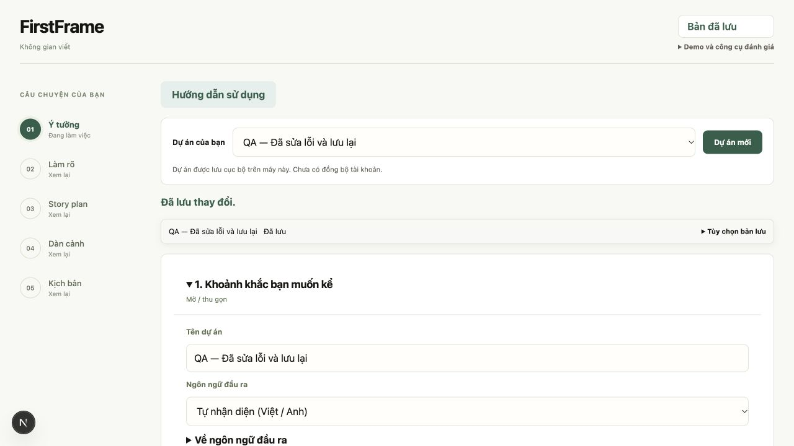
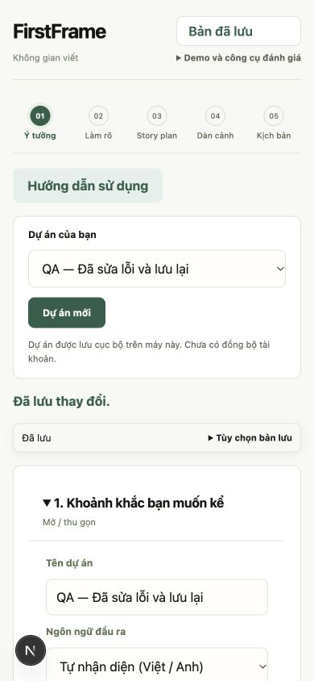
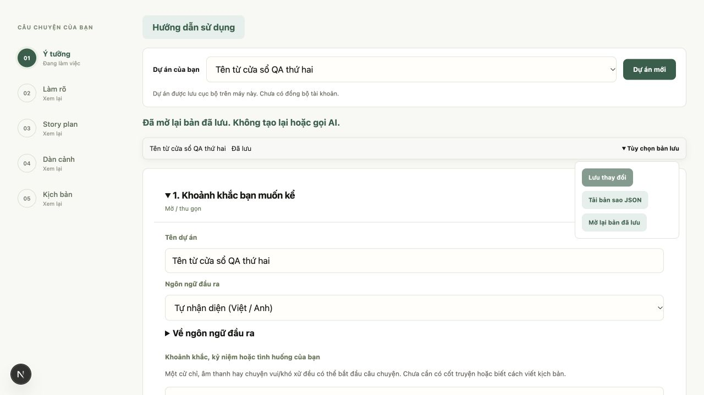

# Kiểm chứng giai đoạn 1 workflow FirstFrame

- Ngày: 29/10/2026.
- Phạm vi: SYS-01, SYS-02 và UI-01 trong [kế hoạch workflow](../plans/ai-first-workflow.md).
- Kết quả: đã triển khai và kiểm chứng kỹ thuật local. Giai đoạn 2–6 và nghiệm thu toàn luồng chưa thực hiện.

## Hành vi đã giao

### SYS-01 Nguồn tác giả và đề xuất AI

Backend giữ provenance riêng cho trường story plan, trường dàn cảnh và heading/text/speaker của screenplay. Client không được gửi các nhãn nguồn này trong payload chỉnh sửa. `origin` phân biệt `author_input`, `ai_proposal`, `legacy_unknown`; `author_confirmed` giữ riêng lựa chọn từng mục đã được tác giả xác nhận, để không đánh mất việc văn bản ban đầu do AI đề xuất.

Nhận một plan/cảnh AI không biến mọi nội dung thành ràng buộc tác giả. Chỉnh một trường chỉ cập nhật nguồn trường đó. Dùng một ý dàn cảnh xác nhận đúng mục được chọn. History, nguồn screenplay và bản chọn xuất giữ metadata của snapshot. Dữ liệu cũ thiếu metadata giữ nguồn chưa biết; feedback cũ vẫn đọc được. UI không dùng trường dàn cảnh chưa rõ nguồn làm bằng chứng đã xác thực về ý đồ tác giả.

Screenplay review dùng phiên bản nguồn `screenplay-review-v5-provenance`. Nguồn dàn cảnh AI/chưa rõ chỉ đi vào nhóm context; nguồn người dùng nhập hoặc từng lựa chọn đã xác nhận mới có vai trò author_choice. Metadata đầy đủ được lưu cùng nguồn, không lặp thêm vào mọi mục gửi model để tránh tăng ngữ cảnh không cần thiết. Không có thử nghiệm model thật hoặc kết luận mới về chất lượng critic.

### SYS-02 Autosave và lịch sử

UI tự lưu sau khoảng một giây dừng gõ, hoãn khi đang composition IME. Chỉ một lần lưu đang gửi; chữ gõ tiếp được giữ và gửi sau bằng revision server trả về. Đóng/mở ô, đổi cảnh và cập nhật trạng thái không thay buffer bằng phản hồi cũ. Card không bị remount theo từng revision autosave; khi nhận feedback mới, layout được tính lại theo đúng snapshot góp ý.

Mỗi phiên chỉnh sửa có ID; autosave nhiều lần cùng phiên dùng một mốc lịch sử trước khi sửa cho từng artifact. Revision/version vẫn tiến để chống ghi đè và giữ nguồn mới. Nhận phương án, khôi phục, review và chọn nguồn là các mốc đóng phiên; client cũ không gửi chế độ autosave tiếp tục hành vi checkpoint cũ. Đường nhận phương án được lưu ngay để các chỉnh sửa tiếp theo trở thành lần lưu riêng, không áp phương án lặp.

Mỗi lần lưu có save ID và fingerprint phân biệt cả trường bị bỏ qua với trường gửi null. Mất phản hồi chỉ được xác nhận bằng GET khi ID và revision của chính lần lưu khớp; dữ liệu mới hơn không được âm thầm rebase. Lỗi chưa rõ dừng autosave; thử lại cần thao tác rõ của người dùng. Lỗi validation 422 đã từ chối ghi được thử lại bằng nội dung người dùng vừa sửa, không replay payload sai. Xung đột giữ buffer và cho tải JSON trước khi mở lại. Phần chưa được server xác nhận vẫn có thể mất nếu đóng trình duyệt đột ngột.

### UI-01 Trạng thái và phục hồi

Thanh lưu hiển thị chờ tự lưu, đang lưu, đã lưu hoặc chưa lưu được. Tùy chọn bản lưu chứa lưu thủ công, tải bản sao và mở lại; mở lại khi còn buffer yêu cầu xác nhận bỏ phần chưa lưu. Lỗi lưu có hành động thử lại và thông báo giữ bản đang sửa. Hướng dẫn card/tour được chỉnh theo autosave; chọn nguồn screenplay chờ lưu xong rồi đọc/chọn đúng bản.

## Kiểm thử tự động

| Kiểm tra | Kết quả |
| --- | --- |
| Toàn bộ backend `backend/.venv/bin/python -m pytest backend/tests -q --tb=short` | 518 passed, 1 skipped, 1 failed đã có trước giai đoạn này |
| Bộ mới `backend/tests/test_phase1_autosave.py` | 8 ca qua; đã chạy lại sau điều chỉnh fingerprint |
| Frontend typecheck `tsc --noEmit` | Qua |
| 12 bộ frontend contract/unit trong `frontend/tests`, loại browser script và bản sao tên 2/3 | 12/12 qua, gồm `autosave.cjs` và compatibility của review cũ |
| Next.js production build trên bản sao frontend QA riêng | Qua; còn cảnh báo CSS `align-items: start` có sẵn trong savedLibrary/storyWorkspace |
| Kiểm tra whitespace diff | Qua |

Bộ mới kiểm tra session/history, replay save ID, 409, metadata giả, client cũ, Unicode/khoảng trắng, nguồn AI sau nhận, nguồn của phần tự chỉnh, xác nhận từng ý dàn cảnh và khôi phục plan giữ nguồn. Unit autosave kiểm tra request tuần tự, chữ mới trong lúc chờ, phục hồi phản hồi mất, retry rõ ràng, validation đã sửa, IME, nhận phương án và phản hồi của dự án cũ.

### Lỗi nền đã đối chiếu

`test_clarification_conversation.py::test_no_new_model_question_preserves_choices_and_streams_as_analysis` mong chỉ có sự kiện `reasoning` và `saving`; implementation đã phát thêm `reasoning_context` và `reasoning_validation`. Ca này cũng thất bại khi chạy riêng trên bản chụp mã ngay trước khi bắt đầu giai đoạn 1. Giữ nguyên test và implementation đó; đây là lệch hợp đồng tiến độ có sẵn, không phải kết quả autosave hoặc thay đổi luồng làm rõ trong giai đoạn 2.

## Kiểm tra trên trình duyệt QA

Dùng `backend/tests/ui_workspace_fixture.py`, SQLite và dataset tạm, provider giả; frontend QA riêng tại localhost:3034 kết nối API QA localhost:8034. Không mở DB tác phẩm của ứng dụng thật và không gọi provider văn bản/ảnh bên ngoài.

| Tình huống | Quan sát |
| --- | --- |
| Sửa tên dự án | Chuyển sang chờ tự lưu rồi đã lưu; option dự án cập nhật; focus ô nhập vẫn giữ |
| Giữ request lưu, gõ thêm rồi thả request | Phản hồi cũ không đè chữ mới; lần lưu kế tiếp giữ đúng nội dung cuối |
| Server lưu xong nhưng fixture trả phản hồi 503 | GET xác nhận đúng save ID; trạng thái về đã lưu, không tạo PUT lặp |
| Sửa logline trong card | Ô sửa vẫn mở và giữ focus; dấu tổ hợp, khoảng trắng đầu/cuối và hai newline được giữ |
| Một cửa sổ khác ghi trước | Lần lưu cũ nhận 409, buffer còn nguyên, hiện thử lưu lại/backup; không tự tăng revision để ghi đè |
| Tên trống gây 422, sửa tên rồi thử lại | Lưu đúng tên mới, không mắc vòng gửi lại tên trống |
| Desktop và mobile 390×844 | Toolbar dùng được; mobile có scrollWidth 390, không tràn ngang |
| Theo dõi provider trong fixture | 0 lượt model văn bản, viết thử, review và ảnh trong các thao tác kiểm tra autosave |

## Giới hạn còn lại

- IME đã kiểm tra tín hiệu composition ở unit controller; chưa thử bộ gõ thật trên thiết bị di động, Safari hoặc screen reader.
- Các browser script cũ giả định mọi thao tác gõ đều không tạo request lưu cần được cập nhật theo hợp đồng autosave trước khi dùng làm nghiệm thu toàn luồng; không coi chúng đã chạy qua trong đợt này.
- Chưa chạy model thật, pilot người dùng, deploy, commit hoặc PR. Trạng thái này không thay nghiệm thu chất lượng critic hay QA-01.

## Review và sửa tiếp ngày 29/10/2026

Phạm vi review: SYS-01, SYS-02, UI-01; giả định ứng dụng local một người dùng, có thể mở nhiều cửa sổ. Giữ nguyên branch và HEAD, không commit/push. Các thay đổi của đợt review nằm ở frontend và test; backend không sửa thêm.

| Mức | Vấn đề tái hiện được | Sửa đã áp dụng |
| --- | --- | --- |
| P1 | Replay save ID trả HTTP 200 nhưng project đã được cửa sổ khác sửa sau lần lưu đó; client có thể nhận nhầm phản hồi này và thay buffer | Kiểm tra cả save ID và revision của mọi acknowledgement, kể cả replay thành công; giữ buffer khi không khớp |
| P1 | Câu hỏi làm rõ đổi trên server nhưng số lượng/câu trả lời trống giống nhau; kiểm tra bản lưu có thể ghép câu trả lời local với câu hỏi mới | Đưa danh sách câu hỏi vào phép so sánh trước khi cập nhật baseline |
| P1 | Nhãn provenance trong review có thể khác snapshot bất biến, hoặc `author_confirmed` sai kiểu bị coi là true | Kiểm tra enum/boolean và map nguồn; đối chiếu nguồn hiển thị với đúng trường trong snapshot, giữ khả năng đọc review legacy |
| P2 | Payload tên trống gửi khi offline, sau đó sửa tên và retry: replay cũ nhận 422 khiến lần retry sau tiếp tục gửi tên trống | Dùng chung xử lý gửi/xác nhận; khi payload cũ bị từ chối 422, retry rõ ràng được tiếp tục với nội dung đã sửa |
| P2 | Bấm kiểm tra trong lúc autosave đang chạy: callback giữ `saved`/`dirty` của render cũ, có thể báo xung đột giả | Tập trung kiểm tra tại controller, chờ hàng đợi rồi lấy baseline mới; các nút kiểm tra dùng cùng đường này |
| P2 | Sau lỗi lưu, người dùng gõ về đúng baseline khiến `dirty=false`; cảnh báo rời trang/mở lại có thể biến mất dù kết quả ghi chưa rõ | Guard tính cả lỗi lưu chưa giải quyết; retry thành công đưa focus về trạng thái lưu |

Kiểm thử hồi quy đã bổ sung vào `frontend/tests/autosave.cjs` và `screenplay-review-contract.cjs`. Đã tái hiện lỗi retry và nhãn nguồn trên mã trước sửa. Kết quả sau sửa: **46/46 backend liên quan**, **12/12 bộ frontend**, typecheck và production build qua. Bộ backend toàn phần không chạy lại trong đợt review này; lỗi nền đã ghi ở trên vẫn chưa xử lý. Build dùng bản sao QA riêng, còn hai cảnh báo CSS có sẵn.

Trình duyệt QA dùng lại fixture/DB tạm: giữ request PUT, sửa tên, bấm kiểm tra kịch bản rồi thả request; giao diện về Đã lưu, không báo xung đột giả. Tên trống gây 422, sửa tên và thử lại lưu đúng, focus trở về `save-status`. Đã quan sát trạng thái lỗi 409, buffer giữ nguyên và công cụ tải bản sao/mở lại. Hộp xác nhận native khi mở lại không kiểm chứng trực tiếp được qua lần chạy CUA này; không tính nó là một ca browser đã qua. Không gọi model thật.

