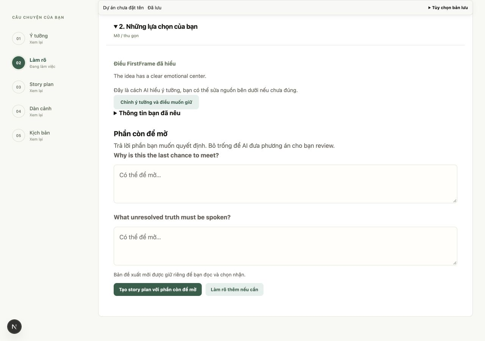
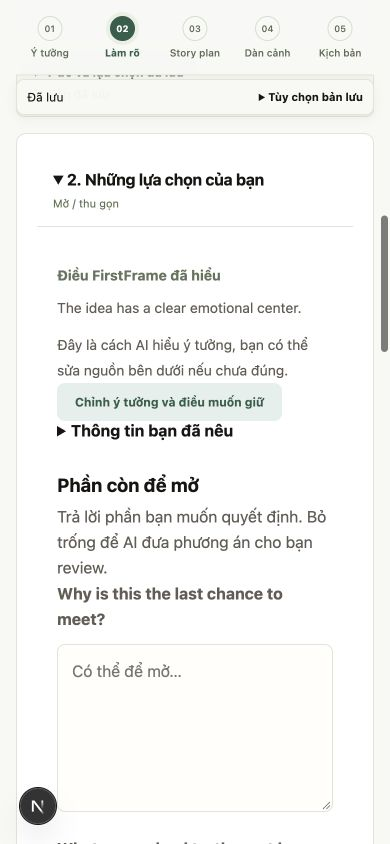

# Giai đoạn 2: làm rõ theo nhu cầu

Ngày 29/10/2026. Nhánh `feat/ai-first-workflow-phase2`, bắt đầu từ `dev` sau PR #70. Phạm vi SYS-03, UI-02, UI-03.

## Hành vi

- Bỏ năm câu hỏi cố định. Mentor ưu tiên 1–2 câu có tác động, tối đa 3; brief đủ rõ có thể trả 0 câu.
- Giữ index và câu trả lời cũ khi hỏi tiếp; cho phép hỏi tiếp hoặc tạo plan khi còn câu trống. Giới hạn tổng 20 câu vẫn giữ. Đổi brief lưu lịch sử rồi bỏ liên kết câu trả lời cũ.
- Planner nhận câu hỏi chưa trả lời cùng hướng dẫn giữ điều chưa quyết định. Không tự điền `answers` hoặc `constraints`; snapshot nguồn vẫn phân biệt câu trả lời với câu hỏi để mở.
- `analysis.ai_suggestions` mặc định rỗng, được truyền từ model tới UI và dataset correction. Gợi ý AI tách khỏi nguồn tác giả; schema cũ vẫn đọc được.
- Màn đầu ưu tiên ý tưởng và điều muốn giữ; tên/ngôn ngữ nằm trong phần tùy chọn. Bước làm rõ hiển thị điều AI hiểu, nguồn người dùng và đề xuất AI riêng. Chỉnh cách hiểu bằng nút quay về sửa brief, không biến tóm tắt AI thành ý đồ tác giả.
- Một CTA tạo story plan, không phải xem lại rồi đồng ý lần nữa. Không dùng nhãn tạo toàn bộ kịch bản trước khi giai đoạn 3 nối xong.
- Onboarding cập nhật copy và focus đúng CTA mới khi không có câu hỏi.

## Kiểm chứng

Kết quả cuối: **519 backend passed, 1 skipped; 13/13 bộ frontend qua; typecheck và production build qua**.

Backend: test toàn bộ; thêm ca brief đủ rõ không hỏi thêm, tạo plan với câu trống, không đưa gợi ý AI vào quyết định tác giả; cập nhật test follow-up/history/câu trả lời đã xóa. Frontend: 13 bộ unit/contract (thêm clarification), typecheck và production build. Bộ bằng chứng reference-isolation cũ tiếp tục khớp hash: chỉ thêm hướng dẫn planner khi có câu hỏi để mở.

Browser QA dùng fixture, SQLite tạm và model giả tại 3034/8034: tạo dự án → nhập brief → chuẩn bị → hai câu hỏi trống → tạo và lưu story plan bằng một lần bấm. Kiểm tra mobile 390×844: document width 390, không tràn ngang. Nội dung tiếng Anh trong ảnh là output fixture, không phải kết quả model thật hoặc đánh giá chất lượng tiếng Việt.

## Giới hạn

Chưa chạy model thật/pilot để đo chất lượng câu hỏi; prompt không bảo đảm model luôn hỏi đúng. Chưa thử bộ gõ thật, Safari hoặc screen reader. Các browser script theo cuộc hội thoại cũ chưa được coi là nghiệm thu tự động toàn luồng. Không triển khai bộ điều phối tạo kịch bản giai đoạn 3 hoặc PDF.
