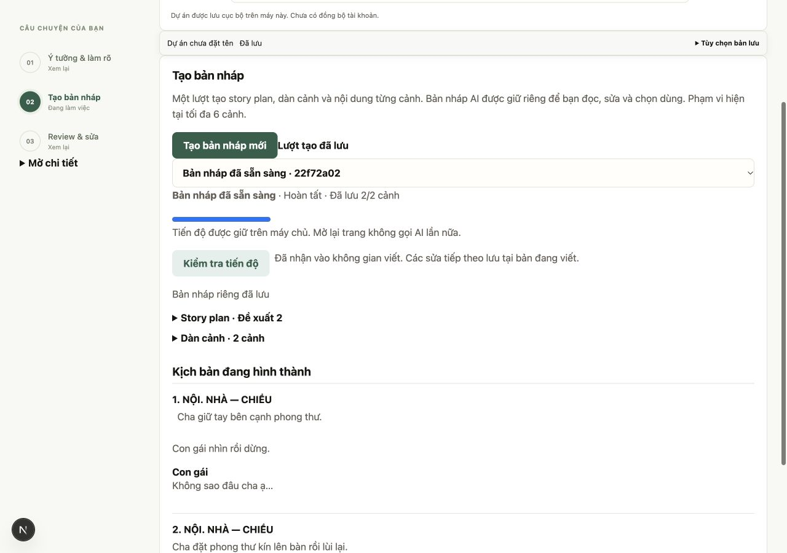
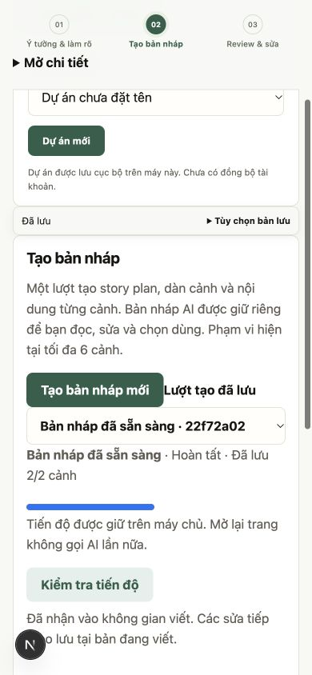

# Kiểm chứng giai đoạn 3 — tạo nháp xuyên bước

Ngày 29/10/2026. Task SYS-04, SYS-05, UI-04, UI-05, UI-09; nhánh `feat/ai-first-workflow-phase3` từ dev sau PR #71.

## Hành vi

- Lưu `draft_runs` cùng SQLite với dự án. Tạo run, khóa lượt đang hoạt động và idempotency nằm trong giao dịch; cùng ID khác revision bị từ chối. Giới hạn 100 run/dự án, 2 worker local, tối đa 6 cảnh tự động.
- Đọc ý tưởng nếu chưa có analysis; phần thiếu dừng ở `needs_input`. Câu trả lời autosave vào candidate riêng; bỏ trống vẫn tiếp tục. Một lần tiếp tục tạo plan → outline → nội dung mọi cảnh, không gọi từng cảnh từ UI.
- Ghi nguồn brief/vùng đích, cấu hình provider/prompt và kết quả từng lần gọi trước khi chuyển bước. Model result đã nhận được đọc lại từ store; request đã gửi mà chưa có kết quả giữ trạng thái gián đoạn và không tự retry. Restart chuyển run của process trước sang `interrupted`.
- Mỗi cảnh được lưu độc lập. Kiểm tra ngữ cảnh trước từng yêu cầu viết; vượt ngân sách hoặc quá 6 cảnh không bị cắt bỏ để báo hoàn tất. Các phần đã có vẫn đọc được.
- Plan được checkpoint trước critic, screenplay trước review. Critic lỗi được báo riêng; không giữ kín hoặc xóa bản nháp và không tự sửa để đạt điểm.
- Candidate có revision/save ID riêng, autosave tuần tự, giữ chữ mới và đối chiếu acknowledgement mất. `original` giữ snapshot trước sửa; nguồn từng trường tự chỉnh do server gán. Không nhận provenance từ client.
- Mọi lần nhận đều do tác giả chọn **Dùng bản nháp này**. Kiểm tra cả brief và outline/screenplay đích từ lúc khởi động, rồi lưu project/history và đánh dấu đã nhận trong cùng giao dịch. Hai tab, nhận lặp hoặc nguồn đổi không ghi đè bản tác giả.
- Hủy dừng bước chưa gửi; kết quả về muộn vẫn được checkpoint, không tự nhận. Candidate đã chỉnh không tự được AI viết tiếp theo nguồn cũ.
- UI có ba công đoạn chính, phần sâu cho plan/outline. Mobile cũng chỉ hiển thị một công đoạn; nhớ công đoạn theo dự án trong session. Poll giãn 1.5–8 giây, chỉ tải candidate khi checkpoint đổi. Vùng ảnh rỗng trên card cảnh được thu gọn.

## Kiểm thử

Kết quả cuối: **533 backend passed, 1 skipped; 14/14 bộ frontend qua; TypeScript và production build qua**. Build còn cảnh báo CSS `align-items: start` có sẵn. Repository chưa có GitHub Actions CI.

Các ca backend mới trong `test_draft_runs.py`: chuỗi đầy đủ/nguồn AI, idempotency, nhận atomic, xung đột brief/vùng đích, candidate riêng/original, save ID replay, cảnh giữa timeout, kết quả đã nhận qua restart (gồm crash sau response nhưng trước checkpoint), hủy khi đang viết, runner nền trả HTTP trước model, critic lỗi và fixture ngắn 2/6 cảnh. Candidate bị xóa nội dung cảnh không báo hoàn tất và không tự viết đè phần sửa.

Frontend bổ sung `candidate-autosave.cjs`: một request đang gửi, chữ mới khi chờ, mất acknowledgement, câu trả lời lưu riêng và giữ buffer khi xung đột. Typecheck, contract/unit và production build chạy trên nhánh này; kết quả cuối được ghi trong PR.

## QA trình duyệt

Dùng `ui_workspace_fixture.py`, SQLite/dataset tạm và provider giả, API 8034 + frontend 3034. Không mở DB ứng dụng thật, không gọi model ngoài máy.

1. Tạo dự án, nhập ý tưởng và khởi động bằng một nút.
2. Trả lời một câu, để mở câu kia. Autosave câu trả lời thành công; reload mở lại đúng run và câu trả lời.
3. Tiếp tục một lần, nhận nội dung 2/2 cảnh, plan, outline và góp ý.
4. Sửa văn bản candidate với khoảng trắng/newline, bấm nhận ngay: autosave hoàn tất rồi project chứa đúng chữ vừa sửa.
5. Desktop 1280px và mobile 390px: mobile `scrollWidth=390`, chỉ `draft-run` là công đoạn đang hiện.

## Giới hạn

Đã đo bằng fixture ngắn 2 và 6 cảnh; chưa đánh giá chất lượng/độ dài thực tế của model. Ngân sách byte của provider vẫn có thể chặn cảnh sau với brief hoặc nội dung dài; hệ thống báo phần đã giữ thay vì coi là xong. Một process local, chưa bảo đảm nhiều worker/host. Không tự retry request AI chưa rõ kết quả; muốn tạo lượt khác cần kết thúc lượt cũ. Chưa thử bộ gõ thiết bị thật, Safari/screen reader hoặc pilot. Browser script cũ giả định workflow năm bước cần cập nhật trước nghiệm thu toàn luồng. PDF và sửa theo đề xuất có kiểm soát vẫn thuộc các giai đoạn sau.

## Review cuối PR #72 — 29/10/2026

Đã tái hiện và sửa hai lỗi trước merge:

- Run `partial` đã nhận vẫn nằm trong khóa lượt đang hoạt động, chặn tạo bản tiếp theo. Cả preflight API và giao dịch SQLite hiện dùng chung kiểm tra trạng thái kèm `adopted_revision`.
- Nếu IME bắt đầu khi request autosave đang chờ, hàng đợi có thể gửi chữ đang ghép ngay sau acknowledgement. Vòng ghi hiện dừng khi composition còn hoạt động và tiếp tục sau compositionend.

Test hồi quy mới thất bại trước sửa và qua sau sửa. Kiểm tra toàn bộ sau sửa: **534 backend passed, 1 skipped; 14/14 bộ frontend, TypeScript và production build qua**. GitHub Actions/status checks chưa được cấu hình; kết quả này là local. Chưa thử bộ gõ thiết bị thật; các giới hạn bên trên giữ nguyên.
