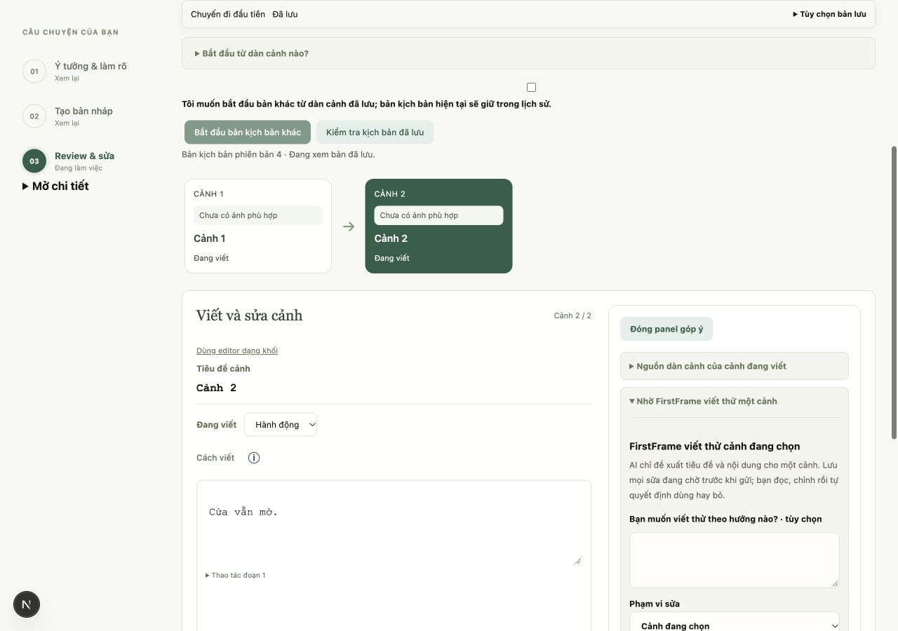
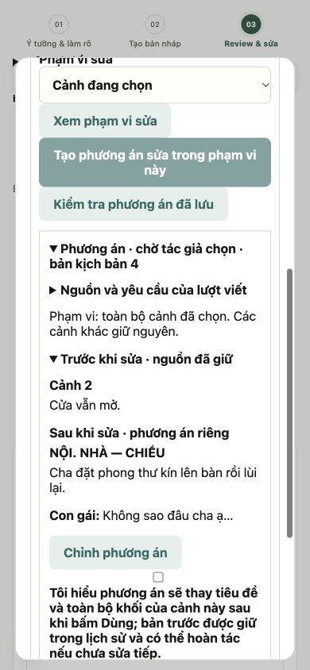

# Kiểm chứng giai đoạn 4 — review và sửa có kiểm soát

Ngày 29/10/2026. SYS-06, SYS-07, UI-06, UI-07, UI-08; nhánh `feat/ai-first-workflow-phase4` từ `dev` sau PR #72 (`8aa8f2b`).

## Hành vi và hợp đồng

- Một editor chính; bản server để đối chiếu và bản đọc toàn bộ mở khi cần. Góp ý/công cụ nằm cạnh editor trên desktop; màn hình ≤1000px dùng native dialog sheet, giữ focus và khóa thao tác khi đang lưu/gọi AI. Góp ý story-plan cũng dùng panel/sheet chung.
- Góp ý có bằng chứng hợp lệ nối thẳng sang phương án sửa các khối được trích dẫn, không bắt nhập prompt mới. Backend đối chiếu nguồn canonical, quote, cảnh đích và độ mới. Góp ý cũ vẫn đọc nguồn riêng; không tự được dùng như nguồn hiện tại.
- `POST /api/projects/{id}/screenplay-revision-target` trả scene/clarify/candidate, không gọi model. Số cảnh được ánh xạ sang ID; UI hiển thị phạm vi trước khi gửi, kể cả khi cảnh được nêu khác cảnh đang chọn.
- `POST .../screenplay-proposals` nhận `scope`, `block_ids`, cặp `review_id`/`note_id` tùy chọn. Sửa khối trả replacement theo ID cùng expected text/kind/speaker; kiểm tra chính xác tập ID, nguồn và nội dung. Không đổi tiêu đề, thứ tự, ID hoặc khối ngoài phạm vi. Những trường chưa viết bên ngoài phần sửa được giữ nguyên.
- Preview riêng có thể chỉnh trước khi nhận. `POST .../screenplay-proposals/{id}/apply` lưu đúng preview, checkpoint và nguồn, kiểm tra revision/nguồn; gọi lặp không áp lại. PUT lưu dự án cũ dùng cùng validator phạm vi, không thể lách qua preview để đổi phần khác.
- `POST .../{id}/undo` chỉ phục hồi cảnh nguồn của lần nhận khi cảnh đó chưa sửa tiếp, nguồn brief/outline còn khớp và không trùng ID khối ở cảnh khác. Giữ thay đổi của cảnh khác, provenance nguồn và lịch sử; gọi lặp không tạo phiên bản mới. Phương án cũ chưa có snapshot lần nhận dùng lịch sử khôi phục hiện có.
- Yêu cầu đổi cấu trúc được gửi `revision_instructions` vào draft-run hiện có. Run ghi yêu cầu và ID các cảnh có thể bị ảnh hưởng; tạo candidate riêng để đọc/sửa trước khi nhận, không ghi đè bản đang viết. Giữ các câu trả lời tác giả, phân tích lại với yêu cầu mới; nhận candidate dùng kiểm tra nguồn và giao dịch của giai đoạn 3.

## Kiểm thử

Kết quả cuối: **543 backend passed, 1 skipped; 14/14 bộ frontend qua; TypeScript và production build qua**. Test dùng provider giả và SQLite tạm. Build còn cảnh báo CSS `align-items: start` có sẵn; pytest có cảnh báo deprecation TestClient/httpx.

`backend/tests/test_screenplay_revisions.py` kiểm tra sửa đúng khối, preview giả ngoài phạm vi, apply/undo lặp, nguồn đã sửa, cảnh đích khác, yêu cầu cấu trúc, expected text giả, nối góp ý đã xác thực, candidate độc lập và nhận cùng ràng buộc, trường chưa viết, giữ sửa cảnh khác, ID nguồn bị dùng lại. Các kiểm thử hiện có tiếp tục kiểm tra xung đột nguồn/revision và lịch sử.

Frontend mở rộng contract proposal theo scope/applied snapshot, canonical nguồn review không phụ thuộc thứ tự khóa JSON, nhãn câu hỏi candidate có prefix riêng để không trùng form workspace ẩn. Hàng đợi autosave và các bộ contract hiện có chạy lại.

## QA trình duyệt

IAB/Chromium desktop 1280×900 và mobile 390×844, API 8034/frontend 3034, fixture `ui_workspace_fixture.py`, SQLite/dataset riêng. Không gọi model ngoài máy hoặc mở DB thật.

1. Từ góp ý cảnh 1, đi tới đúng khối: focus và highlight cùng block ID; editor chuyển dạng khối.
2. Yêu cầu sửa từ góp ý không nhập prompt; preview giữ thoại và các khối khác. Chỉnh khoảng trắng/newline rồi bấm Dùng ngay: flush giữ đúng chữ, tạo bản 3. Hoàn tác trả bản 4 với nội dung gốc và nguồn review còn hợp lệ.
3. Khi đang chọn cảnh 1, “Giảm thoại cảnh 2” hiện phạm vi cảnh 2, nút tạo theo cảnh đã nêu chọn đúng ID; nội dung cảnh 1 không đổi.
4. “Thêm cảnh ở cuối rồi đổi kết thúc” hiện 2 cảnh có thể bị ảnh hưởng, tạo candidate `needs_input` riêng; workspace giữ nguyên. Nhãn câu hỏi của candidate không trùng form ẩn.
5. Mobile sheet chỉ để nội dung dialog trong accessibility tree, đóng trả focus về nút mở; `scrollWidth=390`. Desktop editor không bị lồng vào cột đối chiếu cũ; bản lưu chỉ mở khi cần. Ảnh QA phát hiện lỗi lồng grid, đã sửa và đo lại editor 563px ở viewport 1280px khi mở panel, 947px khi đóng.

## Giới hạn

Resolver dùng số cảnh và nhóm từ khóa cấu trúc Việt/Anh, không suy luận tên nhân vật hay mọi cách diễn đạt tự nhiên; tác giả xem/chọn phạm vi trước khi gửi. Thay đổi cấu trúc tái tạo candidate toàn bộ tối đa 6 cảnh và vẫn chịu giới hạn ngữ cảnh của pipeline; chưa có sửa cấu trúc tự do trên nhiều cảnh đang viết.

Chưa thử model thật/chất lượng sáng tác, IME thiết bị thật, Safari hoặc screen reader. Repository chưa cấu hình GitHub Actions; kết quả kiểm tra là local. PDF, vật liệu kính hoàn thiện, cập nhật tour và nghiệm thu QA-01 thuộc giai đoạn sau.
