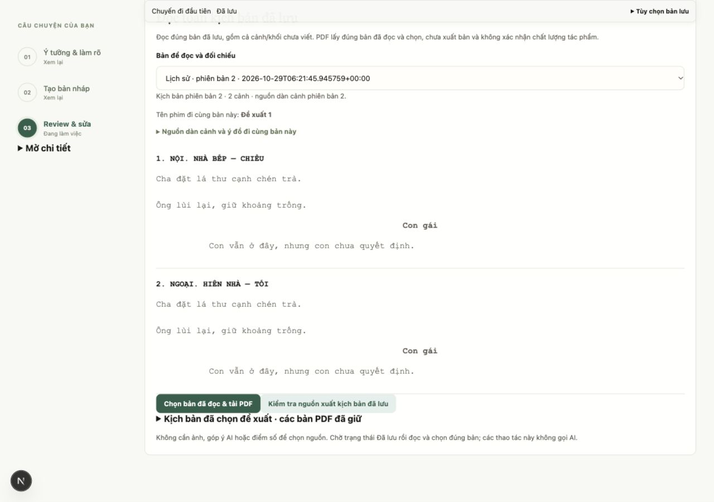
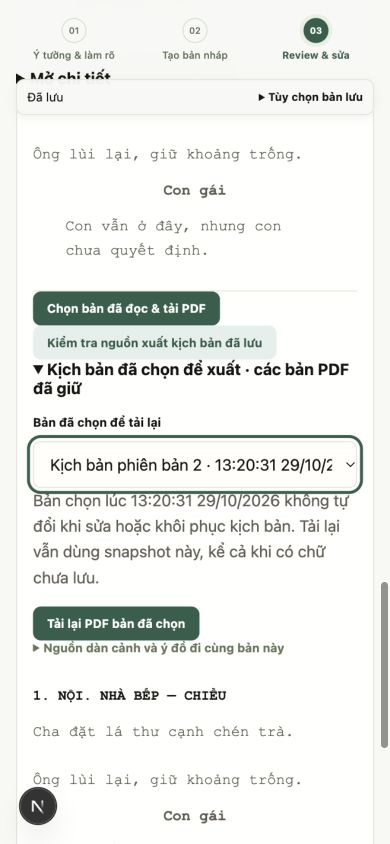
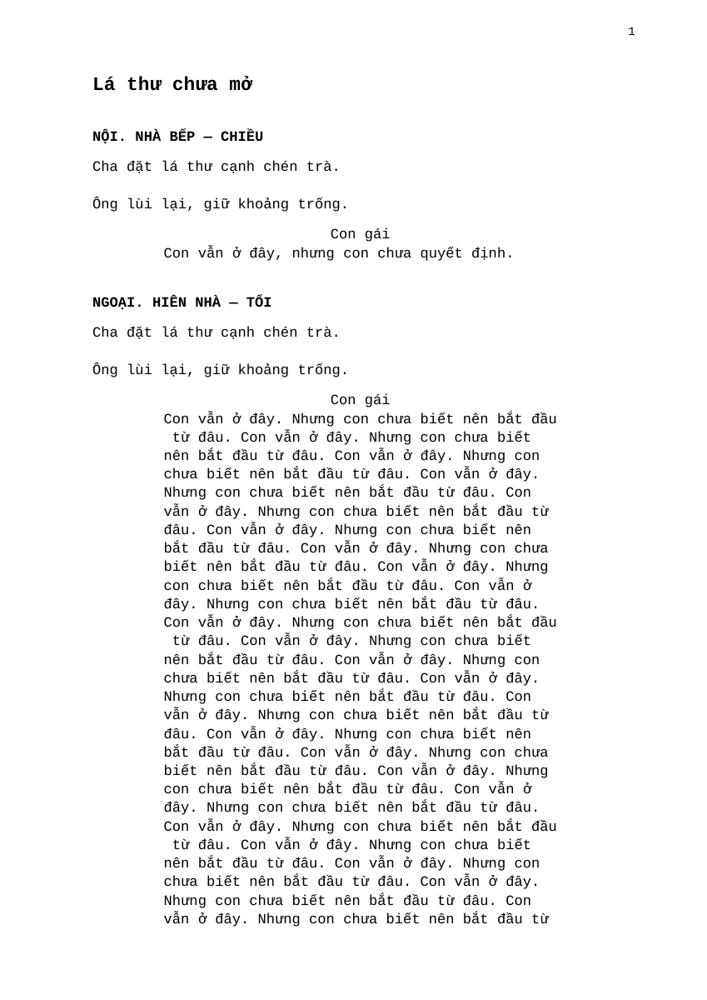
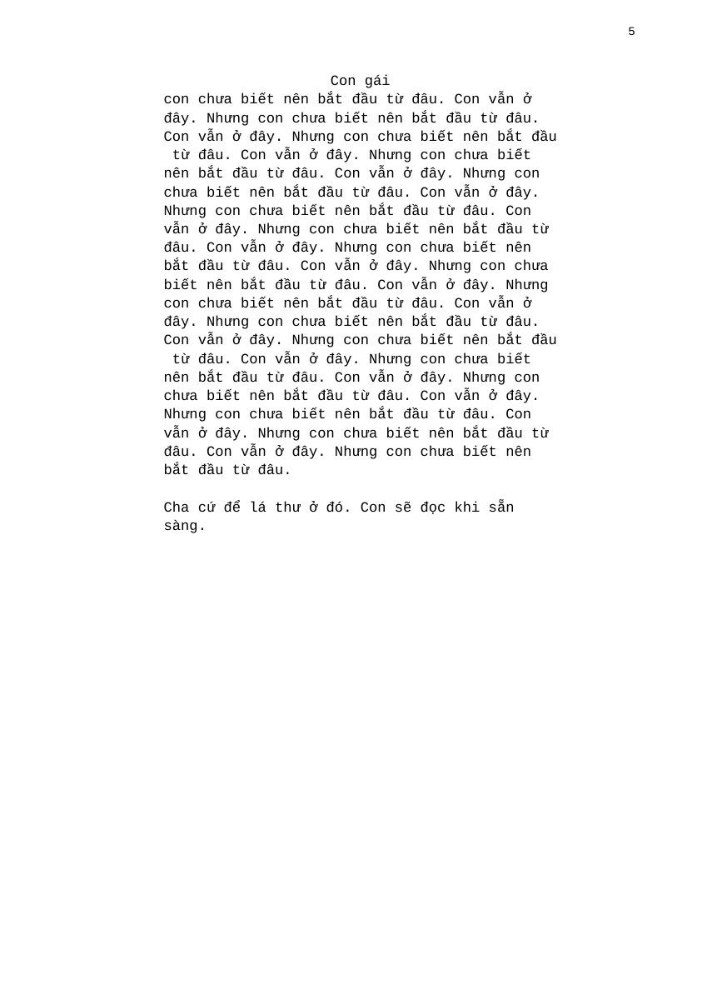
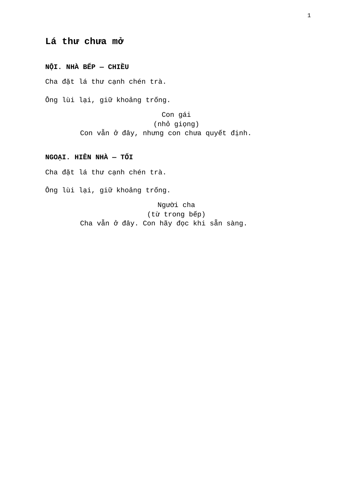

# Kiểm chứng giai đoạn 5 — xuất PDF bản kịch bản đã chọn

Ngày 29/10/2026. SYS-08 và UI-10; nhánh `feat/ai-first-workflow-phase5` từ `dev` sau PR #73 (`c649e1a`).

## Hành vi

- `GET /api/projects/{project_id}/screenplay-selections/{selection_id}/pdf` chỉ đọc selection bất biến trong đúng dự án. Không đọc tên dự án/plan hiện tại để trộn vào bản cũ, không gọi provider và không lưu revision/history. Selection không tồn tại hoặc thuộc dự án khác trả 404.
- ReportLab dựng A4 với tiêu đề phim từ `selection.screenplay.source_outline.source.draft.title`, tiêu đề cảnh, hành động, người nói, lời thoại theo đúng thứ tự và số trang. Không xuất ý tưởng, giới hạn riêng, góp ý, điểm hay model. Render invariant cho cùng snapshot/font cho cùng bytes trong phiên bản renderer này.
- Đóng gói Liberation Mono regular/bold 2.1.5, giấy phép OFL từ [upstream](https://raw.githubusercontent.com/liberationfonts/liberation-fonts/2.1.5/LICENSE), khai báo package data trong wheel. Font bao phủ toàn bộ chữ tiếng Việt. Dấu tổ hợp được compose NFC để đặt dấu khi vẽ; snapshot gốc không đổi. Giữ paragraph/newline và khoảng trắng trong phần nội dung, chỉ wrap theo khổ giấy. Text chứa `<`, `>` hoặc `&` được vẽ nguyên văn.
- Giữ tiêu đề cảnh cùng phần đầu nội dung; không chuyển cả đoạn thoại dài sang trang mới để bỏ trống trang trước. Khi phải chia một lời thoại, lặp lại đúng người nói trên trang tiếp. Không đổi người nói/ghép khối. Ký tự font không hỗ trợ trả 422, font thiếu trả 503; selection và bản đang viết vẫn giữ.
- UI có **Đọc & xuất PDF** và phần **Hoàn tất · đọc và xuất PDF kịch bản**. Tác giả chọn current/history để đọc. Nút chọn/tải flush rồi đối chiếu snapshot đã đọc với chính nguồn được chọn; nếu nguồn đổi trong khi flush thì chặn để đọc lại. Khi đang có chữ chưa lưu, UI chờ bản đã lưu trước khi chọn mới.
- Nhận selection thành công rồi lỗi tải không mất selection; mở phần các bản đã giữ để tải lại. Nếu chính bản đó đã được chọn, tải lại selection hiện có thay vì tạo bản chọn trùng. Có thể tải selection cũ khi current đã đổi hoặc đang có chữ chưa lưu. Không tự đổi history đã chọn thành current.
- HTTP trả attachment, no-store, filename ASCII an toàn và expose Content-Disposition cho client khác origin. Nguồn cũ không có tên hiện nhắc rõ, xuất tên tệp trung tính. Client kiểm tra MIME và magic PDF trước khi tạo download.

## Kiểm thử

**551 backend passed, 1 skipped; 15/15 bộ frontend qua; TypeScript và production build qua.** Backend có cảnh báo TestClient/httpx deprecation có sẵn. Repository chưa cấu hình CI tự động.

7 test PDF mới: offline/current/history/snapshot cũ sau sửa; bytes bất biến và font nhúng; thoại dài qua nhiều trang, dấu NFD và markup literal; tên phim rỗng; 404 khác dự án/lỗi font không ghi; ký tự thiếu không thay âm thầm; ý tưởng → candidate đã review → nhận → chọn → PDF; kiểm tra đủ chữ tiếng Việt trong regular/bold. Một test bao phủ đồng thời nhiều điều kiện nên có 7 hàm kiểm thử.

Frontend `screenplay-export.cjs` kiểm tra nguồn đã đọc đổi khi flush không được chọn âm thầm, giữ source history, route theo selection ID, filename, lỗi HTTP và payload giả PDF không tải. Các bộ autosave/contract/reader hiện có chạy lại. Wheel được dựng và kiểm tra chứa cả hai font cùng giấy phép.

## QA trực quan và trình duyệt

Dùng fixture `ui_workspace_fixture.py`, SQLite/dataset riêng, API 8034 và frontend 3034. Desktop 1280×900, mobile 390×844; không đụng DB thật hoặc model ngoài máy.

1. Đọc bản 2, chọn/tải PDF từ UI; file có tên phim nguồn, tiếng Việt và hai cảnh theo thứ tự. Request không phát sinh viết/review AI.
2. Sửa current thành bản 3, quay lại chọn history bản 2 và tải. Hai file tải có cùng SHA-256 `0eb7ccda488226a097d817c357b1e8f545b20bf049433d0f1407798bcff00251`; không lấy câu mới ở bản 3.
3. Mở phần bản đã chọn trên mobile; giữ snapshot bản 2, có nút tải lại, `scrollWidth=390`. UI giữ selector history qua thay đổi viewport.
4. Render [PDF QA 5 trang](assets/phase5-screenplay-pdf/vietnamese-dialogue.pdf) bằng Poppler, xem từng trang: dấu tiếng Việt, vị trí speaker, paragraph, số trang và phần đầu/cuối không bị cắt. Test trực quan đã phát hiện lỗi ngắt trang của đoạn đầu dài; sửa và render lại trước bàn giao.

## Giới hạn

Xuất văn bản A4 với font cố định; không cung cấp font/khổ giấy tùy ý, Final Draft/FDX, ảnh hoặc phụ lục góp ý. Emoji và chữ ngoài font có thể cần đổi trước khi chọn một snapshot mới; không âm thầm sửa snapshot đã chọn. PDF chưa gắn tag accessibility. Chưa thử Safari/mobile thiết bị thật hoặc máy in thật. Không đánh giá model/chất lượng sáng tác; QA-01 và hoàn thiện vật liệu/tour vẫn ở giai đoạn 6.

## Review cuối PR #74 — 29/10/2026

- Tái hiện font thiếu thực tế: ReportLab ném `TTFError`, không phải `OSError`, làm endpoint trả 500 thay vì 503. Đã xử lý đúng ngoại lệ font và giữ nguyên project/selection. Test mới dùng đường dẫn font không tồn tại, không chỉ mock lỗi renderer.
- Tên người nói có newline là dữ liệu hợp lệ nhưng renderer đưa cả newline vào một lệnh vẽ. Đã tách thành các dòng riêng và giữ chính văn; kiểm tra lại PDF tiếng Việt bằng Poppler, không có glyph lỗi.
- Hai test hồi quy thất bại trước sửa và qua sau sửa. Kết quả cuối: **553 backend passed, 1 skipped; 15/15 bộ frontend, TypeScript và production build qua**. Cảnh báo TestClient/httpx có sẵn giữ nguyên.
- GitHub không có workflow/check run hoặc review chặn merge. Đây là kiểm chứng local, không phải CI đã chạy thành công. Các giới hạn thiết bị thật và chất lượng model ở trên giữ nguyên.

