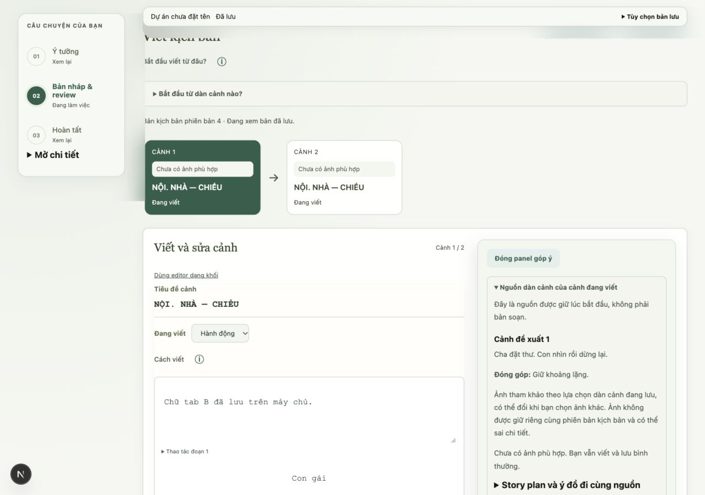
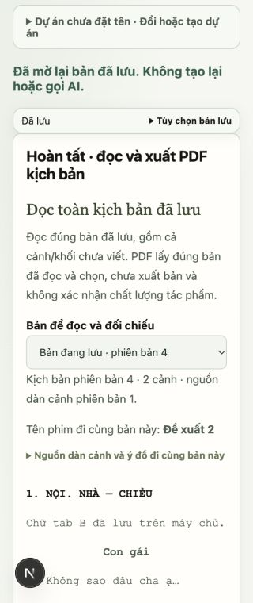
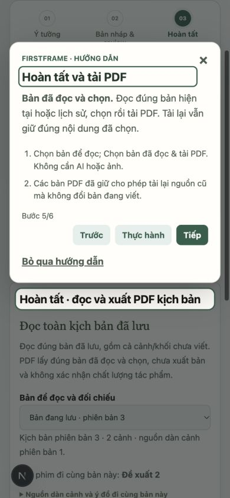
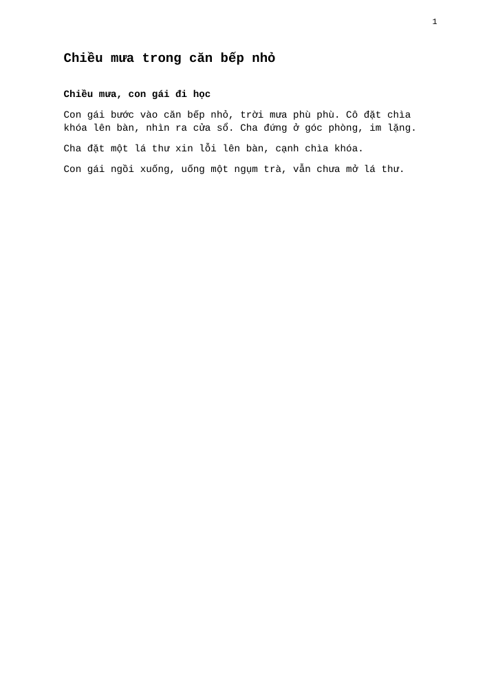
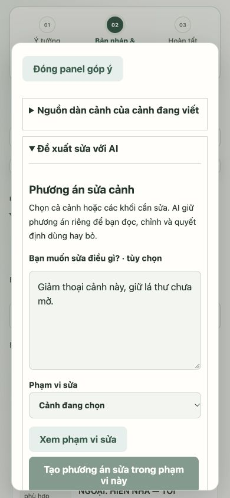

# Giai đoạn 6 — không gian viết, onboarding và QA-01

Ngày 29/10/2026. Nhánh `feat/ai-first-workflow-phase6` từ `dev` sau PR #74 (`789f825`). UI-11/UI-12 đã triển khai và kiểm chứng local. QA-01 đã được thực thi về kỹ thuật, nhưng **nghiệm thu phát hành: cần thêm bằng chứng**. Không coi số test hoặc JSON hợp lệ là xác nhận chất lượng sáng tác.

## Thay đổi

- Ba công đoạn **Ý tưởng → Bản nháp & review → Hoàn tất**, cùng hành vi desktop/mobile. Reader/PDF có stage riêng; editor vẫn mounted khi chuyển. Story plan/dàn cảnh và lượt tạo cũ ở Mở chi tiết; mở dự án cũ không tự gọi AI.
- Bề mặt viết đặc dễ đọc; nền dịu, công cụ/điều hướng kính mờ vừa đủ, panel review có nền riêng và bóng nhẹ. Nền đặc được khai báo trước `@supports`; có giảm chuyển động, giảm trong suốt và forced-colors. Mobile chỉ giữ thanh lưu sticky để không che lỗi lưu bằng điều hướng.
- Project picker, bắt đầu kịch bản khác và tiến trình đã hoàn tất được thu gọn. Lỗi và bước đang chạy vẫn mở. Nhãn candidate nêu rõ cảnh/khối; hiển thị ngày tạo thay ID kỹ thuật, không đổi ID nguồn thực.
- Tour v3 sáu bước: dự án → ý tưởng → tạo nháp → review → PDF → lưu. Giữ cùng storage key để đọc v2; ánh xạ bước cũ rồi kiểm tra artifact thực sự có. Dismissed/completed vẫn giữ, replay chỉ khi chọn. Đi tour không lưu dự án/gọi AI.
- Sửa lỗi panel của stage ẩn tự bật thành sheet khi resize; tour và review không còn hai modal chồng nhau. Đóng panel không đưa focus vào phần đã ẩn. Loại bỏ tracking cuộn cũ khỏi navigation một stage; sessionStorage lỗi không chặn điều hướng.

## Kết quả kiểm chứng

**553 backend passed, 1 skipped; 15/15 bộ frontend qua; TypeScript và production build qua.** TestClient/httpx còn cảnh báo deprecation có sẵn; build còn cảnh báo CSS `align-items: start` có sẵn. Repository chưa cấu hình CI tự động.

| Tiêu chí QA-01 | Kết quả và bằng chứng |
| --- | --- |
| Ý tưởng → candidate → review/sửa → PDF | **Pass kỹ thuật** qua browser với provider giả/DB riêng và test tích hợp backend. Một lần bắt đầu, một lần tiếp tục sau câu hỏi để tạo đủ 2/2 cảnh; không gọi AI từng cảnh từ UI |
| Giữ chữ và nguồn | **Pass**: chỉnh candidate có newline rồi nhận ngay; UI giữ nguyên chữ sau flush. Góp ý cũ không có liên kết vào nguồn mới; sửa từ quote chỉ thay một khối; cảnh khác giữ nguyên |
| Mất acknowledgement/reload | **Pass**: fixture cho PUT candidate đã lưu trả lỗi 503; hàng đợi đối chiếu lại. Reload giữ câu trả lời và run đang chọn, không gọi lại reasoning |
| Hai tab | **Pass**: giữ request A, cho B lưu trước, giải phóng A nhận 409. Buffer A còn nguyên; server giữ B. Có bản sao JSON tải được; mở lại server không gọi AI. Không suy ra rằng một lỗi lưu đã tự được giải quyết |
| Restart/hủy/response muộn | **Pass tự động**: chạy lại bộ draft-runs, autosave, candidate-autosave, selection/source tests hiện có. Không crash process trình duyệt thật trong đợt này |
| Dữ liệu cũ và tour v2 | **Pass kỹ thuật**: contract legacy + test chuyển choices/draft/outline sang bước thích hợp theo screenplay thực. Tour cũ đã bỏ qua/hoàn tất không tự bật lại |
| 320/390px và desktop 1280px | **Pass các view đã kiểm**: chỉ một stage visible, không tràn ngang; 320px trả scrollWidth=320. Resize ở Hoàn tất không mở review sheet ẩn |
| Bàn phím/focus/nhãn | **Pass cấu trúc và thao tác đã thử**: Tab vào tour, modal giữ focus, sáu bước đúng vùng; kết thúc trả focus `save-status`. Nhãn câu trả lời/candidate phân biệt; chưa phải nghiệm thu screen reader thật |
| Tương phản | **Pass ở các view đã đo**: export 86 mẫu chữ thường, min 4.79:1; review 309 mẫu, min 5.17:1; story-plan 110 mẫu, min 5.26:1. Đo từ computed colors và nền đặc gần nhất; không phải chứng nhận mọi trạng thái/theme |
| Motion/fallback | **Đã kiểm tra CSS**: reduced-motion/reduced-transparency/forced-colors và nền đặc. Chưa chạy browser không hỗ trợ backdrop-filter hoặc thay cài đặt OS |
| Model thật | **Có giới hạn được ghi nhận**, xem phần dưới; chưa pass vòng AI review đầy đủ |
| IME thiết bị, VoiceOver/NVDA, Safari/mobile thật, người đọc/pilot | **Chưa kiểm chứng**. Unit tests IME không thay cho bộ gõ/keyboard thật; cần các bằng chứng này trước chốt QA-01 phát hành |

## Thao tác browser và lỗi đã sửa

Fixture `backend/tests/ui_workspace_fixture.py`, API 8034/frontend 3034, SQLite và dataset tạm. Không mở DB ứng dụng thật.

1. Mở hướng dẫn, thực hành tạo dự án, nhập brief/điều muốn giữ rồi Tạo bản nháp.
2. Nhập một câu trả lời, để mở câu còn lại, mô phỏng mất acknowledgement. Reload xác nhận chữ và tiến độ còn nguyên.
3. Tiếp tục một lần, nhận 2/2 cảnh. Sửa action candidate rồi nhận ngay; bản đang viết có đúng whitespace/newline.
4. Mở góp ý: nguồn trước được đánh dấu cũ. Nhận góp ý mới rồi yêu cầu sửa từ quote, xem trước và dùng một khối. Chuyển Hoàn tất, đọc và tải PDF qua UI.
5. Resize desktop → 320/390px. Trước sửa, sheet của script ẩn mở đè Hoàn tất; sau sửa chỉ `workspace-export` hiện và không có dialog mở. Tour bước review cũng từng bị sheet che; sau sửa chỉ một `tour-layer` mở.
6. Đi sáu bước tour trên mobile, Tab/Escape/focus cơ bản. Tour hoàn tất không tự chạy lại; công cụ chi tiết/story plan cũ vẫn mở được.
7. Hai tab trên cùng project: A giữ request, B lưu, A bị 409 và vẫn có chính văn. Mở công cụ phục hồi và tải backup JSON, rồi mở lại server. Sửa sticky mobile để lỗi không bị nav che.

## Một ca model local có đo

[Bằng chứng đầy đủ](../evaluations/phase6-qwen7b-2026-10-29/README.md): `qwen2.5:7b` đã cài, temperature 0.3, num_ctx 16384, brief QA tổng hợp, không dùng OpenAI hoặc dữ liệu tác giả riêng. Không thử prompt/model nhiều vòng để đổi kết luận.

5 call, tổng thời gian model **97.617s**, active pipeline **98.025s** (không gồm thời gian chủ động dừng ở câu hỏi). Reasoning 12.862s; plan+critic 54.182s; outline 13.352s; viết 17.221s. Một cảnh trong giới hạn tối đa hai, giữ lá thư chưa mở; không bắt thêm thoại. Có câu hỏi thừa về việc mở thư và cách diễn đạt vụng vẫn được giữ để đánh giá, không coi JSON hợp lệ là chất lượng tốt.

Run `ready` kèm `review_error`: ngữ cảnh vượt ngân sách trước khi gửi screenplay review. Text vẫn checkpoint; nhận, chọn và PDF đều HTTP 200. Đây **không phải** một lượt hoàn tất AI review; cần xử lý/đánh giá giới hạn ngữ cảnh trước khi coi cấu hình này đủ cho đường review tự động. Không rút ngữ cảnh âm thầm hoặc tăng ngưỡng để làm báo cáo pass. Actual timeout và output từng call nằm trong evidence, gồm timeout reasoning thực là 90s dù ngưỡng latency mong muốn là 45s; thời gian quan sát vẫn 12.862s.

PDF model được render bằng Poppler và kiểm tra trực quan một trang: tiếng Việt, action theo thứ tự, kết mở và số trang đúng.

## Điều kiện còn lại trước phát hành

UI-11/UI-12 đủ để review/merge kỹ thuật. QA-01 chưa được đánh dấu hoàn tất phát hành: cần kiểm chứng thiết bị/IME/screen reader/Safari, người đọc và pilot theo tiêu chí đã chốt; cần kết luận rõ về context guard ở vòng screenplay review trên cấu hình model mục tiêu. Giữ các giới hạn và lỗi trong báo cáo. Mở dự án không tự tạo nháp hoặc tự sửa tác phẩm; người dùng chủ động chọn từng lần dùng/sửa/xuất.

## Review cuối PR #75 — 29/10/2026

Đã tái hiện một lỗi giữ input trên mobile: nhập yêu cầu sửa chưa gửi, đóng rồi mở lại review sheet làm field trở về rỗng vì children bị unmount. Bản sửa giữ dialog/children mounted khi đóng; native dialog đóng vẫn không hiện, không tương tác hoặc nhận focus.

Browser regression với fixture SQLite riêng, 390px: trước sửa yêu cầu bị xóa; sau sửa chuỗi “Giảm thoại cảnh này, giữ lá thư chưa mở.” còn nguyên sau đóng/mở. Khi đóng, dialog có open=false, không có client rect và focus về Dàn cảnh & góp ý. Chuyển Hoàn tất và resize 320px xác nhận chỉ workspace-export hiện, không có dialog mở, scrollWidth=320. Không gửi yêu cầu AI khi kiểm tra này.

Đã chạy lại **553 backend passed, 1 skipped; 15/15 bộ frontend, TypeScript và production build qua**. GitHub không có Actions/check/status test thực thi; trạng thái legacy pending với total_count=0 không phải CI đang chạy. Các điều kiện QA-01 về thiết bị/người đọc thật và giới hạn context của model vẫn chưa được chốt, không thay đổi vì merge kỹ thuật vào dev.

## QA-01 tiếp nối — context review

[Báo cáo context và tám ca Qwen](../evaluations/qa01-review-context-qwen7b-final-2026-10-29/README.md): request của candidate đã giảm từ 12.430 xuống 11.450 byte, không bỏ nguồn và không nới guard; đã đặt trần đầu ra Ollama đúng phần ngân sách dành sẵn. Tám ca đều gửi được, không cắt đầu ra và không đổi kịch bản. Backend 559 passed, 1 skipped.

**Chưa nghiệm thu model:** sáu ca bị từ chối do bằng chứng không hợp lệ; hai ca qua validator nhưng một ca cáo buộc sai với hành động được phép. Vì vậy phần chặn context đã giải quyết cho bộ ca này, còn độ tin cậy góp ý và xác nhận người đọc/thiết bị thật vẫn chặn QA-01 phát hành. Không suy ra chất lượng từ số test hay JSON/quote hợp lệ.
