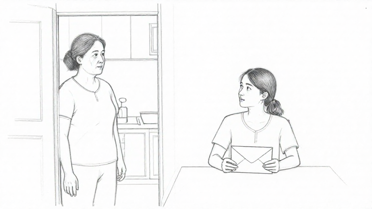

# MFLUX — tuổi mẹ và hướng nhìn của con

- Ngày: 27/10/2026; nhánh hiện có `feat/scene-staging-handoff`.
- Ngân sách được duyệt: tối đa **2 lượt, 180 giây/lượt**, đóng băng trước chạy, lưu mọi lỗi, không retry.
- Chỉ thử offline trên DB tổng hợp riêng. **Runtime, các bảo vệ dữ liệu, plan, prototype, cấu hình và model văn bản giữ nguyên; chưa commit/PR.**

## Đóng băng trước khi chạy

Dùng nguyên byte input từ [bộ nét chì/phong bì kín](scene-sketch-pencil-sealed-prompt.md): cùng một cảnh tiếng Anh, story plan/ý đồ/ràng buộc, scene ID và yêu cầu phác. Giữ MFLUX 0.23.0, MLX 0.32.4, Z-Image-Turbo 4-bit snapshot `b3a8f31115a11f2f9e2fa0bfbc8d78dcc3e6568b`, 768×432, 9 bước, seed 42, low-RAM, cache limit 2 GB, timeout 180 giây. Không thêm LoRA, đổi model/seed hoặc dùng API trả phí.

**Chỉ thay đoạn mô tả nhân vật.** Giữ nguyên từng chữ các đoạn nét chì, phong bì kín, khoảng lặng và giới hạn đầu ra. Mẹ được mô tả là người trung niên khoảng 55, rõ một thế hệ lớn hơn con, vài nét chì ở đuôi mắt/khóe miệng, mí mắt trưởng thành và vài sợi tóc bạc; không biến thành người già yếu. Con vẫn ngồi bàn phải nhưng quay đầu trái theo góc ba phần tư, hơi nâng cằm, mở mắt nhìn lên phía mặt mẹ, tay tiếp tục giữ phong bì kín.

Tám tiêu chí cũ giữ nguyên; **thêm trước chạy** hai mục đối chiếu tuổi tương đối của mẹ và hướng đầu/ánh nhìn của con. Tuổi xấp xỉ là cách đọc hình vẽ, không phải bằng chứng một người có đúng số tuổi. Không sửa kết quả chấm hoặc dữ liệu cũ.

[Prompt](../evaluations/scene-sketch-mflux-age-gaze-2026-10-27/prompt.txt), [manifest](../evaluations/scene-sketch-mflux-age-gaze-2026-10-27/manifest.json), [input](../evaluations/scene-sketch-mflux-age-gaze-2026-10-27/inputs.json), [tiêu chí](../evaluations/scene-sketch-mflux-age-gaze-2026-10-27/criteria.json) và runner được lưu trước suy luận. Đã kiểm tra syntax/guard, byte input, model/tham số, chỉ đúng đoạn nhân vật thay đổi; hash runtime/source/prompt/tiêu chí/baseline được kiểm tra trước từng lượt và sau chạy.

Runner chỉ thay hàm tạo prompt trong tiến trình thử riêng, sau khi kiểm tra scene/context/instructions đúng snapshot. API/provider/PNG/source/revision/lưu ảnh dùng code hiện có. DB nằm tại `backend/.data/scene-sketch-age-gaze-trial-2026-10-27/`, bị Git bỏ qua, không đụng dự án tác giả.

## Kết quả kỹ thuật

| Lượt | Baseline nét chì/phong bì kín | Prompt thêm tuổi/hướng nhìn | Kết quả mới |
| --- | --- | --- | --- |
| 1 | 28,833 giây | **29,295 giây** | 200 ready, PNG 768×432; giữ/mở lại đúng ảnh |
| 2 | 31,356 giây | **32,915 giây** | 200 ready; preview không thay ảnh thứ nhất; bỏ preview/mở lại giữ ảnh cũ |

Đúng 2 lượt, **0 lỗi model/provider, 0 retry**, đều dưới ngân sách. Hai ảnh mới cùng SHA-256, nên đây là một kết quả thị giác được lặp lại với cùng seed, không phải hai ca nội dung độc lập. Không dùng các thời gian này làm SLA hoặc kết luận hiệu năng tổng quát.

## So sánh bằng mắt

Nhận xét của Codex chỉ để đối chiếu hình, không phải điểm AI hoặc nghiệm thu PO/người dùng.

| Điểm cần kiểm chứng | Baseline | Prompt mới |
| --- | --- | --- |
| Tuổi mẹ tương đối | Trông trẻ, chưa rõ khoảng 55 | **Rõ hơn:** có nét mặt trưởng thành, đọc được chênh lệch thế hệ với con; không khẳng định chính xác tuổi |
| Hướng nhìn của con | Cúi/nhìn xuống phong bì | **Đúng hơn:** đầu quay trái, cằm hơi nâng, mắt hướng về mẹ |
| Nét chì thay vì ảnh chụp | Có nét vẽ | **Giữ được:** đường viền/hatch/nền giấy trắng, không trở lại ảnh chụp |
| Phong bì kín | Hình chữ nhật/nắp nằm phẳng | **Giữ được:** toàn phong bì nhìn rõ, nắp tam giác phẳng, không thấy giấy lộ hoặc nắp dựng |
| Vị trí/số người | Mẹ đứng trái, con ngồi phải, hai người | Giữ được |
| Chữ/chia khung/sự kiện mới/chốt kết | Không thấy thêm | Không thấy thêm; ảnh tĩnh không chứng minh toàn bộ diễn tiến |

[Ảnh baseline](../evaluations/scene-sketch-mflux-pencil-sealed-2026-10-27/results/image-1.png), [ảnh mới lượt 2](../evaluations/scene-sketch-mflux-age-gaze-2026-10-27/results/image-2.png), [đối chiếu đủ mười mục đã chốt](../evaluations/scene-sketch-mflux-age-gaze-2026-10-27/comparison.json), [toàn bộ output/metadata/lỗi](../evaluations/scene-sketch-mflux-age-gaze-2026-10-27/results.json), [audit/hash](../evaluations/scene-sketch-mflux-age-gaze-2026-10-27/audit.json).

## Kết luận và điểm dừng

Trên cảnh này, prompt mới cải thiện tuổi tương đối và hướng nhìn, đồng thời giữ được nét vẽ và phong bì trông kín. Đây là kết quả phù hợp hơn để tác giả trực tiếp đối chiếu; không tự suy thành khả năng đúng ý đồ cho mọi cảnh hoặc nghiệm thu Gói 4/M2.

Prompt vẫn được viết thủ công cho một cảnh tổng hợp tiếng Anh. Chưa kiểm chứng bộ chuyển cảnh bất kỳ thành prompt, tiếng Việt, nhiều cảnh hoặc nhất quán nhân vật. Không chạy thêm model hoặc sửa prompt sau khi xem kết quả; không áp dụng vào runtime. Không rerun test/build ứng dụng vì không thay code sản phẩm; kiểm tra đóng băng, nguồn, lifecycle API, hash và bảo toàn plan/prototype/config đã đạt. Baseline và các lỗi cũ giữ nguyên; chưa tạo PR.
