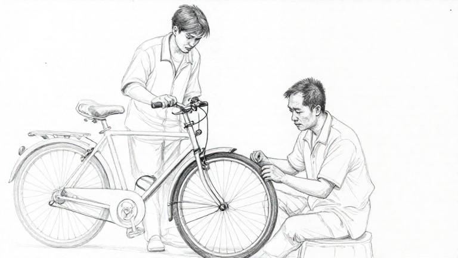
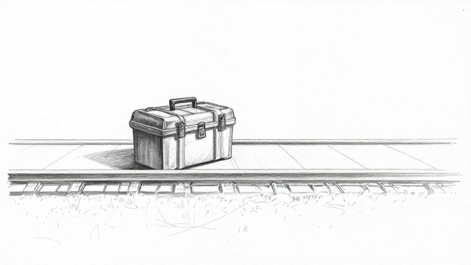

# MFLUX — bỏ câu dẫn và dấu trích trên cùng hai cảnh

- Ngày: 27/10/2026; nhánh `feat/scene-staging-handoff`.
- Phạm vi được duyệt: cùng hai cảnh đã lưu, tối đa **2 lượt, 180 giây/lượt**, đóng băng trước chạy, lưu mọi lỗi, không retry.
- Chỉ thử offline. **Không sửa runtime, plan/roadmap/prototype, cấu hình, model ảnh/văn bản; chưa commit/PR.**

## Bộ thử và thay đổi duy nhất về nội dung prompt

Giữ nguyên snapshot project/scene/context và request của [baseline runtime hai cảnh](scene-sketch-runtime-two-scenes.md): sửa xe với An 68 tuổi ngồi phải/Bình 19 tuổi đứng trái, và hộp dụng cụ khóa trên sân ga không người. Không bổ sung tuổi, góc máy, đạo cụ, hành động hoặc ràng buộc mới.

Bỏ các câu dẫn kiểu “Show the visible action described here”, “Preserve this author constraint”, đoạn giải thích “Quoted passages…” và dấu trích bao quanh giá trị. Nối trực tiếp nội dung các trường đang có thành mô tả, thêm dấu kết câu nếu cần; không xóa các giá trị nguồn/giới hạn hoặc tự tóm tắt. Ví dụ cảnh sửa xe vẫn có nguyên các chuỗi “An, 68…”, “An sits right; Bình stands left…” và “Exactly two people”.

Đoạn phong cách nét chì đầu prompt giữ nguyên byte so với baseline. Đoạn cuối chỉ giữ giới hạn không thêm sự kiện/chốt kết và yêu cầu nét chì/không chữ; các câu dẫn/meta chỉ cách đọc nguồn được bỏ. Vì thế đây là phép so sánh **toàn biến thể mô tả trực tiếp**, không chứng minh riêng dấu ngoặc kép là nguyên nhân duy nhất.

Giữ MFLUX 0.23.0, MLX 0.32.4, Z-Image-Turbo 4-bit snapshot `b3a8f31115a11f2f9e2fa0bfbc8d78dcc3e6568b`, 768×432, 9 bước, seed 42, low-RAM, cache limit 2 GB và timeout 180 giây. Không LoRA, tải weights hoặc API trả phí.

Trước suy luận đã đóng băng [manifest](../evaluations/scene-sketch-direct-two-scenes-2026-10-27/manifest.json), [input](../evaluations/scene-sketch-direct-two-scenes-2026-10-27/inputs.json), [tiêu chí](../evaluations/scene-sketch-direct-two-scenes-2026-10-27/criteria.json), [prompt sửa xe](../evaluations/scene-sketch-direct-two-scenes-2026-10-27/repair-workshop.prompt.txt), [prompt sân ga](../evaluations/scene-sketch-direct-two-scenes-2026-10-27/empty-platform.prompt.txt) và runner. Các mảng tiêu chí/nhãn giữ nguyên baseline; chỉ cập nhật mô tả phép so sánh trước chạy.

Trong tiến trình thử riêng, runner trả đúng prompt trực tiếp đã đóng băng sau khi kiểm tra scene/context/instructions; không sửa tệp runtime. API/PNG/storage/revision/source guard giữ nguyên. Record giữ version runtime nền `scene-sketch-visual-v2` và thêm nhãn thí nghiệm `direct-unquoted-v1` để phân biệt; **không coi runtime đã chuyển sang biến thể này**. DB thử riêng tại `backend/.data/scene-sketch-direct-two-scenes-2026-10-27/`, không đụng dữ liệu tác giả.

## Kết quả kỹ thuật

| Cảnh | Baseline có câu dẫn/trích dẫn | Mô tả trực tiếp | Kết quả mới |
| --- | --- | --- | --- |
| Sửa xe | 29,141 giây | **24,160 giây** | 200 ready; PNG 768×432 |
| Sân ga không người | 28,614 giây | **25,472 giây** | 200 ready; PNG 768×432 |

Đúng **2 lượt, 0 lỗi provider/runner, 0 retry**. Mỗi cảnh một lượt, không chọn seed/ảnh khác sau kết quả. Thời gian đều dưới 180 giây; không coi hai số đo là SLA hoặc benchmark tổng quát.

Đạt các kiểm tra: snapshot/story plan giữ nguyên, prompt đã lưu đúng prompt thử, đúng version nền, không tự chọn giữ ảnh, mở lại dữ liệu giống nhau. Hash prompt/runtime/plan/prototype/config, PNG/results và baseline giữ nguyên. Không rerun test/build ứng dụng vì không đổi code sản phẩm.

## So sánh bằng mắt với baseline

Nhận xét của Codex để đối chiếu, không phải điểm AI hoặc nghiệm thu PO/người dùng. `Chưa rõ` không được tính thành giữ đúng ràng buộc.

| Điểm đối chiếu | Baseline | Mô tả trực tiếp |
| --- | --- | --- |
| Nét chì | Có | Giữ được trên cả hai ảnh |
| Chữ/chú thích | Cả hai thêm chữ chép từ nguồn | **Không thấy chữ trên cả hai ảnh mới** |
| Sửa xe — số người/xe | Đúng hai người/một xe | Giữ được |
| Sửa xe — đứng trái/ngồi phải | Người trái ngồi trên xe, người phải ngồi xổm | **Đúng hơn:** người trẻ đứng trái, người lớn tuổi ngồi ghế phải |
| Sửa xe — tuổi | Cả hai trông trẻ | Chênh lệch tuổi rõ hơn; không khẳng định chính xác 68/19 |
| Sửa xe — hành động/ánh nhìn | Sửa dây phanh chưa rõ | Động tác làm việc ở bánh/phanh rõ hơn, người trẻ nhìn xuống; chi tiết dây phanh vẫn chưa rõ |
| Sửa xe — close two-shot/bình minh | Chưa đạt cỡ cảnh, chưa rõ bình minh | Vẫn gần toàn xe và nhiều phần cơ thể, chưa giống close two-shot; bình minh vẫn chưa rõ |
| Sân ga — người/hộp đóng | Không người, hộp đóng | Giữ được, không lộ đồ |
| Sân ga — vị trí | Hộp trông như trên đường ray | Mặt phẳng và mép gần ray rõ hơn, nhưng vẫn có thể đọc là ván/tà vẹt cạnh ray; **chưa chắc là sân ga** |
| Sân ga — đang khóa | Chưa rõ | Có chốt/chi tiết giữa rõ hơn, nhưng **chưa thấy khóa đã cài đủ chắc** |
| Lẫn ca mẹ–con hoặc mở/chốt thêm diễn tiến | Không thấy | Không thấy |

[Baseline sửa xe](../evaluations/scene-sketch-runtime-mflux-two-scenes-2026-10-27/results/repair-workshop.png), [baseline sân ga](../evaluations/scene-sketch-runtime-mflux-two-scenes-2026-10-27/results/empty-platform.png), [đối chiếu đủ tiêu chí](../evaluations/scene-sketch-direct-two-scenes-2026-10-27/comparison.json), [mọi output/metadata/lỗi](../evaluations/scene-sketch-direct-two-scenes-2026-10-27/results.json), [audit/hash](../evaluations/scene-sketch-direct-two-scenes-2026-10-27/audit.json).

## Kết luận và điểm dừng

Hai cặp ảnh cùng cảnh/model/seed cho thấy biến thể mô tả trực tiếp loại được chữ ở hai trường hợp này và cải thiện bố trí cảnh sửa xe. Kết quả ủng hộ tiếp tục dùng mô tả trực tiếp để xem xét, nhưng **không chứng minh formatter đã giữ được mọi ràng buộc**: cỡ cảnh, bình minh, chi tiết dây phanh, vị trí sân ga và dấu hiệu khóa vẫn còn thiếu/chưa rõ.

Đây chỉ là hai cảnh tổng hợp tiếng Anh, một lượt mỗi biến thể/cảnh. Chưa kiểm chứng tiếng Việt, nhiều seed, cảnh khác hoặc bộ chuyển runtime tổng quát. Không thay dữ liệu, tiêu chí hay prompt sau output để gọi đạt; baseline và mọi lỗi cũ giữ nguyên.

Đã dùng hết ngân sách đợt này; chưa áp dụng biến thể vào runtime, chưa tạo PR và chưa nghiệm thu Gói 4/M2 đầy đủ. Đường text/giữ quyền chọn ảnh của tác giả vẫn độc lập.
