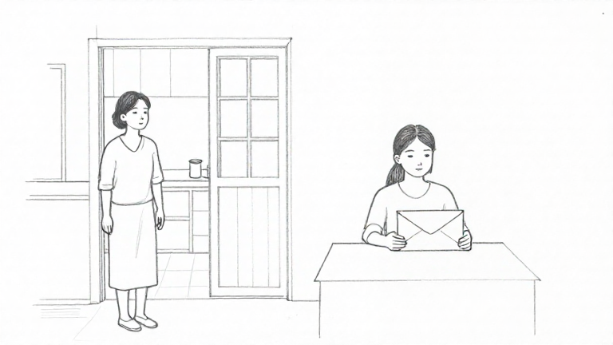

# MFLUX — siết nét vẽ chì và phong thư còn kín

- Ngày: 27/10/2026; nhánh hiện có `feat/scene-staging-handoff`.
- Phạm vi được duyệt: cùng cảnh đã lưu, tối đa **2 lượt, 180 giây/lượt**, đóng băng trước chạy, lưu toàn bộ kết quả/lỗi, không retry. **Chỉ thử offline; runtime, plan, prototype và cấu hình giữ nguyên, chưa commit/PR.**

## Bộ thử đã đóng băng

Giữ nguyên byte input của [lượt prompt thị giác trước](scene-sketch-visual-prompt.md): một cảnh tổng hợp tiếng Anh, mẹ khoảng 55 đứng bên cửa trái, con gái khoảng 25 ngồi bên bàn phải, cầm phong thư kín chưa mở bằng hai tay; hai người nhìn về nhau và chờ, không khép kết thúc. Cùng story plan/ý đồ/ràng buộc/scene ID/yêu cầu phác.

Giữ nguyên MFLUX 0.23.0, MLX 0.32.4, Z-Image-Turbo 4-bit snapshot `b3a8f31115a11f2f9e2fa0bfbc8d78dcc3e6568b`, 768×432, 9 bước, seed 42, low-RAM, MLX cache limit 2 GB và timeout 180 giây. Không LoRA, đổi model, tải weights hay API trả phí.

Prompt mới nhấn mạnh hình dựng từ nét viền graphite mảnh/hơi bất quy tắc, ít hatch, mặt người giản lược, nhiều giấy trắng; tránh texture da/vải, chuyển sắc hoặc bóng tối kiểu ảnh chụp. Phong bì được mô tả rõ thành một hình chữ nhật phẳng nguyên vẹn, nắp tam giác nằm phẳng trên mặt sau, chỉ thấy đường ráp nắp, nội dung nằm hoàn toàn bên trong, không nắp nhấc lên hay giấy lộ ra. Đây là chỉ dẫn cách vẽ đạo cụ đã có, không thêm hành động mở thư hoặc thay diễn tiến.

Trước chạy đã lưu [prompt](../evaluations/scene-sketch-mflux-pencil-sealed-2026-10-27/prompt.txt), [manifest](../evaluations/scene-sketch-mflux-pencil-sealed-2026-10-27/manifest.json), [input](../evaluations/scene-sketch-mflux-pencil-sealed-2026-10-27/inputs.json), [tiêu chí](../evaluations/scene-sketch-mflux-pencil-sealed-2026-10-27/criteria.json) và runner. Tám tiêu chí giữ nguyên từ đợt trước; không đổi nhãn sau output. Kiểm tra hash runtime/provider/route/schema, model/config, nguồn và baseline trước mỗi lượt và sau chạy.

Chỉ thay hàm tạo prompt trong tiến trình thử riêng sau khi kiểm tra scene/context/instructions đúng snapshot. Không sửa tệp runtime; tiếp tục dùng API/guard/source/revision/PNG/storage hiện có. DB tổng hợp riêng ở `backend/.data/scene-sketch-pencil-sealed-trial-2026-10-27/`, không đụng DB tác giả.

## Kết quả chạy

| Lượt | Prompt thị giác trước | Prompt siết nét vẽ/phong bì | Kết quả mới |
| --- | --- | --- | --- |
| 1 | 26,095 giây | **28,833 giây** | 200 ready; PNG 768×432; giữ/mở lại đúng ảnh |
| 2 | 27,236 giây | **31,356 giây** | 200 ready; preview không thay ảnh cũ; bỏ preview/mở lại giữ ảnh thứ nhất |

Đúng 2 lượt, **0 lỗi model/provider, 0 retry**, cả hai dưới 180 giây. Hai ảnh mới có cùng SHA-256, nên đây vẫn là một kết quả thị giác được lặp lại bằng cùng seed, không phải hai ca nội dung độc lập. Máy không cô lập tải; không kết luận tăng/giảm hiệu năng tổng quát từ các số này.

## Đối chiếu bằng mắt

Đây là nhận xét của Codex, không phải điểm AI hoặc nghiệm thu PO/người dùng. Nhãn đạt chỉ mô tả điều nhìn thấy trong ảnh của ca này.

| Tiêu chí đã chốt | Prompt thị giác trước | Prompt mới |
| --- | --- | --- |
| Nét chì đen trắng | Chưa đạt: giống ảnh chụp đen trắng | **Đạt:** nét viền vẽ rõ, ít tô bóng, nền giấy trắng |
| Đúng hai người | Đạt | Đạt |
| Mẹ đứng cửa trái | Đạt | Đạt |
| Con ngồi bàn phải | Đạt | Đạt |
| Người và phong bì nhìn rõ | Vật giấy chưa rõ là phong bì | **Đạt:** thấy hình chữ nhật nguyên vẹn giữa hai tay |
| Phong bì còn kín, chưa mở | Chưa rõ, giống giấy gấp/nắp mở | **Đạt về thể hiện thị giác:** nắp tam giác nằm phẳng, không thấy nắp dựng hoặc nội dung lộ ra |
| Không chữ/chú thích/chia khung | Đạt | Đạt |
| Không thêm người/sự kiện hoặc chốt kết | Không thấy thêm | Không thấy thêm; ảnh tĩnh không chứng minh toàn bộ câu chuyện |

**Chi tiết nguồn vẫn chưa giữ tốt:** mẹ được vẽ khá trẻ, chưa thể hiện rõ khoảng 55 tuổi; con nhìn xuống phong bì thay vì hướng về mẹ như diễn tiến đã lưu. Đây là các quan sát về độ trung thành với nguồn, không thêm tiêu chí chấm hoặc đổi dữ liệu sau chạy. Không dùng việc đạt các mục trong bảng để gọi toàn cảnh đã đúng ý đồ.

[Ảnh lượt 2](../evaluations/scene-sketch-mflux-pencil-sealed-2026-10-27/results/image-2.png), [ảnh baseline thị giác](../evaluations/scene-sketch-mflux-visual-2026-10-27/results/image-1.png), [đối chiếu có cấu trúc](../evaluations/scene-sketch-mflux-pencil-sealed-2026-10-27/comparison.json), [toàn bộ output/metadata/lỗi](../evaluations/scene-sketch-mflux-pencil-sealed-2026-10-27/results.json), [audit/hash](../evaluations/scene-sketch-mflux-pencil-sealed-2026-10-27/audit.json).

## Kết luận và điểm dừng

Trên đúng cảnh này, siết mô tả phong cách đã đưa kết quả về **nét vẽ thay vì ảnh chụp**, đồng thời thể hiện phong bì còn kín rõ hơn. Tuy nhiên, độ tuổi/hướng nhìn còn lệch; không coi Gói 4 hoặc M2 đầy đủ đã được nghiệm thu.

Prompt này viết thủ công cho một cảnh tiếng Anh; chưa có bộ chuyển tự động cho cảnh bất kỳ, chưa kiểm chứng tiếng Việt/nhiều cảnh/nhất quán nhân vật. Chưa áp dụng vào runtime, không chỉnh prompt hay mở thêm lượt sau kết quả trong đợt này. Không chạy lại test/build ứng dụng vì không sửa code sản phẩm; kiểm tra syntax/guard, parity input/tham số, hash, lifecycle API và bảo toàn plan/prototype/config đã đạt. Giữ toàn bộ baseline và lỗi các đợt trước; chưa tạo PR.
