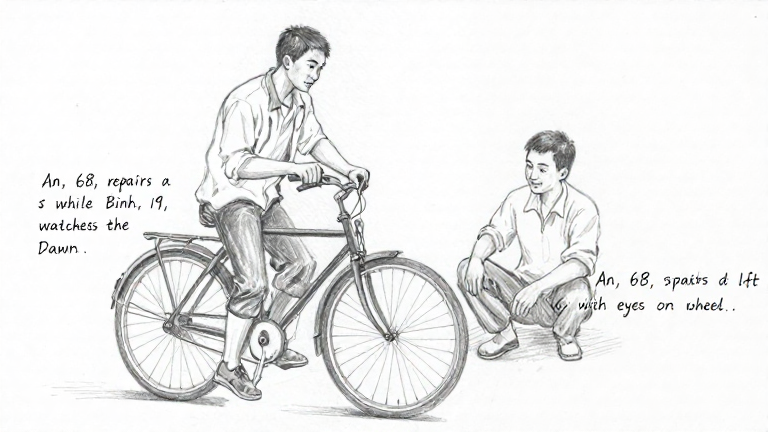
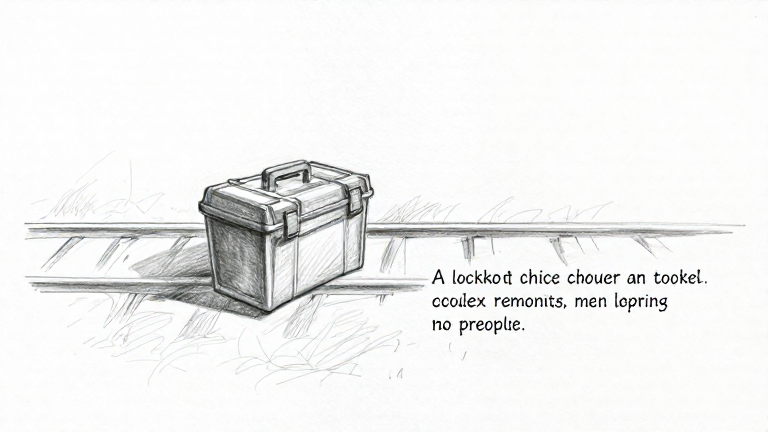

# Bộ ghép prompt runtime — kiểm chứng MFLUX trên hai cảnh

- Ngày: 27/10/2026; nhánh `feat/scene-staging-handoff`.
- Được duyệt tối đa **2 lượt, 180 giây/lượt**. Đã chạy một lượt cho mỗi cảnh, không retry hoặc sửa prompt sau output.
- **Kết luận:** luồng kỹ thuật dùng đúng prompt runtime và lưu ảnh được; **bộ ghép chưa đạt chất lượng ảnh để demo đúng nguồn**. Cả hai ảnh đều thêm chữ, cùng các lỗi cảnh riêng nêu dưới.
- Không thay runtime, plan/roadmap/prototype, cấu hình hoặc model văn bản; chưa commit/PR. Không API trả phí, tải model hay dùng DB tác giả.

## Bộ thử được đóng băng trước chạy

Chọn hai cảnh khác nhau từ [mẫu runtime đã lưu](../evaluations/scene-sketch-runtime-prompt-2026-10-27/samples.json), giữ nguyên scene/context và prompt tương ứng, không viết lại thủ công:

1. **repair-workshop:** An 68 tuổi sửa xe đạp, Bình 19 tuổi nhìn bánh xe. An ngồi bên phải, Bình đứng bên trái; ánh nhìn An hướng dây phanh; bình minh, close two-shot, đúng hai người, không khách/xe khác.
2. **empty-platform:** hộp dụng cụ khóa đặt trên sân ga vắng; không người, không mở hoặc chạm vào hộp.

Runtime `scene-sketch-visual-v2` tự ghép prompt qua route/API thật. Runner **không override hàm tạo prompt**. Trước chạy đã lưu snapshot, prompt tạo ra, tiêu chí, hash code/nguồn/plan/prototype/config và tham số. Mỗi cảnh là dự án tổng hợp riêng trong `backend/.data/scene-sketch-runtime-two-scenes-2026-10-27/`; không tự chọn giữ ảnh.

Giữ MFLUX 0.23.0, MLX 0.32.4, Z-Image-Turbo 4-bit snapshot `b3a8f31115a11f2f9e2fa0bfbc8d78dcc3e6568b`, 768×432, 9 bước, seed 42, low-RAM, cache limit 2 GB, timeout 180 giây. Không LoRA, đổi seed hoặc thêm model để dịch/viết lại prompt.

[Manifest](../evaluations/scene-sketch-runtime-mflux-two-scenes-2026-10-27/manifest.json), [input](../evaluations/scene-sketch-runtime-mflux-two-scenes-2026-10-27/inputs.json), [tiêu chí đã chốt](../evaluations/scene-sketch-runtime-mflux-two-scenes-2026-10-27/criteria.json), [prompt sửa xe](../evaluations/scene-sketch-runtime-mflux-two-scenes-2026-10-27/repair-workshop.prompt.txt), [prompt sân ga](../evaluations/scene-sketch-runtime-mflux-two-scenes-2026-10-27/empty-platform.prompt.txt).

## Kết quả kỹ thuật

| Cảnh | Lượt | HTTP/model | Thời gian API | PNG |
| --- | --- | --- | --- | --- |
| Sửa xe | 1 | 200 ready | **29,141 giây** | 768×432, hợp lệ |
| Sân ga không người | 1 | 200 ready | **28,614 giây** | 768×432, hợp lệ |

Đúng **2 yêu cầu, 0 lỗi provider/runner, 0 retry**, cả hai dưới 180 giây. Đã lưu toàn bộ response, metadata và ảnh; không có kết quả bị loại bỏ để chọn mẫu đẹp.

Các kiểm tra đều đạt: prompt provider nhận/lưu đúng nguyên prompt đã đóng băng, đúng version; scene/story plan không đổi; không tự chọn giữ ảnh; mở lại trả đúng dữ liệu; hash PNG/result và hash runtime/plan/prototype/config giữ nguyên. Không chạy lại test/build toàn ứng dụng vì không sửa code sản phẩm. Máy không cô lập tải; thời gian hai lượt không phải SLA hoặc benchmark tổng quát.

## Đối chiếu ảnh với nguồn

Nhận xét bằng mắt của Codex để tham khảo, không phải điểm AI hoặc nghiệm thu PO/người dùng. `Chưa rõ` không được tính là đúng ràng buộc.

| Tiêu chí | Sửa xe | Sân ga không người |
| --- | --- | --- |
| Nét vẽ chì, không phải ảnh chụp | Giữ được | Giữ được |
| Không chữ/chú thích/chia khung | **Chưa đạt:** chú thích chép lại mảnh câu nguồn cạnh nhân vật | **Chưa đạt:** thêm chú thích về hộp/không người |
| Không lẫn ca mẹ–con/phong bì | Không thấy lẫn | Không thấy lẫn |
| Số người | Đúng hai người | Đúng không người |
| Tuổi nhân vật | **Chưa đạt:** hai người trông trẻ, không đọc được chênh lệch 68–19 | Không áp dụng |
| Vị trí/tư thế hoặc nơi đặt vật | **Chưa đạt:** người trái ngồi trên xe thay vì đứng, người phải ngồi xổm | **Chưa đạt:** hộp trông như nằm trên đường ray; không thấy mặt/viền sân ga rõ |
| Hành động/trạng thái cần giữ | Sửa dây phanh chưa rõ; thấy tư thế giữ/quan sát xe | Nắp hộp đóng, không lộ đồ; **chưa rõ đang khóa**, không có dấu hiệu khóa đủ chắc |
| Cỡ cảnh/thời điểm | Không giống close two-shot; bình minh chưa rõ. Chữ “Dawn” không chứng minh ánh sáng bình minh | Nguồn không chốt cỡ cảnh/thời điểm |
| Không thêm khách/xe khác hoặc mở hộp | Đúng một xe, không thấy thêm khách/xe | Không thấy người hay hành động mở hộp |

[Đối chiếu theo từng tiêu chí cố định](../evaluations/scene-sketch-runtime-mflux-two-scenes-2026-10-27/comparison.json), [toàn bộ output/metadata/lỗi](../evaluations/scene-sketch-runtime-mflux-two-scenes-2026-10-27/results.json), [audit/hash](../evaluations/scene-sketch-runtime-mflux-two-scenes-2026-10-27/audit.json).

## So sánh và giới hạn kết luận

Hai cảnh cho thấy bộ ghép lấy được nội dung riêng và không áp ca mẹ–con vào mọi ảnh. Cảnh nhiều nhân vật thất bại ở tuổi/động tác/vị trí; cảnh không người giữ được số người và trạng thái đóng nhưng chưa giữ rõ nơi đặt vật/khóa. **Cả hai đều thêm chữ**, nên lỗi này không chỉ xuất hiện ở một cảnh nhiều nhân vật.

Các đoạn trích dẫn và câu dẫn mô tả nguồn có thể đang khuyến khích model vẽ chú thích; đây là giả thuyết từ ảnh có các mảnh câu nguồn, chưa phải chứng minh nhân quả. Đạt unit/API test hoặc PNG hợp lệ không chứng minh bộ ghép tạo ảnh đúng ý đồ.

Không có ảnh prompt thủ công baseline trên chính hai cảnh này. Vì vậy không được dùng ca mẹ–con cũ để khẳng định formatter tổng quát tốt hơn/kém hơn theo một thí nghiệm trước/sau có đối chứng. Đây chỉ là hai cảnh tiếng Anh, một lượt mỗi cảnh, chưa đại diện tiếng Việt/nhiều loại cảnh.

## Điểm dừng

Đã dùng hết hai lượt được duyệt; không sửa runtime hoặc mở thêm vòng thử trong đợt này. Bộ ghép chưa đủ căn cứ nghiệm thu chất lượng phần ảnh của Gói 4/M2. Đường lưu/sửa/bàn giao text vẫn độc lập và không bị chặn; cả hai preview giữ trạng thái chưa được tác giả chọn.

Nếu kiểm chứng tiếp, thay đổi nhỏ có thể xem xét là bỏ câu dẫn/ngoặc trích mang dáng tài liệu và chỉ giữ mô tả trực tiếp điều nhìn thấy, trong khi ràng buộc nguồn vẫn được giữ. Cần đóng băng và chốt ngân sách riêng; chưa triển khai thay đổi này, chưa tạo PR.
