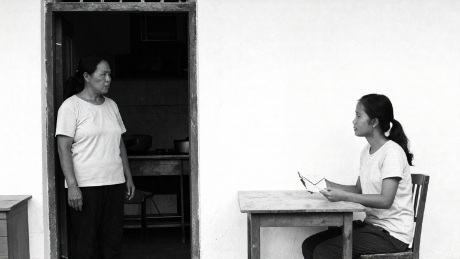

# MFLUX — prompt mô tả thị giác so với nguồn JSON

- Ngày: 27/10/2026; nhánh hiện có `feat/scene-staging-handoff`.
- Theo yêu cầu: tối đa **2 lượt**, **180 giây/lượt**, đóng băng trước khi chạy, lưu mọi lỗi/kết quả; không retry hoặc thay kỳ vọng sau output.
- Chỉ kiểm chứng offline bằng DB tổng hợp riêng. **Không sửa prompt runtime, bảo vệ dữ liệu, plan, prototype, model văn bản; chưa commit/tạo PR.**

## Điều giữ nguyên và thay đổi

Dùng nguyên byte `inputs.json` của đợt JSON baseline `scene-sketch-mflux-adapter-v2-2026-10-27`: cùng một cảnh tiếng Anh, cùng story plan/ý đồ/ràng buộc, scene ID và yêu cầu phác. Cảnh yêu cầu mẹ khoảng 55 tuổi đứng bên cửa trái, con gái trưởng thành khoảng 25 tuổi ngồi bên bàn phải, cầm phong thư kín chưa mở, hai người nhìn nhau và chờ trong bếp Việt Nam, không khép kết thúc.

Giữ MFLUX 0.23.0, MLX 0.32.4, Z-Image-Turbo 4-bit snapshot `b3a8f31115a11f2f9e2fa0bfbc8d78dcc3e6568b`, 768×432, 9 bước, seed 42, low-RAM, cache limit 2 GB và timeout 180 giây. Không thêm LoRA, đổi seed/model, tải weights hoặc dùng API trả phí.

Thay toàn bộ prompt JSON bằng một prompt mô tả thị giác viết thủ công cho đúng cảnh này, không tiêu đề hay tên trường JSON. Prompt mô tả lần lượt phong cách hình → góc nhìn/không gian → vị trí/tư thế/đạo cụ → khoảng lặng → giới hạn đầu ra. Đây là so sánh hai prompt hoàn chỉnh, không phải thí nghiệm chứng minh riêng cấu trúc JSON là nguyên nhân duy nhất.

Trong tiến trình thử riêng, runner thay hàm tạo prompt bằng text đã đóng băng sau khi kiểm tra nguyên scene/context/instructions khớp snapshot. API, kiểm tra nguồn/revision, provider, kiểm tra PNG và lưu ảnh vẫn dùng code hiện có. Không sửa tệp runtime hoặc DB tác giả. DB thử nằm trong `backend/.data/scene-sketch-visual-trial-2026-10-27/`, bị Git bỏ qua.

## Đóng băng và kết quả kỹ thuật

Trước suy luận đã lưu [manifest](../evaluations/scene-sketch-mflux-visual-2026-10-27/manifest.json), [input](../evaluations/scene-sketch-mflux-visual-2026-10-27/inputs.json), [prompt thị giác](../evaluations/scene-sketch-mflux-visual-2026-10-27/prompt.txt), [tiêu chí đối chiếu](../evaluations/scene-sketch-mflux-visual-2026-10-27/criteria.json) và runner. Hash service/route/schema, model config, input, prompt, tiêu chí và baseline được kiểm tra trước từng lượt và sau khi chạy.

| Lượt | Baseline JSON đã lưu | Prompt thị giác mới | Kết quả mới |
| --- | --- | --- | --- |
| 1 | 35,347 giây | **26,095 giây** | 200 ready; PNG 768×432; giữ/mở lại đúng ảnh |
| 2 | 31,990 giây | **27,236 giây** | 200 ready; preview không thay ảnh thứ nhất; bỏ preview/mở lại giữ ảnh cũ |

Đúng 2 lượt mới, **0 lỗi model/provider**, **0 retry**. Hai ảnh mới có cùng SHA-256 (cùng prompt/seed), nên đây là hai lần kiểm tra vòng đời trên **một kết quả thị giác**, không phải hai ca nội dung độc lập. Thời gian đều dưới ngân sách; máy không cô lập tải và không có bộ benchmark đủ để kết luận cải thiện tốc độ tổng quát.

Lệnh kiểm tra bằng `runpy` đầu dùng path tương đối nên lỗi trước suy luận; chạy lại với path tuyệt đối đạt. Không đổi runner đã đóng băng, không phát sinh model call ở các lệnh kiểm tra. Không rerun bộ test ứng dụng vì không đổi code sản phẩm; đã kiểm tra syntax/guard, input/config parity, toàn bộ hash và vòng đời ảnh bằng API thật trong runner.

## Đối chiếu bằng mắt theo tiêu chí cố định

Các nhận xét dưới đây là đối chiếu của Codex, không phải điểm AI hay quyết định PO/người dùng. `Chưa rõ` không được tính thành giữ đúng ràng buộc.

| Tiêu chí | JSON baseline | Mô tả thị giác |
| --- | --- | --- |
| Phác chì đen trắng | Có nét vẽ chì | **Chưa đạt nét chì:** giống ảnh chụp đen trắng, có chi tiết da/vải/bóng đổ kiểu ảnh |
| Đúng hai người | Đạt | Đạt |
| Mẹ đứng bên cửa trái | Chưa đạt, trông như cả hai ngồi bàn | **Đạt**, thấy rõ người mẹ đứng tại cửa trái |
| Con ngồi bàn phải | Đạt | Đạt |
| Hai người và phong bì nhìn rõ | Chưa rõ phong bì | Hai người/vật giấy nhìn rõ; chưa chắc đó là phong bì |
| Phong bì còn kín, chưa mở | Chưa rõ | **Chưa rõ:** giống giấy gấp hoặc nắp phong bì mở; không đủ xác nhận còn kín |
| Không chữ/chú thích/chia khung | Chưa đạt: tiêu đề và nhãn trường | **Đạt**, không thấy chữ hoặc chia khung |
| Không thêm người/sự kiện hay chốt kết | Không thấy thêm | Không thấy thêm; ảnh tĩnh không chứng minh toàn bộ câu chuyện |

Tuổi nhân vật và đặc trưng căn bếp cũng chưa đủ bằng chứng để xác nhận chính xác. Không dùng vẻ đẹp ảnh hoặc thao tác fixture “giữ” làm nghiệm thu đúng ý đồ.

[Ảnh JSON baseline](../evaluations/scene-sketch-mflux-adapter-v2-2026-10-27/results/image-1.png), [ảnh mới lượt 2](../evaluations/scene-sketch-mflux-visual-2026-10-27/results/image-2.png), [đối chiếu có cấu trúc](../evaluations/scene-sketch-mflux-visual-2026-10-27/comparison.json), [toàn bộ kết quả/metadata/lỗi](../evaluations/scene-sketch-mflux-visual-2026-10-27/results.json), [audit/hash](../evaluations/scene-sketch-mflux-visual-2026-10-27/audit.json).

## Kết luận và điểm dừng

Trên cảnh đã lưu, mô tả thị giác giúp bỏ chữ và thể hiện bố trí đứng/ngồi đúng hơn baseline JSON. Tuy nhiên, prompt này **chưa đáp ứng đồng thời phác chì và phong thư còn kín**. Chưa đủ căn cứ đưa nguyên prompt vào runtime hoặc coi Gói 4 đã đạt chất lượng.

Giữ hướng prompt mô tả thị giác để xem xét tiếp, nhưng không mở thêm lượt hoặc sửa prompt sau kết quả trong đợt này. Chưa có bộ chuyển từ cảnh bất kỳ thành mô tả thị giác tự động, chưa kiểm chứng tiếng Việt/nhiều cảnh/nhân vật nhất quán và chưa có nghiệm thu người dùng. Baseline cùng các lỗi cũ được giữ nguyên; plan/prototype/config không đổi, chưa tạo PR.
